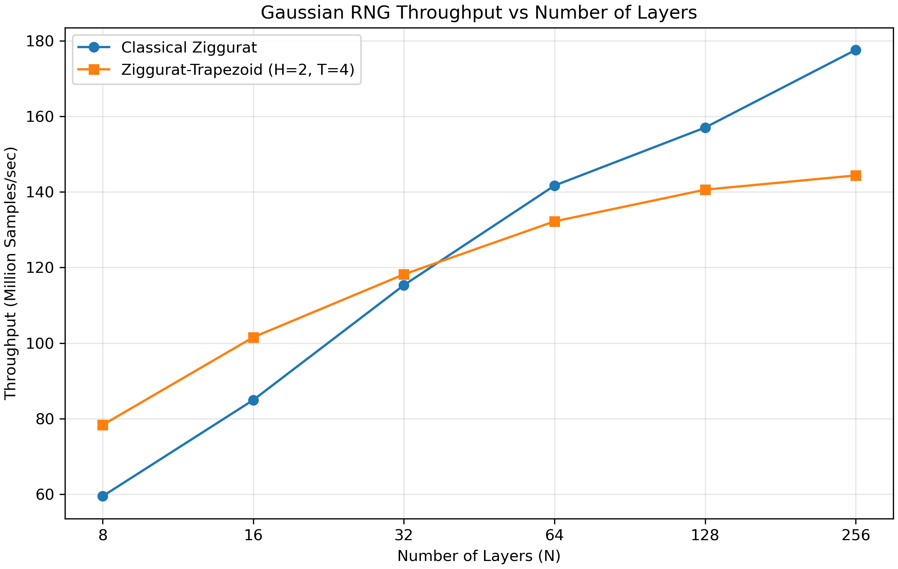

# Experiment 03 — Layer-count comparison

Classical Ziggurat and Ziggurat-Trapezoid were measured at N=8,16,32,64,128,256 using -O2, seed 1, 10 million samples, and five timing repetitions. Trapezoid used H=2,T=4. Each performance run warmed 100,000 samples outside timing and then reset to seed 1. Six Trapezoid-only validations applied all four established tests to 10 million samples each. Validation samples were transferred through a pipe into RAM; no raw sample files were saved.

## Median performance

| N | Classical M/s | Trapezoid M/s | Speedup | Classical time (s) | Trapezoid time (s) |
|---:|---:|---:|---:|---:|---:|
| 8 | 59.4972 | 78.3441 | 1.31677 | 0.168075 | 0.127642 |
| 16 | 84.9452 | 101.548 | 1.19545 | 0.117723 | 0.098476 |
| 32 | 115.331 | 118.184 | 1.02474 | 0.086707 | 0.084614 |
| 64 | 141.671 | 132.203 | 0.933171 | 0.070586 | 0.075641 |
| 128 | 157.023 | 140.594 | 0.89537 | 0.063685 | 0.071127 |
| 256 | 177.576 | 144.361 | 0.812952 | 0.056314 | 0.069271 |

Trapezoid has higher measured medians at N=8,16,32; Classical is faster at N=64,128,256. The N=32 margin is small and individual repetition ranges overlap. Throughput does not establish statistical correctness.

## Trapezoid statistical validation

Alpha=0.05; 98 final Chi-square bins; 97 degrees of freedom. PASS means fail-to-reject. AD retains its existing approximate p-value calibration and critical-value decision. Every test cell gives statistic / p-value / decision.

| N | Mean | Variance | Chi-square | KS | CvM | AD |
|---:|---:|---:|---|---|---|---|
| 8 | 0.00024778931846547675 | 0.9992749846410384 | 195.71942 / 1.2094761681756181e-08 / FAIL | 0.00034755192 / 0.17841499737412403 / PASS | 0.15679183 / 0.3695283261284168 / PASS | 1.0191001 / 0.34741278316463764 / PASS |
| 16 | -0.00014949777176793237 | 0.9991376747496019 | 97.748609 / 0.45959022599778326 / PASS | 0.0002167884 / 0.735058046808613 / PASS | 0.079091289 / 0.6971274722155159 / PASS | 0.7247362 / 0.538524614221014 / PASS |
| 32 | -0.00027202633526145534 | 1.0001878340902932 | 94.132654 / 0.5635285455605887 / PASS | 0.00029138018 / 0.3637669460022487 / PASS | 0.1370272 / 0.43164365392830106 / PASS | 0.76878624 / 0.5041024277608297 / PASS |
| 64 | -0.00015798838654489228 | 0.999601025883462 | 95.72696 / 0.5174928091353196 / PASS | 0.00023664198 / 0.6298942352049599 / PASS | 0.10127934 / 0.5786376052775769 / PASS | 0.80959354 / 0.4741734690996534 / PASS |
| 128 | 0.00038678530328124436 | 0.9992679485549806 | 103.27459 / 0.3125051477796402 / PASS | 0.00034345305 / 0.18878900267470933 / PASS | 0.22281713 / 0.227304687687383 / PASS | 1.2554305 / 0.24735385405962296 / PASS |
| 256 | -2.487956932512248e-05 | 1.0002421376820787 | 107.40179 / 0.22090532167007843 / PASS | 0.00016445364 / 0.9496150654547442 / PASS | 0.039652286 / 0.9349337655518926 / PASS | 0.36719349 / 0.8805442906756844 / PASS |

Only N=8 Chi-square rejected. These results use one seed and 10 million samples; passing does not prove exact normality or negate the earlier 100-million-sample results.

## Files and reproducibility

- `processed/`: numerical CSV and aggregate validation JSON.
- `tables/`: copies of the two comparison CSV tables.
- `raw/performance/`: all 60 original performance records.
- `raw/validation/`: six saved numerical validation records; no raw observations.
- `figures/`: the original 300-DPI throughput PNG.
- `artifacts/`: configuration, original and relocated metadata, and the driver version used for measurement.
- `execution_order.json`: original execution schedule.
- `verification.json`: relocation integrity checks.

Reorganization preserved all numerical results and figure bytes. No experiment was rerun. The original metadata records the measured driver hash; its matching source is archived separately. The current driver defaults to this directory and refuses existing outputs. Experiments 01 and 02 were not modified.
