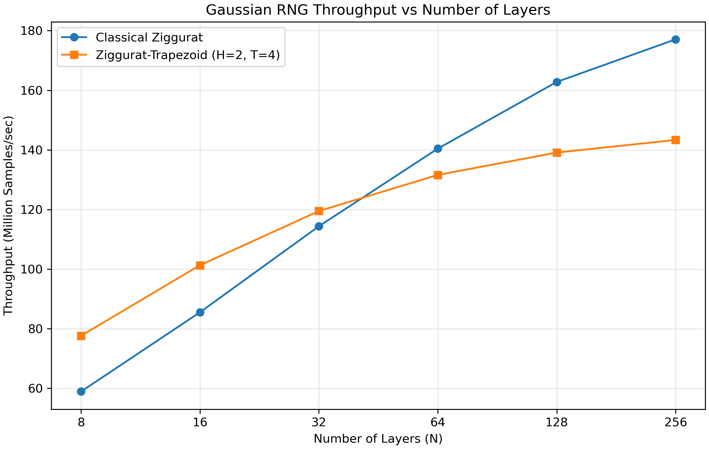

# Experiment 04 — 100,000,000 samples

N=8,16,32,64,128,256; Trapezoid H=2,T=4; seed=1; compiler -O2. Five separate performance repetitions per algorithm and N, each with 100,000 warm-up samples outside timing, followed by seed reset. Each Trapezoid validation processes the complete dataset using the existing fixed N(0,1) tests. No raw sample file or preview is saved.

## Median performance

| N | Classical M/s | Trapezoid M/s | Speedup | Classical time (s) | Trapezoid time (s) |
|---:|---:|---:|---:|---:|---:|
| 8 | 58.933944 | 77.652352 | 1.3176168 | 1.696815 | 1.287791 |
| 16 | 85.530395 | 101.30481 | 1.1844305 | 1.169175 | 0.98712 |
| 32 | 114.3763 | 119.47888 | 1.0446122 | 0.874307 | 0.836968 |
| 64 | 140.4167 | 131.60025 | 0.93721221 | 0.712166 | 0.759877 |
| 128 | 162.78612 | 139.0987 | 0.85448746 | 0.614303 | 0.718914 |
| 256 | 177.07232 | 143.32479 | 0.80941386 | 0.564741 | 0.697716 |

Trapezoid has higher measured medians at N=8, 16, 32. Small differences should be interpreted with the saved repetition timings. Performance measurements do not establish statistical correctness.

## Trapezoid validation

Alpha=0.05; no fitted parameters or standardization. PASS means fail-to-reject. Chi-square retains the existing 100 equal-width interior bins over [-5,5], two unbounded tails, and expected-count-only merging with minimum expected count 5. Changes in final bin count with sample size reflect this unchanged rule. AD uses its existing approximate calibration and critical-value decision; an unavailable p-value is shown as NA. Every test cell gives statistic / p-value / decision.

| N | Mean | Variance | Chi2 bins / df | Chi-square | KS | CvM | AD |
|---:|---:|---:|---|---|---|---|---|
| 8 | 5.689219890501139e-05 | 0.9998472473936072 | 102 / 101 | 975.411098 / 4.675645263316411e-143 / FAIL | 8.3020172e-05 / 0.4958488219328405 / PASS | 0.13514693 / 0.43818506628183185 / PASS | 1.20433255 / 0.2659031592376915 / PASS |
| 16 | 6.741538987484663e-05 | 0.9998412373663211 | 102 / 101 | 327.388925 / 1.060130848404047e-25 / FAIL | 8.74025791e-05 / 0.4295496908988826 / PASS | 0.105544736 / 0.5583690361499795 / PASS | 0.648818806 / 0.6030852331638787 / PASS |
| 32 | 4.205775843086865e-05 | 0.9999977409144384 | 102 / 101 | 215.551966 / 2.703472704065035e-10 / FAIL | 8.63786792e-05 / 0.44459464852525454 / PASS | 0.115325095 / 0.5148420683620188 / PASS | 0.772053525 / 0.5016374380389212 / PASS |
| 64 | 6.821067272127076e-05 | 0.9997932944054965 | 102 / 101 | 131.440356 / 0.02254452532813898 / FAIL | 9.01443482e-05 / 0.3907177998488216 / PASS | 0.0717970767 / 0.7405818755572036 / PASS | 0.547718436 / 0.6987177961500368 / PASS |
| 128 | 9.552229844447143e-05 | 0.9998857654060833 | 102 / 101 | 137.081612 / 0.00983166212421095 / FAIL | 0.000115370937 / 0.13954607841516364 / PASS | 0.158457103 / 0.3648048014183607 / PASS | 0.868883282 / 0.43391702129000487 / PASS |
| 256 | 5.218322012287894e-05 | 0.9998937313474724 | 102 / 101 | 110.527051 / 0.24293134694072913 / PASS | 7.73994151e-05 / 0.5869445254066527 / PASS | 0.0865252778 / 0.6550085644924284 / PASS | 0.595034584 / 0.6527090020624685 / PASS |

Rejections: [(8, 'chi2'), (16, 'chi2'), (32, 'chi2'), (64, 'chi2'), (128, 'chi2')].

These are results from one seed. Larger samples increase power against fixed approximation errors; passing does not prove exact Gaussianity. No second-level p-value uniformity tests were performed.

## Reproducibility

Executable SHA-256: `0e96c28d88b6d45c87aa75c12151bd5b8511cd9156ae7420fe6fe39233b1654c`.

Validation code SHA-256: `3ee7f7d66ceadd12541b84eecf782d01b4d117d2305965993842a637a46c4bc9`.

NumPy 1.26.4; SciPy 1.13.1.
Full-precision results and calibration details: `../../processed/samples_100000000/trapezoid_validation_vs_layers.json`. All repetition records: `../../raw/performance/samples_100000000/performance_runs.json`.
