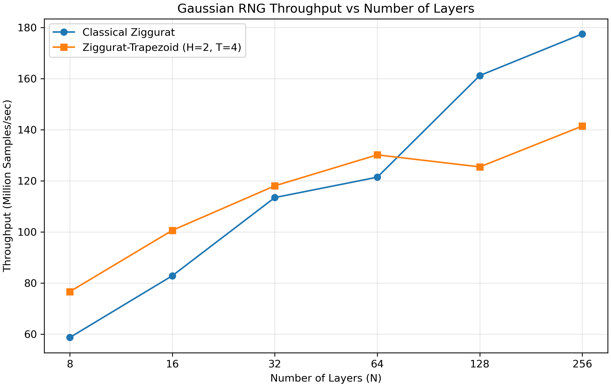

# Experiment 04 — 33,554,432 samples

N=8,16,32,64,128,256; Trapezoid H=2,T=4; seed=1; compiler -O2. Five separate performance repetitions per algorithm and N, each with 100,000 warm-up samples outside timing, followed by seed reset. Each Trapezoid validation processes the complete dataset using the existing fixed N(0,1) tests. No raw sample file or preview is saved.

## Median performance

| N | Classical M/s | Trapezoid M/s | Speedup | Classical time (s) | Trapezoid time (s) |
|---:|---:|---:|---:|---:|---:|
| 8 | 58.696484 | 76.640663 | 1.3057113 | 0.57166 | 0.437815 |
| 16 | 82.861088 | 100.62777 | 1.2144153 | 0.404948 | 0.333451 |
| 32 | 113.45961 | 118.0484 | 1.0404443 | 0.295739 | 0.284243 |
| 64 | 121.42884 | 130.1735 | 1.0720146 | 0.27633 | 0.257767 |
| 128 | 161.207 | 125.46339 | 0.77827508 | 0.208145 | 0.267444 |
| 256 | 177.50193 | 141.4295 | 0.79677727 | 0.189037 | 0.237252 |

Trapezoid has higher measured medians at N=8, 16, 32, 64. Small differences should be interpreted with the saved repetition timings. Performance measurements do not establish statistical correctness.

## Trapezoid validation

Alpha=0.05; no fitted parameters or standardization. PASS means fail-to-reject. Chi-square retains the existing 100 equal-width interior bins over [-5,5], two unbounded tails, and expected-count-only merging with minimum expected count 5. Changes in final bin count with sample size reflect this unchanged rule. AD uses its existing approximate calibration and critical-value decision; an unavailable p-value is shown as NA. Every test cell gives statistic / p-value / decision.

| N | Mean | Variance | Chi2 bins / df | Chi-square | KS | CvM | AD |
|---:|---:|---:|---|---|---|---|---|
| 8 | 0.00025503711061218234 | 0.9998533741345814 | 102 / 101 | 423.206189 / 4.985462505951791e-41 / FAIL | 0.000165047911 / 0.32006822205126917 / PASS | 0.265856456 / 0.16925599587515638 / PASS | 1.50553772 / 0.1751567492160362 / PASS |
| 16 | -2.4947640458521277e-05 | 0.9999676398530238 | 102 / 101 | 145.695273 / 0.0024136185981631707 / FAIL | 8.53706645e-05 / 0.9673251002204455 / PASS | 0.0268233002 / 0.9854006493949675 / PASS | 0.18692144 / 0.993568895155322 / PASS |
| 32 | -9.253557857656446e-05 | 1.0001276731463054 | 102 / 101 | 122.561201 / 0.07119343071522682 / PASS | 0.000211273496 / 0.09999622211662662 / PASS | 0.272407479 / 0.16201853480744854 / PASS | 1.26122148 / 0.24534474581770893 / PASS |
| 64 | 8.507918027152396e-05 | 0.9998256312505226 | 102 / 101 | 125.499329 / 0.0497434594327326 / FAIL | 0.000137513265 / 0.5496992974915336 / PASS | 0.0979225966 / 0.5951546898721827 / PASS | 0.528440475 / 0.7179839457461459 / PASS |
| 128 | 0.00032537754720578525 | 0.9997634061357951 | 102 / 101 | 110.168119 / 0.2504402475148713 / PASS | 0.000240434041 / 0.04131677910506293 / FAIL | 0.425073952 / 0.062085379244600225 / PASS | 2.18795463 / 0.072575203220411 / PASS |
| 256 | 0.00014318291500927167 | 0.9998417947988187 | 102 / 101 | 100.007873 / 0.5092022414040893 / PASS | 9.30177929e-05 / 0.9335750803134802 / PASS | 0.0539562707 / 0.8519186764012414 / PASS | 0.372447707 / 0.8755663957454263 / PASS |

Rejections: [(8, 'chi2'), (16, 'chi2'), (64, 'chi2'), (128, 'ks')].

These are results from one seed. Larger samples increase power against fixed approximation errors; passing does not prove exact Gaussianity. No second-level p-value uniformity tests were performed.

## Reproducibility

Executable SHA-256: `0e96c28d88b6d45c87aa75c12151bd5b8511cd9156ae7420fe6fe39233b1654c`.

Validation code SHA-256: `3ee7f7d66ceadd12541b84eecf782d01b4d117d2305965993842a637a46c4bc9`.

NumPy 1.26.4; SciPy 1.13.1.
Full-precision results and calibration details: `../../processed/samples_33554432/trapezoid_validation_vs_layers.json`. All repetition records: `../../raw/performance/samples_33554432/performance_runs.json`.
