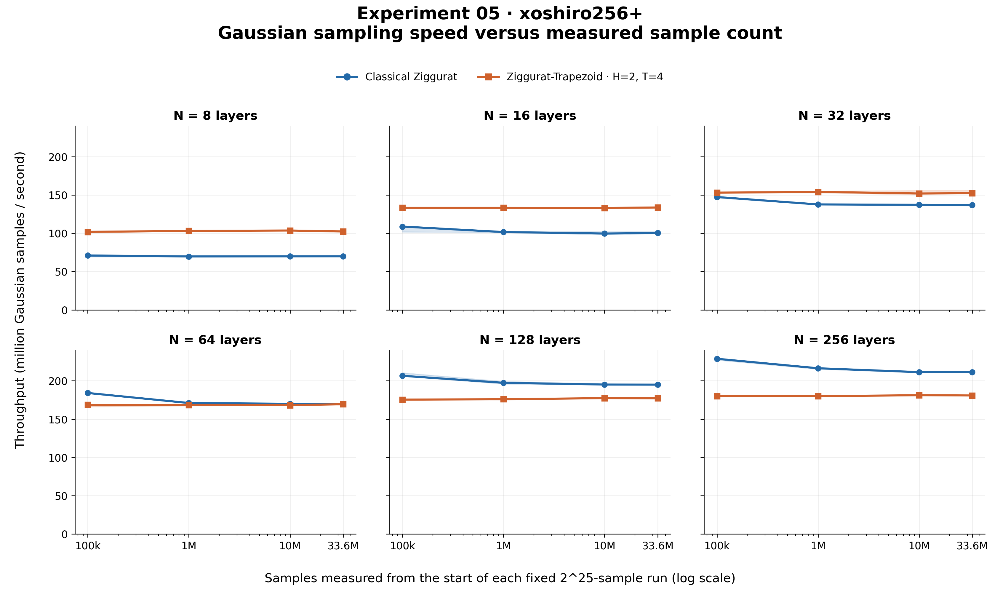

# Experiment 05 — xoshiro256+ only

Both methods use N=8,16,32,64,128,256, seed 1, and -O2. Trapezoid uses H=2/T=4. Each timing or validation run generates exactly 2^25 = 33,554,432 samples. No Gaussian warmup is generated. Performance uses five repetitions and cumulative checkpoints within each fixed-length run; checkpoints reuse a single stream rather than generating separate datasets.

Curves show median cumulative throughput; shaded bands are the interquartile range of five repetitions. Earlier and later points from one run are dependent. Timings exclude initialization and table construction, and no validation/output buffering is included. The experiment-only C harness retains the original sampling loop’s generate/checksum/sum/sumsq work, with a volatile checksum. Clock reads and small checkpoint bookkeeping between prefixes contribute to subsequent cumulative timings. The existing C benchmark and Gaussian source are unchanged.

## Full-run median speed

| N | Classical M/s | Trapezoid M/s | Trapezoid / Classical |
|---:|---:|---:|---:|
| 8 | 69.862 | 102.316 | 1.465× |
| 16 | 100.225 | 133.581 | 1.333× |
| 32 | 136.637 | 152.232 | 1.114× |
| 64 | 169.647 | 169.537 | 0.999× |
| 128 | 195.059 | 177.162 | 0.908× |
| 256 | 211.280 | 180.896 | 0.856× |

## Full-data validation

Every dataset is tested against fixed N(0,1) using the existing Chi-square, KS, CvM and AD code. Alpha=0.05; no parameter fitting, standardization, or multiple-testing adjustment. PASS means failure to reject, not proof of Gaussianity. Chi-square retains 100 interior bins over [-5,5], two unbounded tails, and minimum-expected-count merging at 5. AD retains its existing finite-n approximation and critical-value decision; an unavailable p-value is recorded as NA. Results use one seed.

| Method | N | Mean | Variance | Chi-square | KS | CvM | AD |
|---|---:|---:|---:|---|---|---|---|
| Classical Ziggurat | 8 | -0.0001266652 | 1.000134 | PASS | PASS | PASS | PASS |
| Ziggurat-Trapezoid | 8 | -0.0003597497 | 0.9998346 | REJECT | REJECT | PASS | PASS |
| Classical Ziggurat | 16 | 0.0001048987 | 1.000298 | PASS | PASS | PASS | PASS |
| Ziggurat-Trapezoid | 16 | -6.783484e-05 | 0.9995721 | REJECT | PASS | PASS | PASS |
| Classical Ziggurat | 32 | -9.366049e-05 | 1.000012 | PASS | PASS | PASS | PASS |
| Ziggurat-Trapezoid | 32 | 3.765287e-05 | 0.9996727 | REJECT | PASS | PASS | PASS |
| Classical Ziggurat | 64 | -0.0001288423 | 0.999989 | PASS | PASS | PASS | PASS |
| Ziggurat-Trapezoid | 64 | -0.0002102312 | 0.999692 | REJECT | PASS | PASS | PASS |
| Classical Ziggurat | 128 | -0.0001838249 | 0.999952 | PASS | PASS | PASS | PASS |
| Ziggurat-Trapezoid | 128 | -0.0002391621 | 0.9998467 | PASS | PASS | PASS | PASS |
| Classical Ziggurat | 256 | -0.000181468 | 0.9997451 | PASS | PASS | PASS | PASS |
| Ziggurat-Trapezoid | 256 | -0.0001564197 | 1.00002 | PASS | PASS | PASS | PASS |

Rejections: 5 of 48 tests.

Full statistics, p-values, critical values and degrees of freedom are in `../processed/validation_results.json` and `../tables/validation_results.csv`. Raw observations were transferred through a pipe into RAM and discarded after full-data validation; no sample binaries, previews or subsets were saved.

## Reproducibility

Compiler: Apple clang version 17.0.0 (clang-1700.6.3.2); platform: macOS-26.2-arm64-arm-64bit.
Flags: `-std=c11 -Wall -Wextra -pedantic -O2`. Sources, configuration, hashes, commands and execution counts are retained under artifacts/ and execution_order.json. The validation code, previous experiment results and original C executable/sources were checked for changes. No commit was made.
