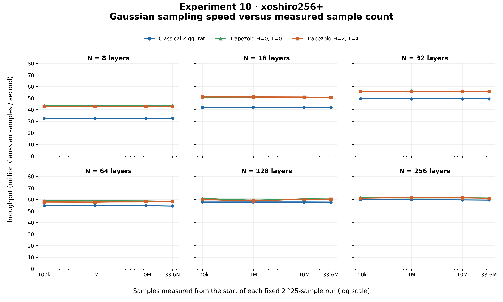
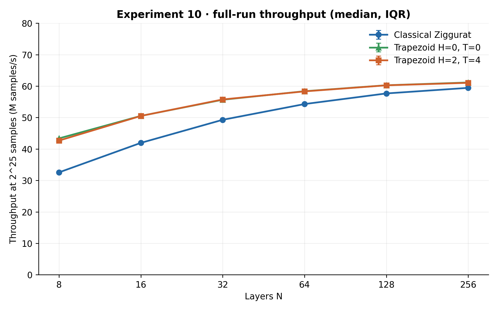

# Experiment 10 — Classical vs Trapezoid (H=0/T=0 and H=2/T=4), xoshiro256+

Three configurations at N=8,16,32,64,128,256, seed 1, -O2: Classical Ziggurat, Trapezoid H=0/T=0 (unrefined) and Trapezoid H=2/T=4. Each timing or validation run generates exactly 2^25 = 33,554,432 samples; no Gaussian warmup. Performance uses 5 interleaved repetitions (order shuffled per round), each run in its own process pinned to CPU 7 with taskset, and cumulative checkpoints within each fixed-length run (a single stream, no separate prefix datasets).

Curves show median cumulative throughput; bands/bars are interquartile ranges. Checkpoints within a run are dependent. Timings exclude initialization and table construction; a volatile checksum prevents loop elimination.

## Full-run median speed (2^25 samples)

| N | Classical M/s | Trap H0/T0 M/s | Trap H2/T4 M/s | H0T0 / Classical | H2T4 / Classical | H2T4 / H0T0 |
|---:|---:|---:|---:|---:|---:|---:|
| 8 | 32.562 | 43.372 | 42.674 | 1.332× | 1.311× | 0.984× |
| 16 | 41.942 | 50.524 | 50.506 | 1.205× | 1.204× | 1.000× |
| 32 | 49.282 | 55.661 | 55.755 | 1.129× | 1.131× | 1.002× |
| 64 | 54.289 | 58.375 | 58.319 | 1.075× | 1.074× | 0.999× |
| 128 | 57.669 | 60.269 | 60.249 | 1.045× | 1.045× | 1.000× |
| 256 | 59.441 | 61.147 | 61.041 | 1.029× | 1.027× | 0.998× |

## Full-data goodness of fit

Every dataset is tested against fixed N(0,1) using the existing Chi-square, KS, CvM and AD code at alpha=0.05; no parameter fitting, standardization or multiple-testing adjustment. PASS means failure to reject, not proof of Gaussianity. Chi-square uses 100 interior bins over [-5,5], two unbounded tails, and minimum-expected-count merging at 5. AD retains its existing finite-n approximation and critical-value decision (p-value may be NA). One seed.

| Method | N | Mean | Variance | χ² p | KS p | CvM p | AD p | χ² | KS | CvM | AD |
|---|---:|---:|---:|---:|---:|---:|---:|---|---|---|---|
| Classical Ziggurat | 8 | -0.000126665 | 1.000134 | 0.9949 | 0.4186 | 0.4667 | 0.6237 | PASS | PASS | PASS | PASS |
| Trapezoid H=0, T=0 | 8 | -0.000189825 | 0.9968698 | 0 | 4.96e-27 | 5.969e-11 | NA | REJECT | REJECT | REJECT | REJECT |
| Trapezoid H=2, T=4 | 8 | -0.00035975 | 0.9998346 | 4.021e-35 | 0.04993 | 0.05749 | 0.05588 | REJECT | REJECT | PASS | PASS |
| Classical Ziggurat | 16 | 0.000104899 | 1.000298 | 0.7053 | 0.3615 | 0.6257 | 0.5259 | PASS | PASS | PASS | PASS |
| Trapezoid H=0, T=0 | 16 | -0.000185798 | 0.9985997 | 0 | 6.458e-09 | 0.0006077 | NA | REJECT | REJECT | REJECT | REJECT |
| Trapezoid H=2, T=4 | 16 | -6.78348e-05 | 0.9995721 | 0.0006372 | 0.2399 | 0.3781 | 0.3408 | REJECT | PASS | PASS | PASS |
| Classical Ziggurat | 32 | -9.36605e-05 | 1.000012 | 0.4631 | 0.9432 | 0.8434 | 0.9058 | PASS | PASS | PASS | PASS |
| Trapezoid H=0, T=0 | 32 | -0.000294838 | 0.9993 | 0 | 4.373e-05 | 0.02256 | 0.006241 | REJECT | REJECT | REJECT | REJECT |
| Trapezoid H=2, T=4 | 32 | 3.76529e-05 | 0.9996727 | 0.0006537 | 0.887 | 0.881 | 0.8214 | REJECT | PASS | PASS | PASS |
| Classical Ziggurat | 64 | -0.000128842 | 0.999989 | 0.5561 | 0.9657 | 0.8741 | 0.853 | PASS | PASS | PASS | PASS |
| Trapezoid H=0, T=0 | 64 | -7.1087e-05 | 0.9993341 | 0 | 0.1239 | 0.2857 | 0.2093 | REJECT | PASS | PASS | PASS |
| Trapezoid H=2, T=4 | 64 | -0.000210231 | 0.999692 | 0.01009 | 0.2009 | 0.1266 | 0.1537 | REJECT | PASS | PASS | PASS |
| Classical Ziggurat | 128 | -0.000183825 | 0.999952 | 0.755 | 0.3096 | 0.306 | 0.4053 | PASS | PASS | PASS | PASS |
| Trapezoid H=0, T=0 | 128 | 3.01114e-05 | 0.9996338 | 0 | 0.773 | 0.9368 | 0.9092 | REJECT | PASS | PASS | PASS |
| Trapezoid H=2, T=4 | 128 | -0.000239162 | 0.9998467 | 0.5928 | 0.3011 | 0.1933 | 0.2378 | PASS | PASS | PASS | PASS |
| Classical Ziggurat | 256 | -0.000181468 | 0.9997451 | 0.9686 | 0.1449 | 0.2604 | 0.2929 | PASS | PASS | PASS | PASS |
| Trapezoid H=0, T=0 | 256 | -7.24486e-05 | 0.9998017 | 2.484e-180 | 0.9916 | 0.9898 | 0.9757 | REJECT | PASS | PASS | PASS |
| Trapezoid H=2, T=4 | 256 | -0.00015642 | 1.00002 | 0.9598 | 0.2264 | 0.1395 | 0.2123 | PASS | PASS | PASS | PASS |

Rejections: 20 of 72 tests (basic: 0, trap_H0T0: 15, trap_H2T4: 5). With 72 tests at alpha=0.05, about 3.6 rejections are expected by chance even for a perfect generator.

Full statistics, p-values and degrees of freedom: `../processed/validation_results.json`, `../tables/validation_results.csv`. Raw observations went through a pipe into RAM and were discarded; no sample files were saved.

## Reproducibility and environment

Compiler: gcc (Ubuntu 11.4.0-1ubuntu1~22.04.3) 11.4.0; platform: Linux-5.15.0-198-generic-x86_64-with-glibc2.35.
Flags: `-std=c11 -Wall -Wextra -pedantic -O2`. Sources, configuration, hashes and commands are under artifacts/ and execution_order.json. Git commit ce4dfabf1dc9; uncommitted files at start: ['?? experiments/experiment10.py', '?? experiments/experiment10.yaml', '?? experiments/experiment10_benchmark.c', '?? experiments/results/experiment10/']. BIOS cap 3.2 GHz, boost off, SMT off; governor and frequency snapshots (reported, not effective frequency) are in execution_order.json. No CPU isolation was active, so desktop activity can add occasional outliers; see the IQR and `min/max` columns in `tables/performance_vs_samples.csv`.
