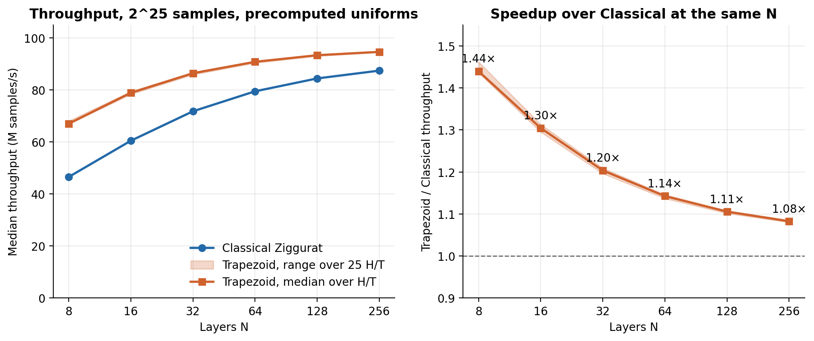
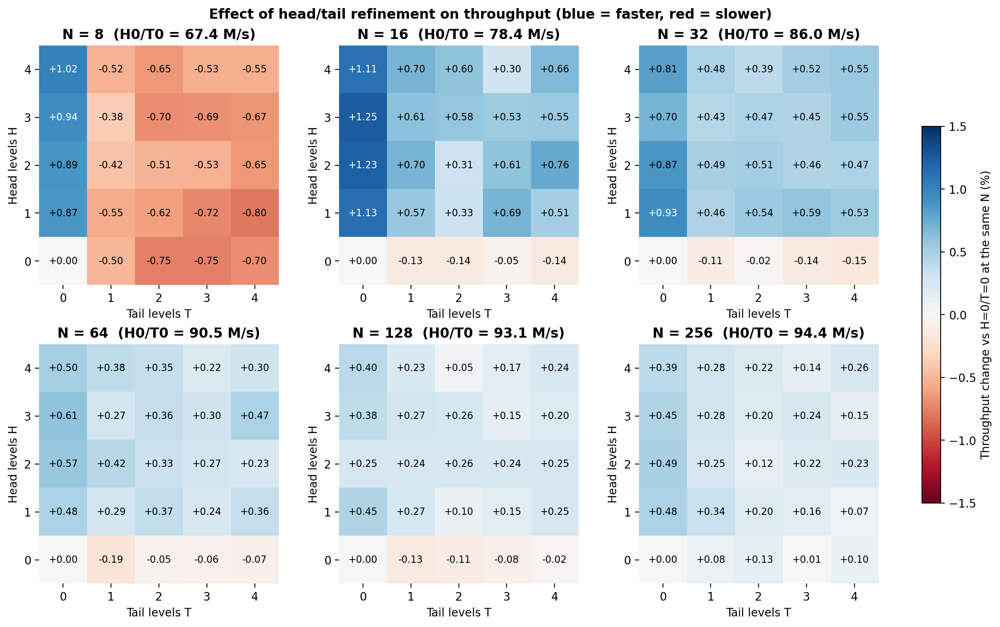
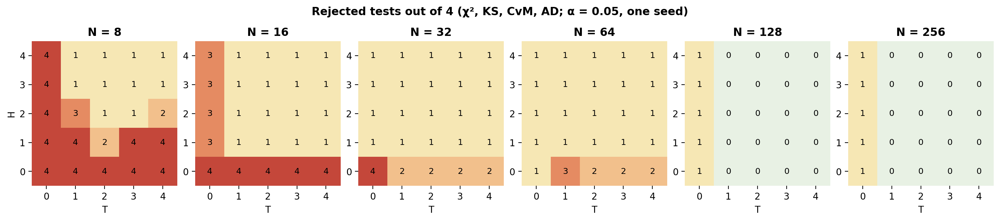
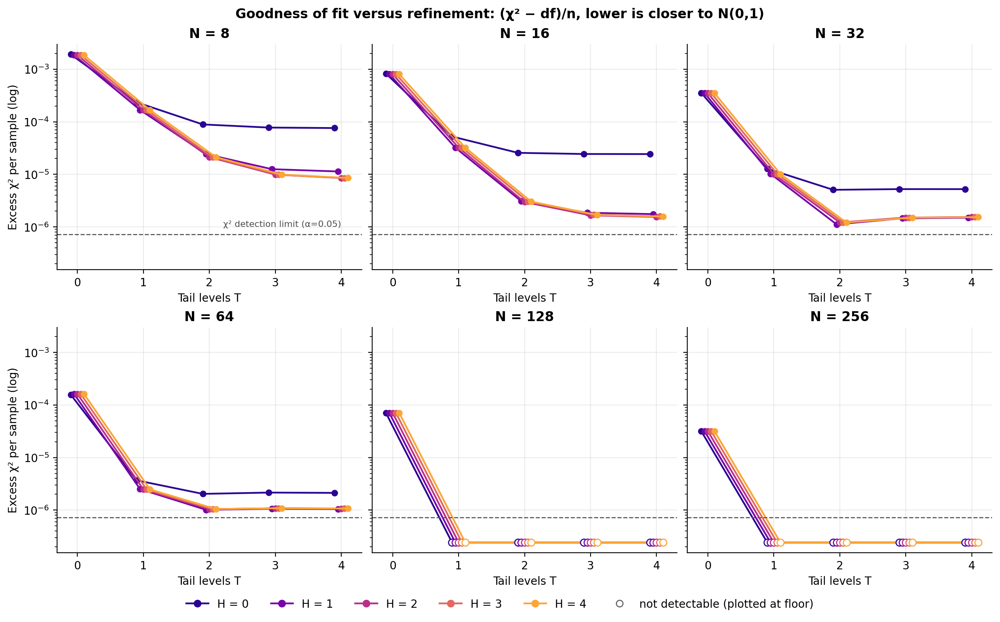
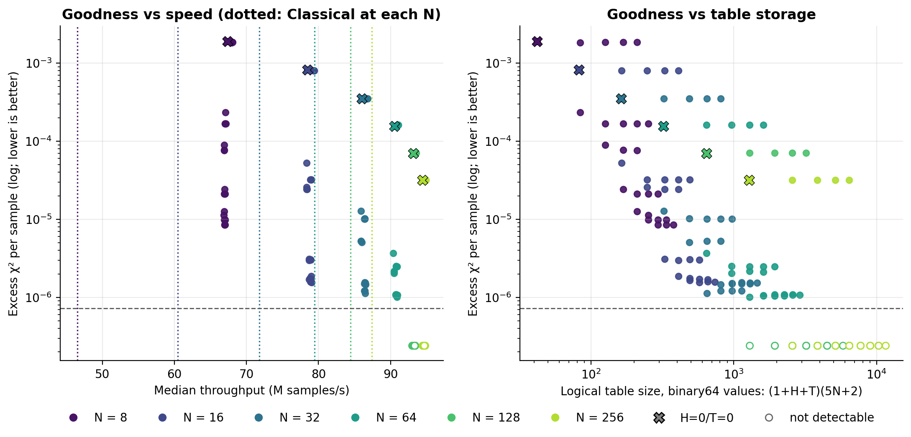

# Experiment 11: Classical vs Trapezoid Ziggurat across heads, tails and layers

Analysis of `experiments/results/experiment11/` (run on 26 October 2026). The figures and tables are
regenerated by `analysis/analyze_experiment11.py` from the saved CSV files; no experiment was rerun.

## Key findings

1. **Trapezoid is faster than Classical at every layer count, for every H/T.** The speedup is
   1.44× at N=8 and falls to 1.08× at N=256. Over all 25 H/T combinations at one N, it varies
   by at most 0.03× (Figure 1, Table 1).
2. **Head/tail refinement is almost free in throughput.** Within one N, all 25 H/T
   configurations are within 1.8% of each other (N=8) to 0.5% (N=256). That is only about
   1–4 times the run-to-run noise (Figure 2, Table 2).
3. **Refinement buys a large improvement in goodness of fit.** At a cost of under 1% throughput,
   it reduces the excess χ² by 150–700× compared with the unrefined H0/T0 table. Tail levels are
   the main source of the gain. Going from T=0 to T=1 gives the biggest step, and T=2 is enough
   in most cases. Head levels matter only once T≥2, and H=1 already gives almost all of their
   benefit (Figure 3, Table 3).
4. **Refinement cannot remove a residual error at small N.** For N≤64 every configuration still
   rejects χ². The remaining discrepancy shrinks as N grows: excess χ² per sample is about
   8.5×10⁻⁶ at N=8 and about 1×10⁻⁶ at N=64. Refinement only targets the extreme regions, so the
   residual comes from the interior trapezoid approximation.
5. **More layers improve speed and goodness together.** Each doubling of N raises throughput and
   cuts the unrefined discrepancy by about 2.3×. Its cost is table storage, not speed. With N≥128
   and T≥1, no test rejects at 2^25 samples for this seed (20 of 25 configurations at each N).
   With other seeds, Experiment 06 found isolated single rejections at N=128/256, so this is
   "not detected", not "exact".

## 1. Setup

| Item | Value |
|---|---|
| Configurations | Classical at N = 8, 16, 32, 64, 128, 256; Trapezoid at every combination of H 0–4, T 0–4 and N (150 configurations) |
| Samples | 2^25 = 33,554,432 per run after a 100,000-sample warm-up; seed 1 |
| Uniforms | Precomputed xoshiro256+ (2 GiB buffer). PRNG computation is excluded from timing; buffer reads are included |
| Timing | 5 repetitions per configuration, 780 timed processes in shuffled order, pinned to CPU 7 (`isolcpus=domain,managed_irq,7 irqaffinity=0-6`) |
| Validation | All 150 Trapezoid configurations on the full timed stream. χ² (100 bins over [−5, 5] plus two tail bins, df = 101), KS, CvM and AD against fixed N(0,1) at α = 0.05 |
| Build | GCC 11.4, `-O2`, binary SHA-256 `80f115be…` (unchanged throughout the session) |

Classical streams were not re-validated in Experiment 11. All 18 configurations shared with
Experiment 10 (Classical, Trapezoid H0/T0 and H2/T4 at every N) produced bit-identical streams,
since precomputed mode reproduces the inline stream exactly. So the Experiment 10 results apply
here: Classical passed all four tests at every N
(`tables/crosscheck_experiment10.csv`).

## 2. Data quality and environment

- **Completeness:** all 780 timed runs and all 150 validations finished with status `ok`. No
  buffer was exhausted; peak buffer use was about 55% at N=8.
- **Stream consistency:** every repetition of a configuration produced the same checksum, and
  every validated stream matches its timed stream.
- **Run-to-run noise:** the median coefficient of variation is 0.18%, and the median
  max-minus-min range within a configuration is about 0.45%. Eight configurations have CV above
  4% because of a single slow run each, for example `trap_N128_H3_T4` with one run at
  70.1 M/s. All results use medians, which these single outliers don't move.
- **CPU boost was on.** `environment.csv` records `boost = 1`, and CPU 7 reported a median of
  4.29 GHz before the runs (8 of 780 runs started below 4 GHz). The 3.2 GHz fixed-frequency
  BIOS setting was therefore **not** in effect. Comparisons within this experiment are valid,
  but absolute throughput is not comparable with runs made at the 3.2 GHz cap, such as
  Experiment 10. Boost frequency also depends on temperature.
- **Other environment notes:** irqbalance was active, and one IRQ remained effective on CPU 7.
  The kernel has no `nohz_full`, so CPU 7 still received the periodic timer tick.

## 3. Task 1: Classical vs Trapezoid

**Table 1. Throughput and PRNG calls per sample** (`tables/table1_classical_vs_trapezoid.csv`)

| N | Classical M/s | Trapezoid M/s (min / median / max over 25 H/T) | Speedup (min / median / max) | PRNG calls/sample: Classical | Trapezoid H0/T0 → H4/T4 |
|---:|---:|---:|---:|---:|---:|
| 8 | 46.6 | 66.9 / 67.0 / 68.1 | 1.436 / 1.440 / 1.462 | 3.701 | 4.169 → 4.361 |
| 16 | 60.5 | 78.3 / 78.9 / 79.4 | 1.295 / 1.305 / 1.313 | 3.385 | 4.093 → 4.181 |
| 32 | 71.8 | 85.9 / 86.4 / 86.8 | 1.196 / 1.204 / 1.209 | 3.209 | 4.051 → 4.093 |
| 64 | 79.5 | 90.4 / 90.8 / 91.1 | 1.137 / 1.143 / 1.146 | 3.113 | 4.028 → 4.048 |
| 128 | 84.4 | 93.0 / 93.4 / 93.5 | 1.102 / 1.106 / 1.108 | 3.061 | 4.015 → 4.025 |
| 256 | 87.4 | 94.4 / 94.6 / 94.9 | 1.080 / 1.083 / 1.086 | 3.032 | 4.008 → 4.013 |

- **Every Trapezoid configuration beats Classical at the same N.** The worst Trapezoid is still
  8% faster at N=256 and 44% faster at N=8.
- **The speedup shrinks as N grows** because Classical improves faster with more layers: its
  throughput rises 1.88× from N=8 to N=256, against 1.41× for Trapezoid. With more layers,
  fewer Classical samples reach the boundary strips that need `exp()` evaluation and possible
  rejection.
- **Trapezoid uses more uniforms per sample than Classical:** 13% more at N=8 and 32% more at
  N=256. It is still faster because its rectangle/triangle draws need no `exp()` and no
  rejection retry.
- **These speedups assume free uniforms.** In precomputed mode, a uniform costs one buffer read.
  When each uniform must be generated (inline PRNG, or a hardware uniform source), the extra
  draws count against Trapezoid. Experiment 05 (inline xoshiro256+, different machine and
  compiler) found Trapezoid slower than Classical at N=256. For a hardware design, the
  uniforms-per-sample column matters as much as throughput.

## 4. Task 2: Head/tail levels at a fixed layer count

**Table 2. Throughput spread across the 25 H/T configurations at each N**
(`tables/table2_ht_throughput_spread.csv`). Throughput in M samples/s.

| N | Fastest | Slowest | Spread | T=0 faster than T≥1 by | H=0 relative to H≥1 | Run-to-run range (median) |
|---:|---|---|---:|---:|---:|---:|
| 8 | H4/T0 (68.08) | H1/T4 (66.86) | 1.83% | 1.36% | −0.25% | 0.45% |
| 16 | H3/T0 (79.42) | H0/T4 (78.33) | 1.39% | 0.52% | −0.77% | 0.48% |
| 32 | H1/T0 (86.81) | H0/T4 (85.88) | 1.08% | 0.29% | −0.64% | 0.45% |
| 64 | H3/T0 (91.09) | H0/T1 (90.36) | 0.80% | 0.19% | −0.44% | 0.34% |
| 128 | H1/T0 (93.55) | H0/T1 (93.01) | 0.58% | 0.15% | −0.31% | 0.37% |
| 256 | H2/T0 (94.90) | H0/T0 (94.44) | 0.49% | 0.18% | −0.19% | 0.48% |

- **Effect size:** all H/T effects are at most 1.8%, and at N≥64 they are about the size of
  the run-to-run noise.
- **Tail levels cost a little at small N:** at N=8, T≥1 configurations are on average 1.4%
  slower than T=0.
  T≥1 makes more samples take the refined tail path, and calls per sample rise from 4.17 to
  4.36 at N=8. At N≥32 the cost is below the noise.
- **Head levels are slightly faster, not slower:** H≥1 is 0.2–0.8% faster than H=0 at every N.
  This is small, consistent in direction, and not explained by calls per sample, which are
  higher with H≥1. Code-layout or branch-prediction effects are possible, but this experiment
  can't separate them.
- **Choose H/T for goodness:** speed is effectively flat across H and T, so the choice should be
  made on goodness of fit (Section 5).

## 5. Task 3: Goodness of fit vs performance

### 5.1 Goodness metrics

Pass/fail at α = 0.05 is coarse, and with 2^25 samples even tiny discrepancies reject. Three
measures are used:

- **Rejections out of 4** (χ², KS, CvM, AD) as an overview (Figure 4).
- **χ² z = (X² − df)/√(2·df)**, about N(0,1) for an exact sampler. The rejection threshold is
  z ≈ 1.8.
- **Excess χ² per sample = max(X² − df, 0)/n**, the main effect-size measure. It estimates the
  Pearson χ² divergence between the binned output distribution and N(0,1), and does not grow
  with sample size. The smallest divergence detectable at α = 0.05 with 2^25 samples is
  7.3×10⁻⁷; values below it are shown as "< limit".

χ² accounts for 110 of the 185 rejections; KS, CvM and AD for 33, 19 and 23. With 600 tests at
α = 0.05, about 30 rejections are expected by chance. The observed 185 are concentrated at T=0
and at N≤64, which points to real discrepancies rather than chance.

### 5.2 What head/tail refinement buys

**Excess χ² per sample at H=1, by tail levels, with the H=0 plateau for comparison**

| N | T=0 | T=1 | T=2 | T=3 | T=4 | H=0, T=4 |
|---:|---:|---:|---:|---:|---:|---:|
| 8 | 1.8e-03 | 1.7e-04 | 2.4e-05 | 1.3e-05 | 1.1e-05 | 7.6e-05 |
| 16 | 8.0e-04 | 3.2e-05 | 3.1e-06 | 1.9e-06 | 1.8e-06 | 2.4e-05 |
| 32 | 3.5e-04 | 1.0e-05 | 1.1e-06 | 1.5e-06 | 1.5e-06 | 5.2e-06 |
| 64 | 1.6e-04 | 2.5e-06 | 1.0e-06 | 1.1e-06 | 1.0e-06 | 2.1e-06 |
| 128 | 7.0e-05 | < limit | < limit | < limit | < limit | < limit |
| 256 | 3.2e-05 | < limit | < limit | < limit | < limit | < limit |

- **T=0 → T=1 is the biggest step:** 11× lower divergence at N=8, 25–65× at N=16–64, and
  undetectable at N≥128.
- **T=1 → T=2 is a second large step at N≤32:** 7–10× at N=8–16.
- **Beyond T=2 the curve is flat:** extra tail levels change little.
- **Heads only matter once tails are refined.** Without heads (H=0), divergence plateaus 2–13×
  higher than with H≥1 (last column versus T=4). H=1 gives essentially all of the benefit;
  H=2–4 are identical within noise. In Figure 3 the H≥1 curves overlap.

**Table 3. Gain and cost of the best refinement at each N** (`tables/table3_goodness_tradeoff.csv`).
"Best" is the lowest-divergence configuration when every configuration is detectable (N≤64).
Otherwise it is the fastest configuration that is undetectable.

| N | H0/T0 χ² z | H0/T0 excess χ²/n | H0/T0 rejections | Best | Best χ² z | Best excess χ²/n | Best rejections | Divergence reduction | Throughput vs H0/T0 | Configs passing all 4 |
|---:|---:|---:|---:|---|---:|---:|---:|---:|---:|---:|
| 8 | 4500 | 1.9e-03 | 4 | H3/T4 | 20.1 | 8.5e-06 | 1 | 224× | −0.67% | 0 / 25 |
| 16 | 1937 | 8.2e-04 | 4 | H2/T4 | 3.7 | 1.6e-06 | 1 | 528× | +0.76% | 0 / 25 |
| 32 | 832 | 3.5e-04 | 4 | H1/T2 | 2.7 | 1.1e-06 | 1 | 314× | +0.54% | 0 / 25 |
| 64 | 368 | 1.6e-04 | 1 | H1/T2 | 2.4 | 1.0e-06 | 1 | 154× | +0.37% | 0 / 25 |
| 128 | 165 | 7.0e-05 | 1 | H3/T1 | 0.2 | < limit | 0 | to undetectable | +0.27% | 20 / 25 |
| 256 | 75 | 3.2e-05 | 1 | H1/T1 | −1.6 | < limit | 0 | to undetectable | +0.34% | 20 / 25 |

**Answer for H/T:** within a layer count, refinement improves goodness by two to three orders
of magnitude for at most a 0.7% throughput loss. At N≥16 the best configuration is even
slightly faster than H0/T0, because of the head effect described in Section 4. In software,
throughput is not a real cost of refinement.

### 5.3 What more layers buy

- **Speed and goodness improve together with N.** For H0/T0, each doubling of N cuts the divergence
  by about 2.3× (1.9×10⁻³ at N=8 to 3.2×10⁻⁵ at N=256), while throughput rises from 67 to
  94 M/s. The left panel of Figure 5 has no speed-for-goodness trade-off along N: higher N
  moves up and to the right.
- **Refinement cannot remove the small-N floor.** At N=8 the best possible configuration still
  has χ² z ≈ 20. At N=32–64 the floor sits just above the detection limit (z ≈ 2.4–2.7, a single
  χ² rejection). Only N≥128 with T≥1 falls below detection at 2^25 samples.
- **The real cost of goodness is table storage** (right panel of Figure 5). Logical size is
  (1+H+T)·(5N+2) binary64 values for Trapezoid, against 2N for Classical.
  - **Storage spent on refinement is more efficient at small N.** N=32 H1/T2 (648 values)
    reaches a lower divergence than N=128 H0/T0 (642 values).
  - **Clearing detection needs N≥128.** The cheapest undetectable configuration is N=128 H0/T1
    at 1,284 values, against 512 for Classical N=256.
- **Comparison with Classical:** Trapezoid N=128 with T≥1 runs at 93.0–93.4 M/s. That is 1.10×
  Classical at N=128 and 1.06–1.07× Classical at N=256, the largest tested, which is exact by
  construction and passed all tests. It needs about 2.5× the table storage of Classical N=256.

## 6. Conclusions and limitations

- **CPU speed:** with precomputed uniforms, Trapezoid is 8–44% faster than Classical at equal
  N, regardless of H/T.
- **Refinement choice:** use at least T=1. Prefer H=1/T=2: it is close to the best goodness at
  every N, and extra levels add storage without measurable benefit. H0/T0 should not be used;
  it fails all four tests at N≤32.
- **Goodness:** only N≥128 with T≥1 produced no rejection at 2^25 samples. Configurations with
  N≤64 retain a measurable residual error that refinement cannot remove.
- **Single seed:** the goodness results come from seed 1 only. Experiment 06 (seeds 2 and 2026,
  H2/T4) found single χ² or KS rejections at N=128/256, which is about what chance predicts
  across that many tests. Treat "undetectable" as "below the 2^25-sample detection limit for
  this seed". The Trapezoid sampler is approximate by construction, so no test count proves
  exactness. Additional seeds for the N≥128 configurations would firm this up.
- **CPU boost:** boost was on (about 4.3 GHz), so absolute throughput is specific to this
  session. Relative comparisons stand, but re-enable the 3.2 GHz cap before comparing with
  Experiment 10.
- **Hardware relevance:** precomputed uniforms hide the PRNG cost, which falls more heavily on
  Trapezoid (4.0–4.4 uniforms per sample, against 3.0–3.7 for Classical). Table sizes here are
  logical binary64 counts, not a fixed-point FPGA memory estimate.

## Files

| Path | Contents |
|---|---|
| `figures/fig1_classical_vs_trapezoid.png` | Throughput and speedup vs N |
| `figures/fig2_ht_throughput_heatmaps.png` | Throughput change by H/T at each N |
| `figures/fig3_goodness_vs_refinement.png` | Excess χ² vs T, one line per H, at each N |
| `figures/fig4_rejection_counts.png` | Rejected tests per configuration |
| `figures/fig5_goodness_tradeoff.png` | Goodness vs throughput and vs table storage |
| `tables/table1_…`, `table2_…`, `table3_…` | Data for Tables 1–3 |
| `tables/trapezoid_configurations.csv` | All 150 Trapezoid configurations: throughput, speedup, calls per sample, all four tests, χ² z, excess χ², table size |
| `tables/crosscheck_experiment10.csv` | Stream identity with Experiment 10 |
| `analysis/analyze_experiment11.py` | Regenerates every figure and table: `.venv/bin/python -B reports/experiment11/analysis/analyze_experiment11.py` |
