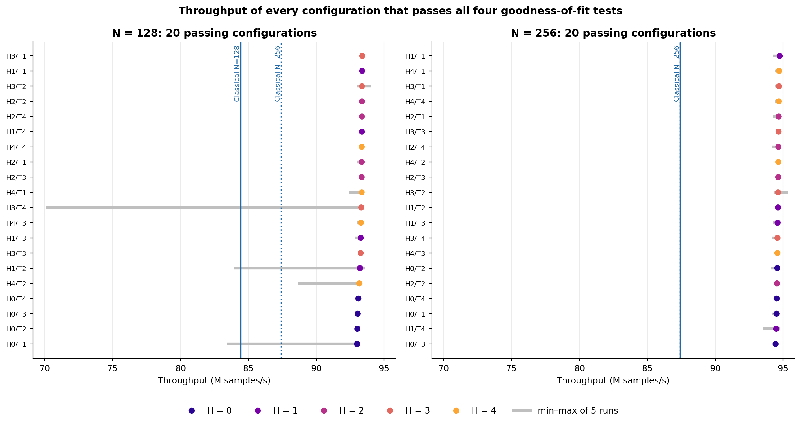
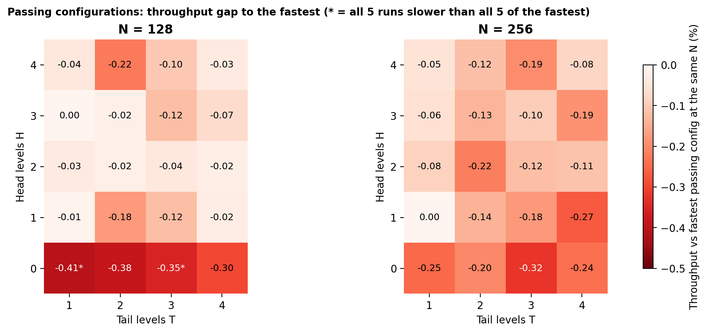
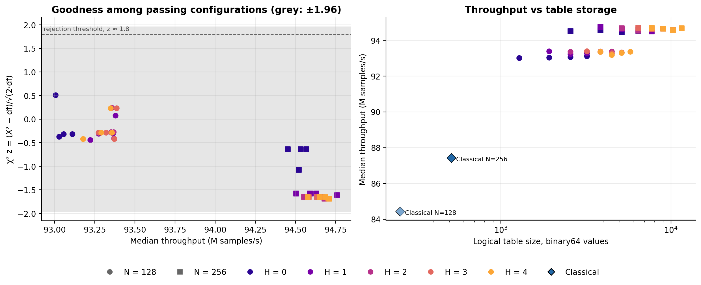

# Experiment 11, passing subset: performance of the Trapezoid configurations that pass every goodness-of-fit test

A follow-up to [report.md](report.md). It keeps only the Trapezoid configurations with **no rejection in
any of the four tests** (χ², KS, CvM, AD at α = 0.05) and analyses their performance, using Classical
Ziggurat as the reference. The figures and tables are regenerated by `analysis/analyze_passing.py` from
the saved CSVs; no experiment was rerun.

## Key findings

1. **Only 40 of 150 Trapezoid configurations pass, all at N=128 or N=256 with T≥1.** Every
   configuration at N≤64 rejects at least one test, and so does every T=0 configuration. H can
   be anything from 0 to 4.
2. **Every passing configuration beats Classical at the same N:** 1.10× at N=128 and 1.08× at
   N=256. The slowest passing configuration, N=128 H0/T1, is still 6.4% faster than Classical
   N=256, the fastest Classical tested (Figure 1, Table 1).
3. **Within a layer count, the H/T choice barely affects speed.** The passing configurations
   span 0.41% (N=128) and 0.32% (N=256). Configurations with byte-identical output differ by up
   to 0.21%, so most of that spread is measurement noise. The only effect beyond noise is a
   0.1–0.4% penalty for H=0 (Figure 2, Table 2).
4. **Passing configurations can't be ranked on goodness.** All of them are below the χ²
   detection limit, and their test statistics vary only as random sampling would. More
   refinement adds table storage but no measurable goodness. Beyond H3/T3 at N=128 and H3/T2 at
   N=256, it doesn't even change the output in 2^25 samples (Section 5).
5. **The only real trade-offs left are N and table storage.** N=256 is 1.4% faster than N=128 and
   needs twice the storage. N=128 H1/T1 is the best compromise: 93.4 M/s and 1,926 table values.
   That is within noise of the fastest at N=128, 6.8% faster than Classical N=256, and 3.8× its
   storage.

## 1. Setup

| Item | Value |
|---|---|
| Source data | Same session as [report.md](report.md): 2^25 samples per run, precomputed xoshiro256+ uniforms, seed 1, 5 timed repetitions pinned to isolated CPU 7, GCC 11.4 `-O2` |
| Filter | Trapezoid configurations with `rejections = 0` in `validation_results.csv` |
| Passing set | 40 configurations: N ∈ {128, 256} × H ∈ {0..4} × T ∈ {1..4} |
| Reference | Classical at N=128 and N=256. Experiment 11 did not validate Classical, but its streams are bit-identical to Experiment 10, where Classical passed all four tests at every N |

**Passing configurations by N** (`tables/good_counts_by_N.csv`)

| N | 8 | 16 | 32 | 64 | 128 | 256 |
|---|---:|---:|---:|---:|---:|---:|
| Passing / 25 | 0 | 0 | 0 | 0 | 20 | 20 |

At N=128 and N=256, the five T=0 configurations each reject χ² (one test). Every other
configuration passes.

## 2. Data quality and environment

- **Run quality:** all 40 configurations have 5 successful timed runs, consistent checksums and
  matching validation streams.
- **Outliers:** four N=128 configurations have one slow outlier run each (H3/T4 at 70.1 M/s,
  H0/T1 at 83.4, H1/T2 at 83.9, H4/T2 at 88.7; visible in Figure 1). All comparisons use
  medians, which these single runs don't affect.
- **Same environment caveats as the main report:** CPU boost was on (median about 4.29 GHz, so
  the 3.2 GHz BIOS cap wasn't in effect), irqbalance was active, and the timer tick still
  reached CPU 7. Throughput differences within this session are valid; absolute numbers are
  specific to this session.
- **The 40 configurations produce only 20 distinct sample streams** (12 at N=128, 8 at N=256;
  `tables/good_identical_streams.csv`). Some H/T settings never reach their deepest levels
  within 2^25 samples, so they output exactly the same samples. Two consequences:
  - **Goodness:** the 40 goodness results are not 40 independent observations.
  - **Speed:** configurations with identical output show the pure measurement noise in their
    speed difference. This is used in Section 4.

## 3. Task 1: Classical vs passing Trapezoid configurations

**Table 1. Classical vs passing Trapezoid configurations** (`tables/good_summary_by_N.csv`)

| N | Classical M/s | Passing Trapezoid M/s (min / median / max) | Speedup vs Classical, same N | Speedup vs Classical N=256 | PRNG calls/sample: Classical → Trapezoid | Table values: Classical → smallest passing Trapezoid |
|---:|---:|---:|---:|---:|---:|---:|
| 128 | 84.43 | 93.01 / 93.34 / 93.39 | 1.102–1.106 | 1.064–1.068 | 3.061 → 4.022–4.025 | 256 → 1,284 (H0/T1) |
| 256 | 87.42 | 94.45 / 94.63 / 94.76 | 1.080–1.084 | 1.080–1.084 | 3.032 → 4.012–4.013 | 512 → 2,564 (H0/T1) |

- **Speed:** every passing configuration is faster than Classical at the same N, and faster than
  Classical N=256.
- **Uniforms:** the passing configurations draw 31–32% more uniforms per sample than Classical
  (about 4.02 against 3.03–3.06). The measured speedup assumes free uniforms (precomputed
  buffer). When each uniform has to be generated, by an inline PRNG or a hardware uniform
  source, the extra draws reduce or reverse the advantage.
- **Storage:** passing configurations need 5× the logical table storage of Classical at the same
  N, even at the smallest setting, H0/T1.

## 4. Task 2: Head/tail levels within a layer count

**Table 2. Throughput spread among passing configurations** (`tables/good_summary_by_N.csv`,
`tables/good_identical_streams.csv`)

| N | Fastest | Slowest | Spread | Noise: spread among identical-output configs (max) | Distinguishable from fastest* | Mean M/s, H=0 → H=1 / 2 / 3 / 4 | Mean M/s, T=1 / 2 / 3 / 4 |
|---:|---|---|---:|---:|---:|---|---|
| 128 | H3/T1 (93.39) | H0/T1 (93.01) | 0.41% | 0.21% | 2 of 19 (H0/T1, H0/T3) | 93.05 → 93.31 / 93.36 / 93.34 / 93.29 | 93.30 / 93.23 / 93.25 / 93.30 |
| 256 | H1/T1 (94.76) | H0/T3 (94.45) | 0.32% | 0.13% | 0 of 19 | 94.52 → 94.62 / 94.63 / 94.65 / 94.66 | 94.67 / 94.61 / 94.59 / 94.59 |

\*All five runs slower than all five runs of the fastest configuration (exact permutation test,
p = 0.008).

- **Noise floor:** configurations that output the same samples, such as N=128 H3/T3, H3/T4,
  H4/T3 and H4/T4, differ in median speed by up to 0.21% (N=128) and 0.13% (N=256). Differences
  below about 0.2% should therefore be read as noise.
- **Head levels:** H=0 is the only setting that is consistently slower, by about 0.3% at N=128
  and 0.13% at N=256. At N=128 it is the only setting that separates from the fastest.
  H=1 to H=4 are indistinguishable.
- **Tail levels:** across the passing range (T=1–4), tail levels have no measurable effect on
  speed. The T-means differ by at most 0.09%.
- **Conclusion:** within the passing set, H/T should be chosen for storage, because speed is
  flat once H≥1.

## 5. Task 3: Goodness vs performance within the passing set

### 5.1 No measurable goodness difference

- **All 40 configurations are below the χ² detection limit:** z = (X² − df)/√(2·df) ranges from
  −0.44 to +0.51 at N=128 and from −1.69 to −0.63 at N=256. The rejection threshold is z ≈ 1.8.
- **Smallest p-value per configuration** (over χ², KS and CvM) is 0.19–0.31 at N=128 and
  0.087–0.155 at N=256.
- **These numbers can't be used for ranking.** For a sampler with no detectable discrepancy,
  p-values are uniformly distributed and z varies randomly, so a lower z or a higher p is not
  "better".
- **The N=256 z-values are all negative,** because those 20 configurations share only 8
  distinct streams that differ mainly in rarely reached refinement paths. They are not 20
  independent draws, and a single stream with z ≈ −1.6 is unremarkable.

Within the passing set, extra layers or extra H/T levels give **no measurable goodness gain at
2^25 samples**. Any remaining difference between these configurations is smaller than this
experiment can resolve.

### 5.2 What extra refinement and extra layers cost

- **Extra refinement costs storage and nothing else** (right panel of the figure above):
  - **Some extra levels never change the output in 2^25 samples.** At N=128, H3 and H4 produce
    identical streams, as do T3 and T4. At N=256, T2, T3 and T4 produce identical streams at
    every H, as do H3 and H4. Anything beyond H3/T3 (N=128) or H3/T2 (N=256) adds table storage
    with no change in output at this sample size. The deeper levels would eventually be reached
    with more samples; this is a statement about 2^25 samples only.
  - **The largest passing configuration** (N=256 H4/T4, 11,538 values) is no faster and no
    measurably better than N=256 H1/T1 (3,846 values).
- **Doubling the layers from 128 to 256 costs storage, not speed:** +1.4% throughput (93.34 to
  94.63 M/s, median over H/T) for twice the storage. For example, H1/T1 grows from 1,926 to
  3,846 values. Goodness is not measurably different between the two.

**Candidate configurations** (`tables/good_configurations.csv`)

| Configuration | M/s | vs fastest at same N | vs Classical N=256 | Table values | Note |
|---|---:|---:|---:|---:|---|
| N=128 H0/T1 | 93.01 | −0.41%* | 1.064× | 1,284 | Smallest passing table; H=0 penalty is measurable |
| **N=128 H1/T1** | **93.38** | −0.01% | **1.068×** | **1,926** | Within noise of the fastest at N=128 |
| N=128 H3/T1 | 93.39 | 0 | 1.068× | 3,210 | Fastest at N=128; same output as H4/T1 |
| N=256 H0/T1 | 94.52 | −0.25% | 1.081× | 2,564 | Smallest at N=256 |
| **N=256 H1/T1** | **94.76** | 0 | **1.084×** | **3,846** | Fastest passing configuration overall |
| Classical N=256 (reference) | 87.42 | — | 1.000× | 512 | Exact by construction; 3.03 uniforms per sample |

\*Distinguishable from the fastest configuration at the same N (Section 4).

## 6. Conclusions and limitations

- **Only N=128 or N=256 with T≥1 pass.** Within those, H≥1 is about 0.1–0.4% faster than H=0,
  and everything else about H/T is speed-neutral and goodness-neutral at 2^25 samples.
- **Recommendation:**
  - **N=128 H1/T1** for the best storage/speed balance: 1.07× Classical N=256 at 3.8× its
    table storage.
  - **N=256 H1/T1** if the last 1.4% of throughput is worth twice the storage.
  - **Avoid deeper refinement:** it adds storage without measurable benefit.
- **"Passing" is a single-seed filter.** Experiment 06 found isolated χ² or KS rejections at
  N=128/256 for H2/T4 with seeds 2 and 2026. Those are about as frequent as chance predicts,
  but they mean this set is "not rejected for seed 1", not "verified exact". The Trapezoid
  sampler is approximate by construction. Re-validating the candidate configurations above with
  several seeds is the obvious next check.
- **The speed advantage assumes free uniforms.** It shrinks once uniform generation is counted:
  about 4.02 uniforms per sample against 3.03 for Classical. For an FPGA design, the cost of the
  uniform source and the table memory (here 5× Classical or more, in logical binary64 values,
  not a fixed-point estimate) need to be weighed against the 6–11% CPU throughput gain (6–8% over Classical N=256, 8–11% over
  Classical at the same N).
- **CPU boost:** this session ran with boost on, so the absolute numbers apply to this session
  only.

## Files

| Path | Contents |
|---|---|
| `figures/good_fig1_throughput_ranking.png` | Every passing configuration ranked by throughput, with run ranges and Classical references |
| `figures/good_fig2_ht_heatmaps.png` | Throughput gap to the fastest passing configuration, by H/T |
| `figures/good_fig3_goodness_storage.png` | χ² z vs throughput; throughput vs table storage, with Classical |
| `tables/good_configurations.csv` | All 40 passing configurations: throughput, run range, rank, speedups, calls per sample, table size, χ² z, p-values |
| `tables/good_summary_by_N.csv` | Data for Tables 1 and 2 |
| `tables/good_identical_streams.csv` | Groups of configurations with byte-identical output |
| `tables/good_counts_by_N.csv` | Passing configurations per N |
| `analysis/analyze_passing.py` | Regenerates the above: `.venv/bin/python -B reports/experiment11/analysis/analyze_passing.py` |
