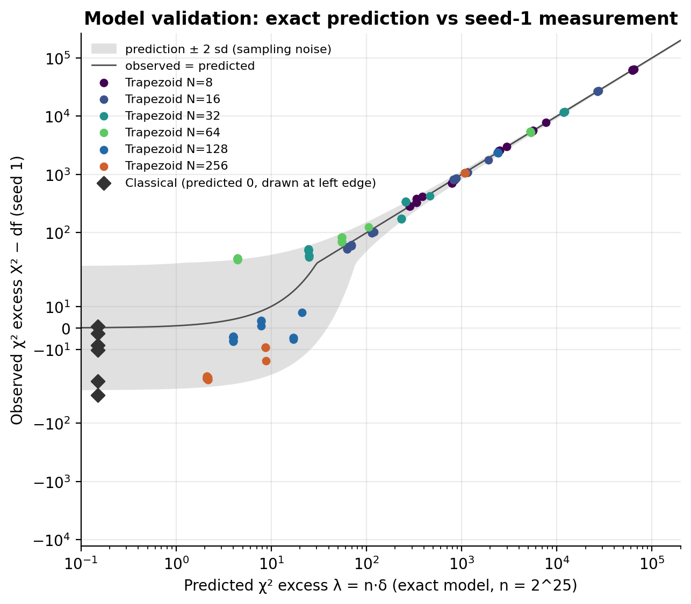
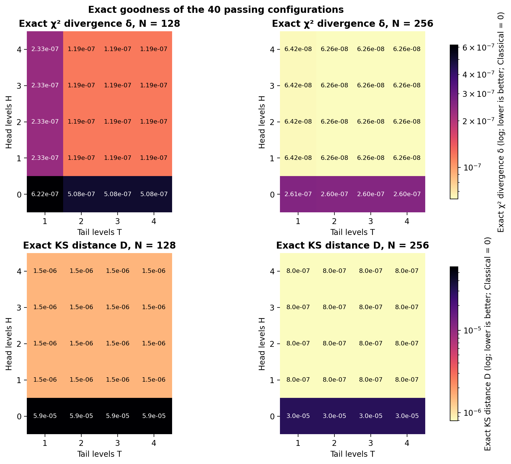
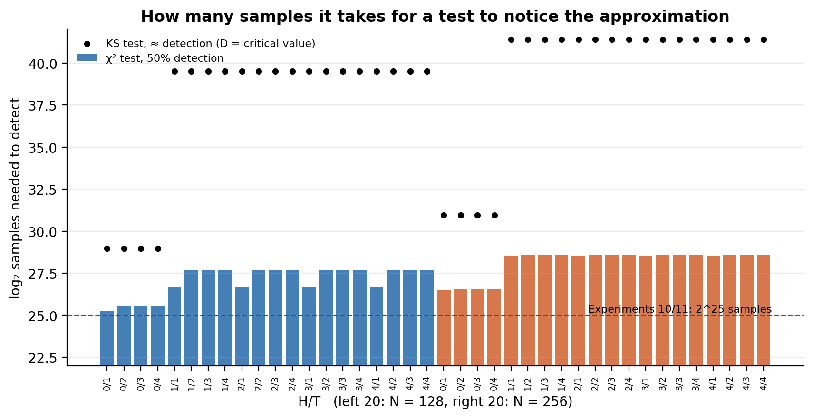
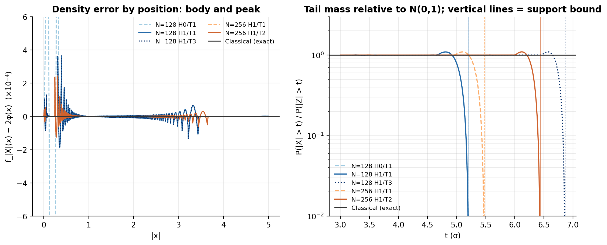
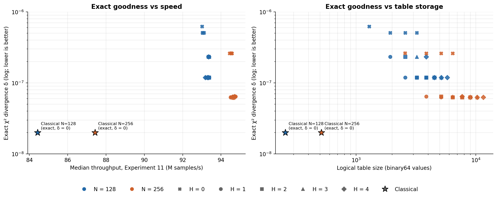

# Experiment 12: exact goodness of the 40 passing Trapezoid configurations vs Classical Ziggurat

Experiment 11 found 40 Trapezoid configurations (N = 128 and 256, T ≥ 1, any H) that passed all four
goodness-of-fit tests with seed 1. Seed-1 tests can't rank them, because all of them sit below the
detection limit at 2^25 samples ([report_good.md](../experiment11/report_good.md)).

Experiment 12 instead computes each configuration's **exact** output distribution, with no random
numbers generated (Method 1; see the manual `Trapezoid_Exact_Distribution_Manual.md`). It then
compares the configurations with each other and with Classical Ziggurat, which is exact by
construction. The seed-1 results serve only to validate the model.

Data: `experiments/results/experiment12/`. Figures and tables are regenerated by
`analysis/analyze_experiment12.py`. Throughput figures come from Experiment 11.

## Key findings

1. **The exact model predicts the experiments.** Over all 150 Experiment 11 configurations, the
   seed-1 χ² results scatter around the predictions as sampling noise should, with none more than
   3 standard deviations away. Where the error is large, prediction and measurement agree within
   noise; for example 64,393 predicted against 63,958 observed for N=8 H0/T0. So the C code produces
   exactly its designed distribution, and the xoshiro256+ PRNG adds nothing visible (Figure 1).
2. **None of the 40 passing configurations is exact, but all are very close.** The exact χ² divergence
   ranges from 6.3×10⁻⁸ to 6.2×10⁻⁷; Classical's is 0. For H≥1, a χ² test would need 2^26.7–2^28.6
   samples to have even a 50% chance of noticing the difference, and a KS test about 2^40.
3. **Seed 1 was partly lucky for H=0 at N=128.** Those four configurations had a predicted 31–40%
   chance of failing χ² at 2^25 samples; they sit right at the detection limit.
4. **H=0 is the weak point.** Leaving the peak slice unrefined makes δ 2–4× larger and the KS
   distance 37–38× larger, with the error concentrated near x ≈ 0.1. H=1 removes it, and H=2–4 add
   nothing measurable (identical δ and KS to three significant figures).
5. **T sets the tail, which the experiments' χ² test can't see.** Output stops at 5.2σ (N=128) or
   5.5σ (N=256) with T=1, and that limit rises 0.7–1.0σ per extra tail level. With T=1 at N=128,
   21% of the mass beyond 5σ is missing. T=2 also halves δ at N=128.
6. **Against Classical:** passing Trapezoids are 6–11% faster, but carry a small non-zero error, a
   bounded tail and 5–23× the table storage. Classical is exact, with unbounded output.
7. **Revised recommendation:** N=128 H1/T2 for the best balance (δ at the N=128 floor, support 6.1σ,
   2,568 table values). Use H1/T3 if tails to 6σ matter, and N=256 H1/T2 or H1/T3 for the lowest error.
   This replaces Experiment 11's pick of H1/T1, which has twice the error and stops at 5.2σ.

## 1. Method and setup

| Item | Value |
|---|---|
| Configurations | The 40 that passed all four tests in Experiment 11 (seed 1): N ∈ {128, 256}, H 0–4, T 1–4. All 150 are used to validate the model |
| Reference | Classical Ziggurat N = 128 and 256: exact by construction (δ = 0). Seed-1 results from Experiment 10, same streams and bins |
| Tables | Exported from the compiled C sampler (`experiment12_dump_tables.c` includes `c/ziggurat_trapezoid.c`), so they are exactly what the experiments ran. They agree with an independent Python reimplementation to within 2×10⁻⁷ relative in δ |
| Exact distribution | Weighted mixture of trapezoid densities; entry weight N^−(depth+1) from the head/tail descent rules |
| Metrics | Exact χ² divergence δ in the experiments' bins (100 over [−5, 5] plus 2 tails, df = 101); predicted χ² excess λ = n·δ and rejection probability at n = 2^25; samples for 50% detection; exact KS distance; support bound; variance error; tail ratio P(\|X\|>t)/P(\|Z\|>t) at t = 3–6 |
| Random numbers generated | None |

**Two ways to measure the error, and what each sees:**
- **δ** is the noise-free version of the "excess χ² per sample" in the Experiment 11 reports. It
  depends on the binning, and only one bin covers everything beyond 5σ.
- **The KS distance** is the largest error in the cumulative distribution, with no binning.

## 2. Model validation

**Table 1. How far each seed-1 result sits from its prediction, in standard deviations of the
sampling noise** (`tables/model_validation_summary.csv`)

| Group | Configurations | Mean | Spread | Beyond ±2 sd | Beyond ±3 sd |
|---|---:|---:|---:|---:|---:|
| Trapezoid, all | 150 | −0.05 | 1.19 | 15 | 0 |
| Trapezoid with large error (λ > 1,000) | 43 | −0.15 | 0.68 | 0 | 0 |
| Classical (predicted 0) | 6 | −0.91 | 0.92 | 1 | 0 |

- **Overall agreement:** results scatter around the predictions with about the expected spread (ideal:
  mean 0, spread 1).
- **Configurations beyond 2 sd:** 15 is more than the ~7 expected for independent results, but many
  configurations share almost all of their samples, so their deviations come in clusters. An example is
  the 12 N=64 plateau configurations at +2 sd.
- **Large-error configurations:** prediction and measurement agree within noise, with at most 7.6%
  relative difference. This is the strongest evidence that the model is right.
- **Classical:** consistent with zero error. The one value beyond 2 sd (N=8, −2.3 sd) is on the *low*
  side, meaning less deviation than chance would give, which is unremarkable.

The model can therefore be trusted for the passing configurations, whose errors are too small for any
single 2^25-sample test to measure.

## 3. Passing Trapezoids vs Classical: exact goodness

**Table 2. Exact goodness by group** (`tables/exact_metrics_passing.csv`). Configurations in a group
share the same δ and KS distance to three significant figures. Throughput is from Experiment 11.

| Configuration | δ (exact) | P(fail χ²) at 2^25 | Samples for 50% χ² detection | KS distance | Support (σ) | Tail ratio at 5σ / 6σ | M samples/s | Table values |
|---|---:|---:|---:|---:|---:|---:|---:|---:|
| **Classical N=128** | **0** | 0.05 (chance) | never | **0** | **∞** | 1 / 1 | 84.43 | 256 |
| N=128 H0/T1 | 6.22e-7 | **0.40** | 2^25.3 | 5.9e-5 | 5.21 | 0.79 / 0 | 93.01 | 1,284 |
| N=128 H0/T2–4 | 5.08e-7 | **0.31** | 2^25.6 | 5.9e-5 | 6.10–7.55 | 1.00 / 0.39–1.00 | 93.03–93.11 | 1,926–3,210 |
| N=128 H≥1/T1 | 2.33e-7 | 0.14 | 2^26.7 | 1.5e-6 | 5.21 | 0.79 / 0 | 93.35–93.39 | 1,926–3,852 |
| N=128 H≥1/T2 | 1.19e-7 | 0.09 | 2^27.7 | 1.5e-6 | 6.10 | 1.00 / 0.39 | 93.18–93.37 | 2,568–4,494 |
| N=128 H≥1/T3 | 1.19e-7 | 0.09 | 2^27.7 | 1.5e-6 | 6.87 | 1.00 / 1.00 | 93.27–93.35 | 3,210–5,136 |
| N=128 H≥1/T4 | 1.19e-7 | 0.09 | 2^27.7 | 1.5e-6 | 7.55 | 1.00 / 1.00 | 93.32–93.37 | 3,852–5,778 |
| **Classical N=256** | **0** | 0.05 (chance) | never | **0** | **∞** | 1 / 1 | 87.42 | 512 |
| N=256 H0/T1 | 2.61e-7 | 0.15 | 2^26.5 | 3.0e-5 | 5.48 | 1.04 / 0 | 94.52 | 2,564 |
| N=256 H0/T2–4 | 2.60e-7 | 0.15 | 2^26.5 | 3.0e-5 | 6.44–8.01 | 1.00 / 1.00 | 94.45–94.57 | 3,846–6,410 |
| N=256 H≥1/T1 | 6.42e-8 | 0.07 | 2^28.6 | 8.0e-7 | 5.48 | 1.04 / 0 | 94.68–94.76 | 3,846–7,692 |
| N=256 H≥1/T2 | 6.26e-8 | 0.07 | 2^28.6 | 8.0e-7 | 6.44 | 1.00 / 1.00 | 94.55–94.65 | 5,128–8,974 |
| N=256 H≥1/T3 | 6.26e-8 | 0.07 | 2^28.6 | 8.0e-7 | 7.27 | 1.00 / 1.00 | 94.58–94.67 | 6,410–10,256 |
| N=256 H≥1/T4 | 6.26e-8 | 0.07 | 2^28.6 | 8.0e-7 | 8.01 | 1.00 / 1.00 | 94.50–94.68 | 7,692–11,538 |

**Comparison with Classical:**
- **Exactness:** Classical has zero error. Every passing Trapezoid has a small but real error: δ
  between 6.3×10⁻⁸ and 6.2×10⁻⁷, and a KS distance between 8×10⁻⁷ and 6×10⁻⁵.
- **Tails:** Classical output is unbounded. Every Trapezoid stops at a finite bound, between 5.2σ and
  8.0σ depending on N and T.
- **Variance:** within 1×10⁻⁶ of 1 for every passing configuration, so it doesn't distinguish them.
- **Speed:** Trapezoid is faster: 1.10–1.11× Classical at N=128 and 1.08× at N=256; even the slowest
  passing Trapezoid is 1.06× Classical N=256.
- **Storage:** Trapezoid needs 5–23× Classical's table storage.
- **What "passed" meant:** for H≥1, the seed-1 pass was the expected outcome (7–14% predicted chance of
  failing). For H=0 at N=128 it wasn't: a 31–40% chance of failing χ² at the same sample size.

**When the difference becomes detectable:**
- **χ² test:** with 50% probability at about 2^25.3–2^25.6 samples for N=128 H=0, 2^26.7–2^27.7 for
  N=128 H≥1, and 2^28.6 for N=256 H≥1.
- **KS test:** needs about 2^29–2^31 for H=0 and 2^39.5–2^41.4 for H≥1.

So an application drawing more than about 10⁸ samples could statistically tell a passing Trapezoid
from an exact Gaussian; Classical can't be told apart at any sample size, apart from PRNG effects.

## 4. Head and tail levels within a layer count

**Head levels: H = 0 versus H ≥ 1.**
- **Size of the effect:** at H=0 the unrefined top slice, nearest the peak, dominates the error. The
  KS distance is 5.9×10⁻⁵ (N=128) and 3.0×10⁻⁵ (N=256), against 1.5×10⁻⁶ and 8.0×10⁻⁷ for H≥1, and the
  worst point sits at |x| ≈ 0.09–0.12. In the left panel above, the N=128 H0/T1 curve (light dashed)
  runs off the scale there.
- **What one head level does:** H=1 re-cuts that slice and removes this error.
- **Beyond H=1:** δ and KS are identical to three significant figures for H=1 to 4. The deeper head
  levels are reached so rarely that they don't change the distribution measurably.

**Tail levels: T sets where the output stops.**
- **Support bound:** each extra tail level extends it by about 0.7–1.0σ: N=128 gives 5.21, 6.10, 6.87
  and 7.55σ for T = 1–4; N=256 gives 5.48, 6.44, 7.27 and 8.01σ.
- **Shape near the bound:** just before it, the tail mass overshoots by up to about 10%, then drops to
  zero (right panel above).
- **Specific cases:**
  - **N=128 T=1:** 21% of the true mass beyond 5σ is missing, and there is nothing beyond 5.21σ.
  - **N=128 T=2:** the mass beyond 6σ is 39% of the true value.
  - **T=3 and above:** the tails are accurate to 6σ at both N.
- **Effect on δ:** the χ² bins put everything beyond 5σ into a single bin, so δ barely reacts to the
  tail. The exception is N=128 T=1, where the cut at 5.21σ falls next to that bin and doubles δ.
  This tail truncation is invisible in the Experiment 10/11 tests and only shows up in the exact
  calculation.

**Body (all configurations):** the remaining error is a small ripple across the interior slices,
under 4×10⁻⁴ in density (left panel). It is the straight-edge approximation inside each slice, and it
sets the floor of δ for H≥1 and T≥2. Only more layers reduce it: the floor halves from N=128 to N=256.

## 5. Goodness vs performance

- **Speed is flat across H/T.** Within each N the passing configurations differ by at most 0.4% in
  throughput, which is mostly measurement noise (report_good §4). Choose H/T for goodness, tail range
  and storage.
- **What each choice costs and buys:**
  - **H: 0 → 1:** +642 (N=128) or +1,282 (N=256) table values, for 2–4× lower δ and 37× lower KS
    distance. Clearly worth it.
  - **T: 1 → 2:** +642 or +1,282 values, for 2× lower δ at N=128 and the support going from about
    5.2–5.5σ to 6.1–6.4σ. Worth it unless tails beyond 5σ are irrelevant to the application.
  - **T: 2 → 3 → 4:** the same storage per level, buying only tail range (about +0.8σ each); δ doesn't
    change.
  - **H ≥ 2:** storage with no measurable benefit.
  - **N: 128 → 256:** twice the storage per table, +1.4% throughput, and about half the δ and KS
    distance.
- **Against Classical:** Classical sits at the exact end of the trade-off (δ = 0, unbounded output,
  smallest tables) but runs 6–11% slower.

**Recommended configurations**

| Use | Configuration | δ | KS distance | Support | M/s | vs Classical N=256 | Table values |
|---|---|---:|---:|---:|---:|---:|---:|
| Exact Gaussian required | Classical N=256 | 0 | 0 | ∞ | 87.42 | 1.000× | 512 |
| Best balance | **N=128 H1/T2** | 1.19e-7 | 1.5e-6 | 6.10σ | 93.22 | 1.066× | 2,568 |
| Tails to 6σ | N=128 H1/T3 | 1.19e-7 | 1.5e-6 | 6.87σ | 93.28 | 1.067× | 3,210 |
| Lowest Trapezoid error | N=256 H1/T2 | 6.26e-8 | 8.0e-7 | 6.44σ | 94.63 | 1.082× | 5,128 |
| Lowest error, tails to 7σ | N=256 H1/T3 | 6.26e-8 | 8.0e-7 | 7.27σ | 94.59 | 1.082× | 6,410 |
| Avoid | Any H=0; N=128 T=1 | — | — | — | — | — | — |

## 6. Conclusions and limitations

- **The exact model works.** Validated against all 150 Experiment 11 configurations, it now gives
  noise-free answers that single-seed testing can't.
- **Passing isn't the same as exact.** Every passing Trapezoid carries a small error that a test would
  detect at about 10⁸ samples (χ²) or about 10¹² (KS) for H≥1, and a hard limit on how far the tails
  reach. Classical has neither.
- **What matters among the passing configurations:** use H=1 and T≥2, then trade N against storage.
  Experiment 11 couldn't separate these configurations; the exact calculation can.
- **Limitations:**
  - **Ideal uniforms are assumed.** The agreement in Section 2 is the evidence that the real PRNG adds
    nothing measurable at 2^25 samples; larger samples would need checking.
  - **δ depends on the binning,** and the experiments' bins can't see beyond 5σ. Use the KS distance
    and the tail ratios for those questions.
  - **The KS detection sample sizes are approximate:** they're where the exact distance equals the 5%
    critical value.
  - **Throughput comes from Experiment 11,** run with CPU boost on (about 4.3 GHz). Relative
    comparisons hold.
  - **Table sizes are logical binary64 counts,** not an FPGA memory estimate. For hardware, quantize
    w, d, a and the uniforms and repeat the calculation (manual §12).

## Files

| Path | Contents |
|---|---|
| `figures/fig1_model_validation.png` | Predicted vs observed χ² excess, all 150 configurations plus Classical |
| `figures/fig2_exact_goodness_heatmaps.png` | Exact δ and KS distance by H/T for N = 128 and 256 |
| `figures/fig3_error_location_and_tails.png` | Density error by position; tail mass ratio and support bound |
| `figures/fig4_goodness_vs_performance.png` | Exact δ vs throughput and vs table storage, with Classical |
| `figures/fig5_samples_to_detect.png` | Samples needed for χ² and KS tests to detect each configuration |
| `tables/exact_metrics_passing.csv` | All metrics for the 40 configurations plus Classical |
| `tables/model_validation_summary.csv` | Table 1 |
| `analysis/analyze_experiment12.py` | Regenerates the figures and tables |
| `../../experiments/experiment12.py`, `experiment12.yaml`, `experiment12_dump_tables.c`, `EXPERIMENT_12_README.md` | Computation, configuration, C table exporter, run instructions |
| `../../experiments/results/experiment12/` | Raw exact results, every terminal trapezoid of the 40 configurations, metadata |
