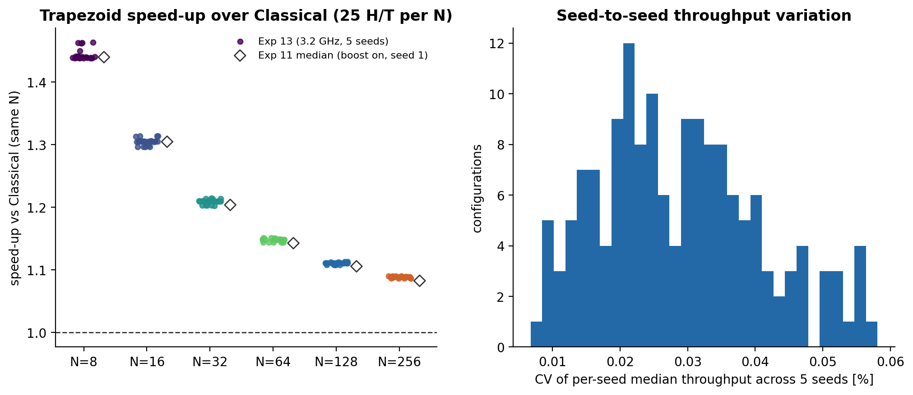
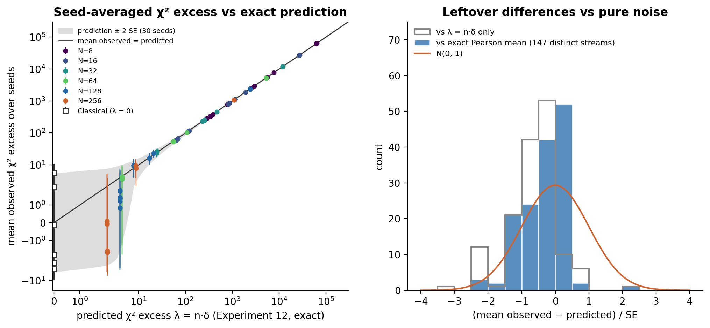
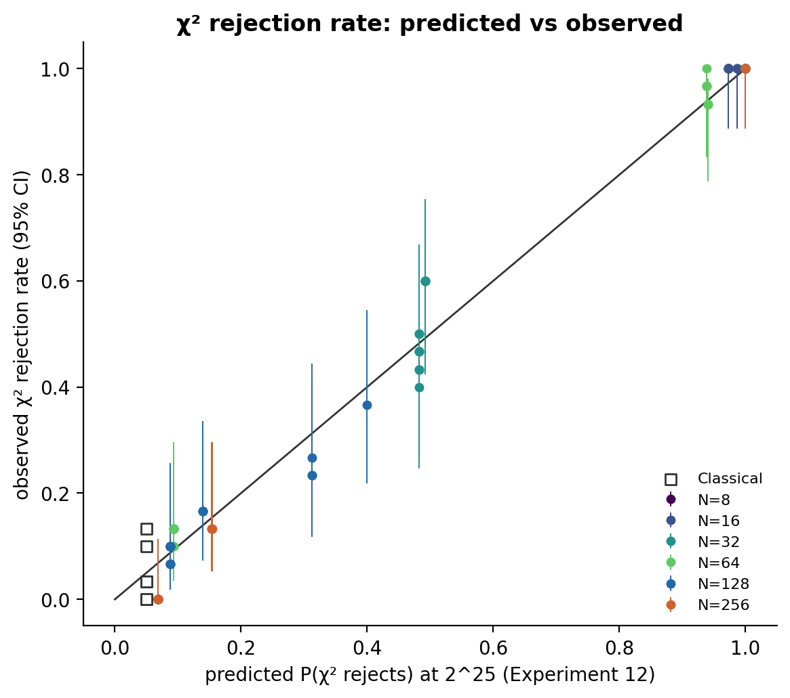
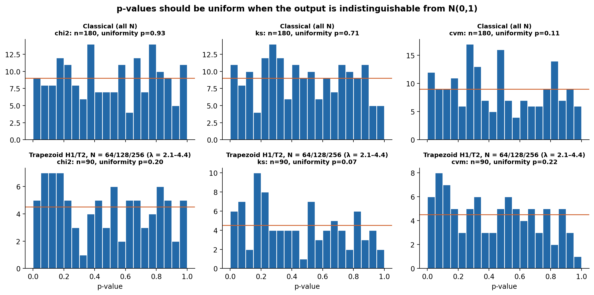
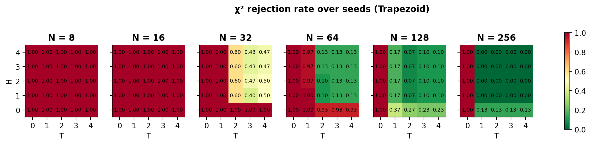
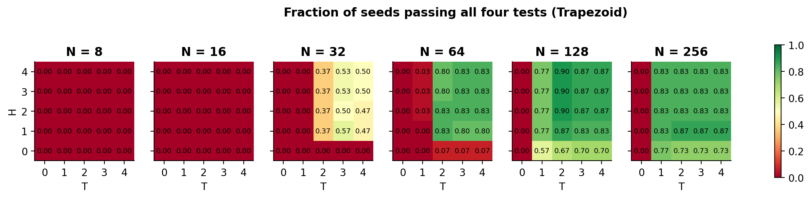
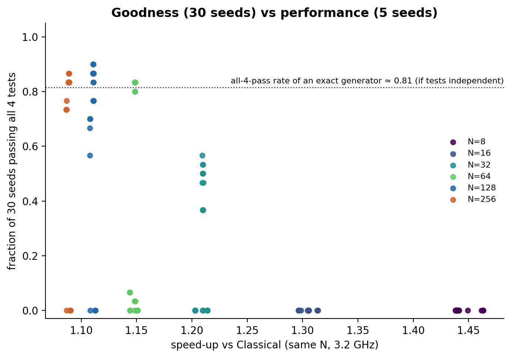

# Experiment 13: 30-seed repeat of the Experiment 11 grid

Experiment 11 ran each of the 150 Trapezoid configurations (N = 8–256, H = 0–4, T = 0–4) and Classical
Ziggurat with one seed. Experiment 12 then predicted, from the exact output distribution, how often each
configuration *should* fail the χ² test at 2^25 samples. Experiment 13 checks both with the real C
sampler, over many seeds:

- **Goodness:** every configuration with seeds 1–30, using the same four tests and bins as before
  (4,680 runs).
- **Performance:** seeds 1–5, with 5 timed repetitions each (3,900 runs).

Data: `experiments/results/experiment13/` (setup in `experiments/EXPERIMENT_13_README.md`). The
figures and tables in this report are regenerated by `analysis/analyze_experiment13.py`.

## Key findings

1. **The exact model is confirmed with 30 seeds.** For every one of the 141 distinct Trapezoid
   streams, the 30-seed mean χ² excess agrees with the exact prediction within 3 standard errors
   (138 of 141 within 2). The predicted χ² rejection probability lies inside the observed rate's 95%
   interval for all 141 (Figures 2 and 5). This holds from λ ≈ 2 up to λ ≈ 64,000.
2. **A small correction to Experiment 12's formula.** The exact mean of Pearson's statistic is
   (n−1)·δ + Σ(p−q)/q, not n·δ. The extra term ranges from −35 to +0.5. It matters only for large λ, where
   the observed excess is about 1–2% below n·δ. With λ alone, the z-scores were biased (mean −0.67,
   13 of 141 beyond 2 SE); with the exact mean they are centred (3 beyond 2 SE). Experiment 12's
   rejection probabilities are essentially unaffected: below λ ≈ 100 the correction is at most 2.2,
   less than one 30-seed standard error.
3. **Seed 1 was unlucky for N = 32 and N = 64, not wrong.**
   - **N = 64, H ≥ 1, T ≥ 2:** all 12 of these configurations failed χ² with seed 1 (p ≈ 0.01). Over
     30 seeds they pass all four tests 80–83% of the time, the same as Classical. Experiment 12
     predicted a χ² failure rate of 9%; the observed rate is 10–13%.
   - **N = 32, H ≥ 1, T ≥ 3:** these configurations pass 47–57% of the time, close to the 52%
     predicted. Seed 1 happened to fall on the failing side.
   - **No seed-1 pass was luck.** None of the 40 configurations that passed with seed 1 drops below a
     50% pass rate.
4. **H/T variants of the same N share one seed's luck.** All H/T variants of an N use the same
   uniforms and differ only in rare deep-level samples, so their test statistics move together. A
   single seed is effectively one draw for the whole block (for example, all 12 N = 64 blocks had χ²
   p ≈ 0.01 with seed 1). This is why one seed misjudged entire groups.
5. **Throughput is extremely reproducible.** Across seeds the variation in median throughput is at
   most 0.06% (median 0.03%). Every repetition reproduced its stream bit for bit.
   - **Speed-up at 3.2 GHz with boost off:** the speed-up over Classical at the same N is 1.44× at N=8,
     1.11× at N=128 and 1.09× at N=256.
   - **Comparison with Experiment 11:** this is within 0.6% of Experiment 11's boost-on ratios. Absolute
     throughput is about 25% lower because of the lower clock.
6. **The recommendation N = 128 H1/T2 stands.**
   - It passes all four tests for 87% of seeds, against 88% for Classical pooled.
   - Its mean χ² excess is 1.2 ± 2.6 (λ = 4.0).
   - It runs at 70.5 M samples/s, 1.11× Classical at the same N.
   - **Alternative:** N = 64 H1/T2 (1.15×, λ = 4.4) is just as good on χ², but its exact KS distance
     is 2.2× larger, its support ends at 5.74σ rather than 6.10σ, and its tail error at 3σ is 10×
     larger (see section 6).

## 1. Setup

| | Performance phase | Validation phase |
|---|---|---|
| Seeds | 1–5 | 1–30 |
| Runs | 156 configurations × 5 seeds × 5 repetitions = 3,900 | 156 × 30 = 4,680 |
| Samples | 2^25 (after 100,000 warm-up) | 2^25 |
| Uniforms | Precomputed xoshiro256+ (2 GiB per seed) | Inline xoshiro256+ (bit-identical stream) |
| CPU | Isolated CPU 7, `taskset`, shuffled order | 4 workers on the non-isolated CPUs |
| Duration | 6,022 s | 8,673 s |

- **Machine:** Ryzen 7 2700X; boost 0 and governor `schedutil` for both phases, with `scaling_max_freq`
  3.2 GHz. Boost could not be switched back on for validation because it needs `sudo`; validation is
  not timed, so this only affected its runtime.
- **Clock before each timed run:** median 3.20 GHz, range 1.72–3.33 GHz. The lowest readings come
  from `schedutil` ramping up at process start. The 0.03% seed-to-seed spread shows this did not
  affect the medians.
- **Tests:** Chi-square (100 bins over [−5, 5] plus 2 tail bins, df = 101), KS, CvM and AD against
  N(0,1) at α = 0.05, the same as Experiments 10–12.

## 2. Integrity checks (`tables/integrity_checks.json`)

| Check | Result |
|---|---|
| Timed runs with status ok | 3,900 / 3,900 |
| (configuration, seed) pairs whose 5 repetitions give the same checksum | 780 / 780 |
| Validation runs with status ok | 4,680 / 4,680 |
| Inline (validation) stream equals precomputed (timed) stream, seeds 1–5 | 780 / 780 |
| Seed-1 stream SHA-256 identical to Experiment 11 | 150 / 150 |
| χ² degrees of freedom | always 101 |
| Boost / isolated CPU / max frequency at every environment checkpoint | 0 / 7 / 3.2 GHz |

The C sampler is fully deterministic, and Experiment 13 reproduces Experiment 11 bit for bit at seed
1.

**Distinct streams.** Configurations whose extra head or tail levels are never reached in 2^25
samples produce identical streams for every seed. Of the 156 configurations, 147 give distinct
streams: 141 Trapezoid and 6 Classical. All counts below are over distinct streams unless stated.

## 3. Performance

*Figure 1. Left: speed-up over Classical at the same N for all 25 H/T per N. Each dot is the pooled
median over 5 seeds × 5 repetitions; diamonds show the Experiment 11 median. Right: seed-to-seed
coefficient of variation of the per-seed median throughput.*

| N | Classical [M/s] | Trapezoid median [M/s] | Speed-up (min–median–max) | Experiment 11 speed-up (median) |
|---|---|---|---|---|
| 8 | 35.09 | 50.51 | 1.438 – 1.439 – 1.463 | 1.440 |
| 16 | 45.59 | 59.51 | 1.296 – 1.305 – 1.314 | 1.305 |
| 32 | 53.90 | 65.20 | 1.203 – 1.210 – 1.214 | 1.204 |
| 64 | 59.71 | 68.58 | 1.144 – 1.148 – 1.151 | 1.143 |
| 128 | 63.43 | 70.46 | 1.108 – 1.111 – 1.113 | 1.106 |
| 256 | 65.67 | 71.50 | 1.087 – 1.089 – 1.090 | 1.083 |

- **Speed-up:** it depends on N and hardly at all on H/T. The spread within an N is at most 2%.
  The speed-up ratios agree with Experiment 11 to within 0.6% despite the clock change from about
  4.3 GHz to 3.2 GHz, so the ratio is a robust figure of merit. Absolute rates are about 25% lower
  than in Experiment 11; for example, Classical N=8 runs at 35.1 here against 46.6 M/s.
- **Seed dependence:** none in practice. The coefficient of variation across seeds is 0.007–0.058%.
  The seed changes which branch is taken on each sample, but not how often, so five seeds were more
  than enough.

## 4. Goodness vs the exact prediction

### 4.1 Mean χ² excess

*Figure 2. Left: 30-seed mean χ² excess (statistic − 101) against Experiment 12's λ = n·δ, with
±2 SE bars. Right: z = (mean observed − predicted) / SE, against λ alone (outline) and against the
exact Pearson mean (filled).*

**Exact mean of the χ² statistic.** For multinomial counts with true bin probabilities p and test
probabilities q, the exact mean of Pearson's statistic is

    E[X²] − df = (n − 1)·δ + Σ (p_i − q_i)/q_i,      δ = Σ (p_i − q_i)²/q_i.

Experiment 12 used only the leading term, λ = n·δ.

- **Size of the second term:** the Trapezoid puts slightly too little mass in the low-q tail bins,
  which makes the second term negative. It reaches −35 at N=8 and about −15 for the large-λ N=16
  configurations.
- **Effect on large-λ configurations:** at λ in the thousands, the second term is 1–2% of λ, which
  exceeds the 30-seed standard error. Measured against λ alone, 13 large-λ streams sat 2–3 SE low,
  and the z-scores had mean −0.67.
- **With the exact mean:** 138 of 141 streams are within 2 SE and all are within 3 SE (mean z −0.34,
  sd 0.63). The three streams beyond 2 SE are N=16 H0 with T = 1, 3 and 4, at z ≈ −2.2. Three
  results this size among 141 correlated z-values are unremarkable.
- **Spread of z:** the sd of 0.63 is below 1 because the 141 streams aren't independent (see 4.4) and
  because the noncentral-χ² SE is slightly conservative.
- **Low-λ configurations:** the second term is at most 2.2 in absolute value for every λ < 100,
  less than one 30-seed SE. Experiment 12's rejection probabilities and recommendations are
  essentially unchanged.

The column `mean_pred_exact` in `tables/goodness_by_config.csv` holds the exact mean; the λ-only
z-score is kept as `consistency_z_lambda`.

### 4.2 χ² rejection rate

*Figure 5. Observed χ² rejection rate over 30 seeds (Wilson 95% interval) against Experiment 12's
predicted P(reject).*

The prediction lies inside the observed 95% interval for all 141 distinct Trapezoid streams. This
holds across the whole range:

| Predicted P(reject) | Configurations | Observed rate |
|---|---|---|
| About 0.07–0.15 (N = 64–256, H ≥ 1, T ≥ 1) | | 0–17% |
| About 0.31–0.49 (N = 32, and N=128 H0) | N=128 H0 | 23–37% |
| | N=32 | 40–60% |
| ≥ 0.94 | | 93–100% |

### 4.3 Classical control

| | χ² | KS | CvM | AD | Pass all four |
|---|---|---|---|---|---|
| Classical, 6 N × 30 seeds | 5.0% | 6.1% | 6.7% | 6.1% | 87.8% |

- **Rejection rates:** at the 5% nominal level, as an exact generator should give. The six per-N mean
  excesses lie within ±2.2 SE of 0.
- **Pass-all baseline:** 88% is the realistic pass-all-four rate for an exact generator. It is above
  0.95⁴ = 0.81 because the four tests are positively correlated. This is the benchmark for the
  Trapezoid pass rates below.

*Figure 6. p-value histograms. Top: Classical, all N. Bottom: Trapezoid H1/T2 at N = 64, 128 and 256
(λ = 2.1–4.4). One configuration is shown per N because H/T variants of the same N are nearly the same
stream.*

The Classical p-values are uniform (KS uniformity p = 0.93, 0.71 and 0.11 for χ², KS and CvM). The
low-λ Trapezoid p-values are also consistent with uniform (p = 0.20, 0.07 and 0.22).

### 4.4 Why one seed misjudged whole blocks

*Figure 3. χ² rejection rate over 30 seeds per configuration.*

**Shared randomness.** All configurations at a given N and seed consume the same uniforms. They take
different paths only for the rare samples that reach a refined head or tail level, so their χ²
statistics differ by little more than the deterministic part λ.

**Consequence for seed 1.** With seed 1, the shared random part was large for N = 32 and N = 64: χ²
p ≈ 0.001–0.008 for the N=32 block and p ≈ 0.01 for the N=64 block. That failed every H ≥ 1, T ≥ 2
configuration at those N together. For N = 128 and 256 the seed-1 draw was ordinary.

**Implication:** single-seed results for neighbouring configurations are not independent evidence, so
a per-configuration pass/fail table from one seed can be wrong as a whole block.

## 5. Pass rates and changes from seed 1

*Figure 4. Fraction of the 30 seeds passing all four tests.*

| Group | Seed 1 (Experiment 11) | 30-seed pass-all rate | Experiment 12 P(χ² reject) |
|---|---|---|---|
| Classical (all N) | pass | 80–97% (pooled 88%) | 0.05 |
| N=256, H ≥ 1, T ≥ 1 | pass | 83–87% | 0.07 |
| N=128, H ≥ 1, T ≥ 2 | pass | 83–90% | 0.09 |
| N=128, H ≥ 1, T = 1 | pass | 77% | 0.14 |
| N=256, H = 0, T ≥ 1 | pass | 73–77% | 0.15 |
| N=128, H = 0, T ≥ 1 | pass | 57–70% | 0.31–0.40 |
| **N=64, H ≥ 1, T ≥ 2** | **fail** | **80–83%** | 0.09 |
| **N=32, H ≥ 1, T ≥ 3** | **fail** | **47–57%** | 0.48–0.49 |
| N=32, H ≥ 1, T = 2 | fail | 37% | 0.48 |
| N = 8 and 16, any N with T = 0, and N=64 with H = 0 or T ≤ 1 | fail | 0–7% | ≥ 0.93 |

- **Seed-1 passes:** all 40 configurations that passed with seed 1 pass at least 57% of the time
  over 30 seeds.
- **Seed-1 failures that mostly pass:** 18 configurations that failed with seed 1 pass in at least
  half of the seeds. These are the 12 N=64 and 6 of the N=32 configurations above.
- **Never passes:** 80 configurations fail in every one of the 30 seeds.
- **Indistinguishable from Classical at 2^25 samples:** 50 configurations reach a pass-all rate of at
  least 70%. These are N=64 to 256 with H ≥ 1 and T ≥ 2, plus N=256 with T ≥ 1.

## 6. Goodness vs performance

*Figure 7. Pass-all rate over 30 seeds against the speed-up over Classical. The dotted line marks
0.95⁴; the empirical Classical rate is 0.88.*

| Configuration | λ (Exp 12) | Mean χ² excess (30 seeds) | Pass all four | Throughput [M/s] | Speed-up |
|---|---|---|---|---|---|
| Classical N=128 | 0 | −4.4 ± 2.6 | 97% | 63.43 | 1.000 |
| N=64 H1/T2 | 4.42 | 3.6 ± 2.7 | 83% | 68.59 | 1.149 |
| **N=128 H1/T2** | **3.98** | **1.2 ± 2.7** | **87%** | **70.46** | **1.111** |
| N=128 H2/T2 | 3.98 | 0.8 ± 2.7 | 90% | 70.46 | 1.111 |
| N=256 H1/T2 | 2.10 | 0.1 ± 2.6 | 87% | 71.50 | 1.089 |

- **Speed-up and goodness:** within an N, goodness changes with H and T, but speed-up barely does.
  The goodness/speed trade-off is therefore set by N.
- **Fastest indistinguishable choice:** N=64 with H ≥ 1 and T ≥ 2 is the fastest setting that is
  indistinguishable from Classical at 2^25 samples, at 1.15×. Experiment 12 did not compute its full
  exact metrics because it failed with seed 1, so they were computed now with the same code
  (`experiment12.full_metrics`):

| Exact metric | N=64 H1/T2 | N=128 H1/T2 | N=256 H1/T2 |
|---|---|---|---|
| χ² divergence δ | 1.32×10⁻⁷ | 1.19×10⁻⁷ | 6.3×10⁻⁸ |
| n for 50% χ² power | 2^27.5 | 2^27.7 | 2^28.6 |
| KS distance (n to detect) | 3.4×10⁻⁶ (2^37.2) | 1.5×10⁻⁶ (2^39.5) | 8.0×10⁻⁷ (2^41.4) |
| Support | 5.74σ | 6.10σ | 6.44σ |
| P(\|X\| > 3) / true | 1.0020 | 1.0002 | 1.0000 |

- **χ² vs other metrics:** on χ², N=64 is almost as good as N=128. On KS, support and the 3σ tail it
  is clearly worse; its largest CDF error sits at 3.2σ, which is where tail-sensitive applications
  look.
- **Recommended choice:** N=128 H1/T2 remains the balanced choice. It is 11% faster than Classical,
  has a 2.2× smaller KS distance and a longer support than N=64, and needs half the table memory of
  N=256.
- **H and T beyond 1 and 2:** H > 1 or T > 2 add table memory but no measurable goodness at 2^25
  samples.

## 7. Conclusions and limitations

**Conclusions**

- **The C sampler matches its exact distribution.** Over 4,680 runs and 30 seeds, the real C sampler
  produces exactly the output distribution that Experiment 12 computes from its tables. With the
  exact Pearson mean, the model explains the χ² results of every configuration from λ ≈ 2 to 64,000.
- **Single-seed testing is unreliable near the detection limit.** It is especially unreliable across
  neighbouring configurations, which share one random draw. Experiment 11's seed-1 table rejected the
  whole N=64 H ≥ 1, T ≥ 2 block, which actually performs like Classical at 2^25 samples.
- **Throughput is stable and the ratio carries over.** Throughput is deterministic to within 0.06%
  across seeds, and the speed-up ratio carries over between clock settings.

**Limitations**

- **Not tested beyond 2^25 samples:** goodness was only tested at 2^25 samples. The ranking at larger
  n comes from Experiment 12's exact δ, now validated, not from direct tests.
- **Correlated configurations:** 30 seeds give about ±8 percentage-point uncertainty on each rate,
  and configurations sharing seeds are correlated. Differences of a few points between neighbouring
  H/T cells, for example 83% vs 87%, aren't meaningful.
- **Lower clock:** timing used the 3.2 GHz `schedutil` configuration with boost off, so absolute
  rates are lower than in Experiment 11. Compare ratios, not M samples/s.

## Files

| File | Contents |
|---|---|
| `tables/integrity_checks.json` | All checks in section 2, plus the environment at every checkpoint. |
| `tables/goodness_by_config.csv` | One row per configuration, with these columns: 30-seed mean and sd of χ² excess; per-test rejection rates; pass-all rate; Experiment 12 `delta_exact`, `lambda_pred` and `p_reject_chi2`; `mean_pred_exact`; z-scores; Wilson CI; `stream_group`; `seed1_passed_all`. |
| `tables/performance_by_config.csv` | Pooled median throughput, per-seed spread, CV, speed-up vs Classical, and Experiment 11's values. |
| `figures/fig1`–`fig7` | Figures 1–7 above. |
| `analysis/analyze_experiment13.py` | Regenerates everything here from `experiments/results/experiment13/`. |
