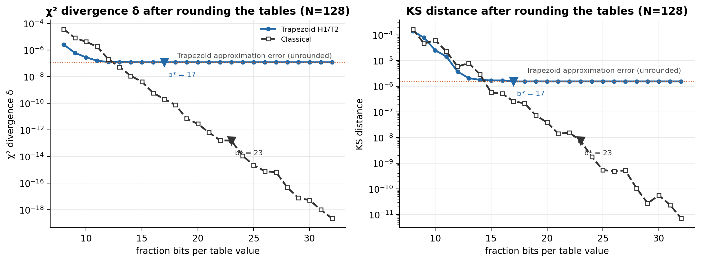
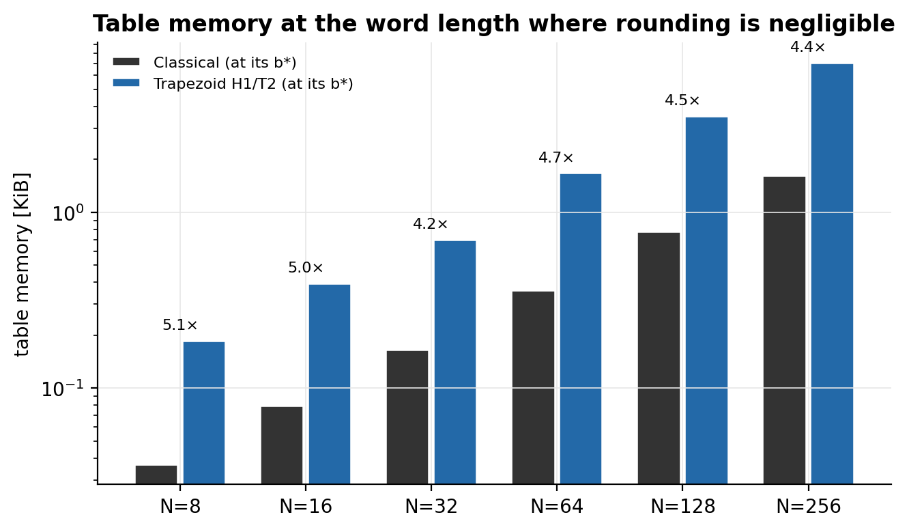
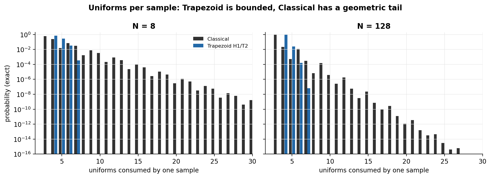
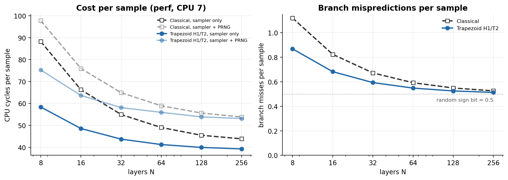
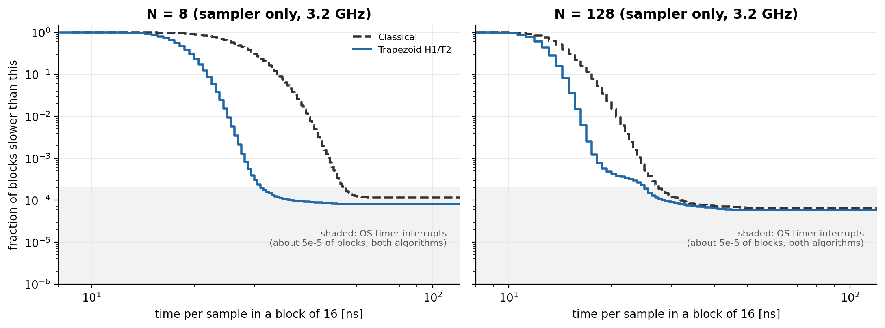
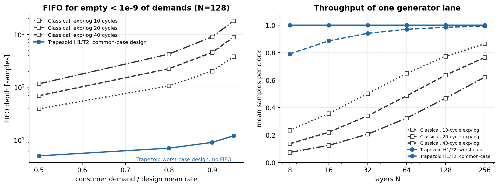

# Experiment 14: memory, per-sample cost consistency and a hardware throughput model

Experiments 10–13 established that the Trapezoid Ziggurat is slightly faster than Classical Ziggurat on
a CPU, and that its approximation error is known exactly. Experiment 14 asks what matters for a
hardware implementation:

- **A. Memory:** how much table memory each design needs, and at what word length.
- **B. Consistency:** how many uniforms a sample consumes, and how much the time per sample varies.
- **C. Throughput:** what one hardware generator lane would deliver per clock, and how large an
  output buffer it needs.

Data: `experiments/results/experiment14/` (setup in `experiments/EXPERIMENT_14_README.md`). The figures
and tables here are regenerated by `analysis/analyze_experiment14.py`.

## Key findings

1. **The Trapezoid needs about 4.5× more table memory at equal precision.**
   - **Word length:** rounding is negligible for N=128 H1/T2 at 17 fraction bits. Classical N=128
     needs 23 bits before its rounding error falls below 1% of the Trapezoid's error.
   - **Table size:** that is 3.6 KiB against 0.8 KiB, a ratio of 4.2–5.1× across N (Figure 2).
   - **Context:** in absolute terms both are small. 3.6 KiB fits in one or two FPGA block RAMs.
2. **The Trapezoid's cost per sample is bounded; Classical's is not.**
   - **Trapezoid N=128 H1/T2:** at most 7 uniforms per sample, mean 4.03.
   - **Classical N=128:** mean 3.06, but a geometric tail with no upper limit; 1 sample in 10⁶ needs
     12 or more uniforms.
   - **Verification:** the exact distributions match the measured counts over 2^25 samples for all 15
     configurations (Figure 3).
3. **On the real CPU the Trapezoid is faster and its timing spread is narrower.**
   - **Speed:** sampler only, it is 1.12–1.51× faster than Classical at the same N.
   - **Spread:** in blocks of 16, its 99.9th-percentile time per sample is 1.40–1.55× its median,
     against 1.59–1.88× for Classical.
   - **Small N:** at N=8, Classical's 99.99th percentile is 159 ns against 38 ns (Figure 4).
   - **With the PRNG included,** the advantage shrinks to 1.01–1.30×, because the Trapezoid consumes
     about one more uniform per sample.
4. **In a hardware model, one Classical lane gives 0.64 samples per clock and needs a FIFO of 456
   entries to hide its slow paths; one Trapezoid lane gives 1.0 with no FIFO.** Conditions: N=128,
   20-cycle `exp`/`log` units, 90% load, FIFO empty for fewer than 10⁻⁹ of demands.
   - **Trapezoid cost:** 104–118 PRNG bits per clock against 72.
   - **Trend:** Classical's FIFO grows roughly in proportion to the `exp`/`log` latency (Figure 6).
5. **Trade-off:** the Trapezoid exchanges about 4.5× more table memory and about 1.5× more random
   bits for no transcendental units, a hard bound on the work per sample and essentially no output
   buffer. When block RAM is cheaper than DSP blocks and a fixed sample rate is required, that is a
   favourable trade.

## 1. Setup

| Part | What | Configurations |
|---|---|---|
| A | Table size; rounding to b = 8–32 fraction bits; k-bit uniforms | All 150 Trapezoid + 6 Classical (KS and k for the shortlist) |
| B1 | Exact distribution of uniforms per sample, checked over 2^25 samples (seed 1) | Shortlist |
| B2 | `perf` counters and `rdtscp` block timing (B = 1, 16, 256) on isolated CPU 7, 2^25 samples, seed 1, 3 repetitions, precomputed and inline uniforms | Shortlist |
| C | Cycle-level model: one generator lane, output FIFO, random consumer | Shortlist |

**Shortlist:**
- Classical at N = 8–256.
- Trapezoid H1/T2 at N = 8–256.
- Trapezoid N=128 H0/T0, N=128 H4/T4 and N=256 H4/T4.

**Machine for B2:** Ryzen 7 2700X, boost 0, governor `schedutil`, CPU 7 isolated, timestamp counter at
3.20 GHz.

**Calculation parts (A, B1, C)** ran with boost on; they don't depend on the clock.

## 2. Integrity checks

| Check | Result |
|---|---|
| Unrounded Trapezoid law reproduces Experiment 12's δ (all 150 configurations) | max relative difference 1.2×10⁻⁹ (CSV precision) |
| Unrounded Classical law is exact | δ ≤ 3×10⁻²⁵, KS ≤ 6×10⁻¹⁶ for all N |
| Exact uniforms-per-sample distribution vs 2^25 measured samples | χ² p = 0.03–0.91 over 15 configurations (one below 0.05, as chance allows) |
| Exact mean uniforms per sample vs Experiment 13's `prng_calls_per_sample` | equal to 4–5 digits |
| Harness checksum = Experiment 13 seed-1 checksum | 15/15 (B1) and 90/90 timing runs (B2) |
| Timing runs ok / on CPU 7 / counters not multiplexed | 90/90 / 90/90 / 90/90 |
| FIFO solver vs 3-million-cycle simulation and vs a cycle-level chain | 0.1145 vs 0.1149; equal to 12 digits |

**One timing pass was disturbed:** repetition 1 of N=128 H1/T2 had a slow B=16 pass (18.5 ns per
sample against 12.66 ns in the other two). Its `perf` pass in the same process was normal. Timing
summaries therefore use the median over the three repetitions; per-run values are in
`timing_summary_by_run.csv`.

## 3. Memory and word length (A)

*Figure 1. Exact δ and KS distance after rounding every table value to b fraction bits, at N=128.
The dotted line is the Trapezoid's own approximation error; triangles mark b\*.*

**Trapezoid:** as b grows, its error falls quickly onto its approximation error (the floor) and stays
there. b\* is where rounding changes δ and KS by less than 1%.

**Classical:** its rounding error keeps falling by about 4× per bit, because it has no approximation
floor. Its b\* is where rounding error drops below 1% of the same-N Trapezoid's error; that is a fair
"equally good" standard. Matching the Trapezoid's error exactly (`b_match`) would need only 15 bits at
N=128.

| N | Classical b\* (b_match) | Classical table | Trapezoid H1/T2 b\* | Trapezoid table | Ratio |
|---|---|---|---|---|---|
| 8 | 16 (9) | 0.04 KiB | 14 | 0.19 KiB | 5.1× |
| 16 | 18 (12) | 0.08 KiB | 15 | 0.40 KiB | 5.0× |
| 32 | 19 (13) | 0.17 KiB | 13 | 0.70 KiB | 4.2× |
| 64 | 21 (14) | 0.36 KiB | 16 | 1.69 KiB | 4.7× |
| 128 | 23 (15) | 0.78 KiB | 17 | 3.56 KiB | 4.5× |
| 256 | 24 (16) | 1.63 KiB | 17 | 7.13 KiB | 4.4× |

*Figure 2. Table memory at each design's b\*. Ratios are Trapezoid / Classical.*

**What is counted:**
- **Trapezoid:** (1+H+T)·N entries of 3 values (a, w, d).
- **Classical:** N entries of 2 values (x, y), plus one probability.
- **Fixed point:** unsigned; integer bits 0 for a and p, 1 for y, 3 for w, d and x.

**Notes:**
- **Extra head and tail levels** add whole tables: N=128 H4/T4 needs 8.0 KiB (2.25× H1/T2) for no
  measurable gain in δ or KS. So the memory cost argues for H1/T2.
- **Across the full grid,** the Trapezoid's b\* by δ is 8–17 bits and grows with N; the median is 14
  at N=128 and 256.

**Uniform word length** (`uniform_bits.csv`, N=128 H1/T2):

| Uniform bits k | δ change | KS (vs 1.54×10⁻⁶ with double uniforms) |
|---|---|---|
| 16 | +3.0% | 7.6×10⁻⁶ (about 5× worse) |
| 24 | < 0.001% | 1.56×10⁻⁶ |
| 32 | < 10⁻⁷ | 1.54×10⁻⁶ |

- **Trapezoid:** 24-bit uniforms are enough, and its support (6.10σ) does not depend on k.
- **Classical:** k limits how far its tail can reach, because `log()` of a k-bit uniform is bounded.
  The reach is 6.7σ at k = 16, 8.3σ at k = 24 and 9.9σ at k = 32.

## 4. Uniforms per sample (B1)

*Figure 3. Exact probability that one sample consumes a given number of uniforms (log scale).*

| | Mean | SD | 99.9999th percentile | Upper limit |
|---|---|---|---|---|
| Classical N=8 | 3.70 | 1.25 | 21 | none |
| Classical N=128 | 3.06 | 0.37 | 12 | none |
| Trapezoid N=8 H1/T2 | 4.35 | 0.54 | 7 | 7 |
| Trapezoid N=128 H1/T2 | 4.03 | 0.16 | 6 | 7 |
| Trapezoid N=128 H0/T0 | 4.01 | 0.12 | 5 | 5 |
| Trapezoid N=128 H4/T4 | 4.03 | 0.16 | 7 | 9 |

**Classical's tail** comes from two sources:
- **Wedge rejections:** 11% of attempts at N=8 and 1.2% at N=128. Each one restarts the sample.
- **The base-layer tail loop:** its acceptance rate per try is 87–94%, so retries are occasionally
  needed.

**Trapezoid's bound:** one index draw per level descended, plus the a-test, plus 1 or 2 uniforms,
plus the sign, so at most 5 + max(H, T).

## 5. Cost and consistency on the CPU (B2)

*Figure 5. Cycles and branch misses per sample (`perf`, counters around the sampling loop only).*

| N | Classical, sampler only | Trapezoid, sampler only | Speed-up | Classical + PRNG | Trapezoid + PRNG | Speed-up |
|---|---|---|---|---|---|---|
| 8 | 27.60 ns | 18.25 ns | 1.51× | 30.56 ns | 23.53 ns | 1.30× |
| 16 | 20.72 | 15.19 | 1.36× | 23.75 | 19.90 | 1.19× |
| 32 | 17.19 | 13.68 | 1.26× | 20.30 | 18.17 | 1.12× |
| 64 | 15.33 | 12.90 | 1.19× | 18.42 | 17.49 | 1.05× |
| 128 | 14.22 | 12.50 | 1.14× | 17.39 | 16.84 | 1.03× |
| 256 | 13.72 | 12.29 | 1.12× | 16.84 | 16.61 | 1.01× |

**Throughput**
- **Comparison with Experiment 13:** the sampler-only ratios are about 2–3% higher than its 1.11×
  at N=128. The two harnesses use different loops; the inner loop and warm-up differ.
- **Instructions and IPC:** the Trapezoid executes slightly more instructions (80 against 73 per
  sample at N=128). It is faster because it has higher instructions per cycle (2.0 against 1.6): no
  `exp`/`log` calls, and the work is mostly independent arithmetic.
- **With the PRNG included,** its extra uniform per sample (4.03 against 3.06) costs about 4 ns and
  removes most of the gain. In hardware the PRNG is a separate block, so this becomes a cost in
  random bits, not in time.

**Branches and cache**
- **Branch misses:** 0.51–0.87 per sample for the Trapezoid and 0.53–1.12 for Classical. The floor of
  about 0.5 is the random sign bit, which no predictor can guess. Classical's excess at small N comes
  from wedge and rejection branches.
- **Cache:** no effect. With inline uniforms, L1 misses are at most 3×10⁻⁴ per sample even for
  N=256 H4/T4, whose tables (54 KiB) exceed the 32 KiB L1, because the deep levels are almost never
  touched. With precomputed uniforms, L1 misses are about 0.4–0.5 per sample, but that is the
  streaming uniform buffer: one miss per 8 uniforms.

*Figure 4. Fraction of 16-sample blocks slower than a given time per sample (sampler only, the
median repetition). The shaded band is operating-system timer interrupts; a block of 16 samples is
hit about once per 4 ms tick, which is about 5×10⁻⁵ of blocks for both algorithms.*

**Time per sample in blocks of 16 (sampler only)**

| | p50 | p99 | p99.9 | p99.99 | p99.9 / p50 |
|---|---|---|---|---|---|
| Classical N=8 | 26.9 ns | 43.1 | 50.0 | 158.8 | 1.86 |
| Trapezoid N=8 H1/T2 | 18.1 | 25.0 | 28.1 | 38.1 | 1.55 |
| Classical N=128 | 14.4 | 20.6 | 24.4 | 31.9 | 1.70 |
| Trapezoid N=128 H1/T2 | 12.5 | 16.3 | 18.1 | 28.8 | 1.45 |
| Classical N=256 | 13.8 | 19.4 | 21.9 | 30.6 | 1.59 |
| Trapezoid N=256 H1/T2 | 12.5 | 15.6 | 17.5 | 26.9 | 1.40 |

**Time by uniforms consumed** (B = 1, joint histogram; 10 ns timer resolution). A count can stand for
more than one path: for the Trapezoid, each level descended adds one uniform and the triangle adds one,
so 5 uniforms is either a triangle at the main level or a rectangle after one descent. Descents happen
in 2/N of samples (25% at N=8, 1.6% at N=128).

| Uniforms | Classical N=8 | Trapezoid N=8 H1/T2 |
|---|---|---|
| 3 | fast path: 62% of samples, 16 ns | — |
| 4 | `exp` wedge accepted, or base rectangle: 25%, 38 ns | rectangle, main level: 68%, 15 ns |
| 5 | first tail try accepted: 1.5%, 60 ns | triangle, or rectangle after one descent: 28%, 31 ns |
| 6 | one rejection, then fast path: 6.9%, 56 ns | one descent + triangle, or two descents: 3.3%, 45 ns |
| 7 | 3.0%, 78 ns | two descents + triangle (the maximum): 0.03%, 63 ns |
| 8–13+ | 1.4% of samples, 95–160 ns | impossible |

At N=128 the pattern is the same but compressed:
- **Classical:** 96.5% fast at 15 ns; 2.2% with 4 uniforms at 41 ns; 1.2% one rejection at 55 ns.
- **Trapezoid:** 97.5% at 15 ns; 2.5% at 31 ns; 0.02% at 6 uniforms.

**Interpretation:** on a CPU, Classical's distribution is wider mainly because of the `exp()` wedge
test and restarts. The Trapezoid's distribution has a hard edge at its longest path.

**Caveats:**
- **Timer resolution:** `rdtsc` on this CPU advances in 32-tick (10 ns) steps, and the timer overhead
  (96 ticks, 30 ns) is subtracted. B=1 numbers are therefore coarse; B=16 gives the per-sample
  spread.
- **Maximum times** of about 200 µs appear for every configuration. They are operating-system
  interrupts, not the algorithm.

## 6. Hardware throughput model (C)

*Figure 6. Left: FIFO depth needed for the consumer to find it empty fewer than 10⁻⁹ times, at N=128.
Right: mean samples per clock of one lane at 90% load. Model, not synthesis.*

**Design assumptions.** Each design produces one sample per clock on its fast path. The number of
random bits drawn per clock is fixed by the design. k = 32-bit uniforms; an index draw uses log2 N
bits; the sign uses 1 bit.

| Design | Slow paths | PRNG bits per clock (N=128) |
|---|---|---|
| Trapezoid, worst-case | none: bits for the deepest path are drawn every clock | 118 |
| Trapezoid, common-case | one extra clock per level descended (1.6% of samples at N=128) | 104 |
| Classical | wedge test: 1 + L clocks (`exp`); tail try: L + 1 clocks (two `log`s in parallel); a rejection restarts | 72 |

**Consumer:** it asks for a sample each clock with probability u × (the design's mean rate). The FIFO
is sized by the exact stationary distribution of the producer–FIFO chain.

**FIFO depth at N=128** (empty for fewer than 10⁻⁹ of demands):

| Load u | Classical L=10 | Classical L=20 | Classical L=40 | Trapezoid common-case | Trapezoid worst-case |
|---|---|---|---|---|---|
| 0.5 | 39 | 69 | 116 | 5 | 0 |
| 0.8 | 106 | 224 | 424 | 7 | 0 |
| 0.9 | 202 | 456 | 901 | 9 | 0 |
| 0.95 | 380 | 895 | 1,810 | 12 | 0 |

**Samples per clock of one lane:**

| N | Classical L=10 | L=20 | L=40 | Trapezoid common-case | Trapezoid worst-case |
|---|---|---|---|---|---|
| 8 | 0.24 | 0.14 | 0.07 | 0.79 | 1.00 |
| 128 | 0.77 | 0.64 | 0.47 | 0.98 | 1.00 |
| 256 | 0.86 | 0.76 | 0.62 | 0.99 | 1.00 |

**Classical:**
- **Throughput and FIFO:** its rate depends strongly on N and on the `exp`/`log` latency, and its
  FIFO grows roughly in proportion to the latency and sharply as the load approaches 1.
- **Equivalent buffer:** at 32-bit samples, 456 entries is about 1.8 KiB of buffer.
- **Per-lane memory:** that buffer comes on top of its tables, so its memory advantage per lane
  shrinks to roughly 2.6 KiB against 3.6 KiB at N=128, L=20.

**Trapezoid:**
- **Worst-case design:** one sample every clock with no buffer at all.
- **Common-case design:** gives up 1.6% of throughput at N=128 to save 14 PRNG bits per clock, and
  needs a FIFO of 9.

**PRNG bandwidth:** the Trapezoid consumes about 72 random bits per sample on average, against
42–55 for Classical.

**Limits of the model:**
- **No synthesis:** areas, maximum clock frequency and real `exp`/`log` latencies come from synthesis,
  and no FPGA tools are installed here.
- **Single lane:** a Classical design could run several lanes in parallel and merge them, which
  raises throughput and lowers FIFO depth. That costs more `exp`/`log` units and a merge stage; it is
  the natural next extension of this model.
- **Random demand:** the consumer is random (Bernoulli). A strictly periodic consumer would need
  somewhat smaller FIFOs.

## 7. Conclusions

**What the Trapezoid costs and what it buys**
- **Memory:** it needs about 4.5× more table memory than Classical at equal precision, roughly
  17-bit values in (1+H+T)·N·3 entries. H1/T2 is the right choice, since extra levels only add
  memory.
- **Random bits:** about 1.5× more per sample.
- **What it buys:**
  - a cost per sample bounded by the design (at most 7 uniforms at H1/T2), with no `exp` or `log`
  - a narrower timing spread on the real CPU, especially at small N
  - in a hardware model, one sample per clock with no output buffer, where a single Classical lane
    delivers 0.47–0.77 samples per clock at N=128 and needs hundreds of FIFO entries
- **On a CPU** the advantage is modest once PRNG cost is included (1.03× at N=128).

**When the trade is favourable:** when block RAM is cheaper than DSP blocks or transcendental units,
and when a guaranteed, steady sample rate matters more than the last few kilobytes of memory.

**Open items:**
- **Model:** add a multi-lane Classical design.
- **Competitor:** compare with inverse-CDF hardware generators, which also avoid rejection.
- **Synthesis:** confirm the model with FPGA synthesis.

## Files

| File | Contents |
|---|---|
| `tables/key_numbers.json` | Integrity numbers and the distribution of b\* by N. |
| `tables/perf_table.csv` | `perf` results per configuration and uniform mode. |
| `figures/fig1`–`fig6` | Figures above. |
| `analysis/analyze_experiment14.py` | Regenerates everything here from `experiments/results/experiment14/`. |
