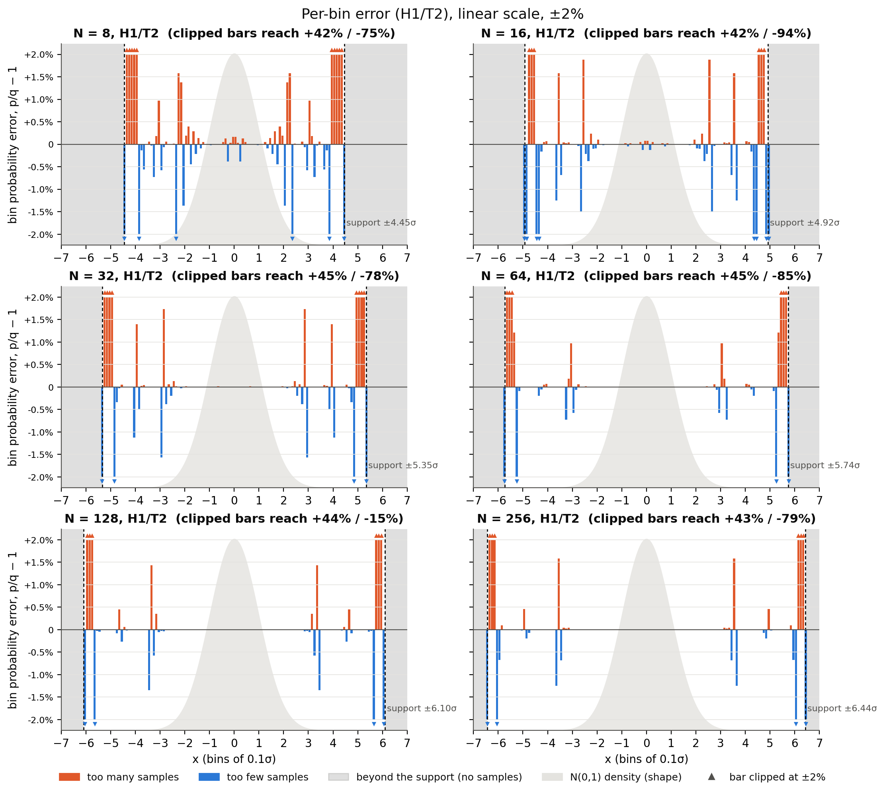
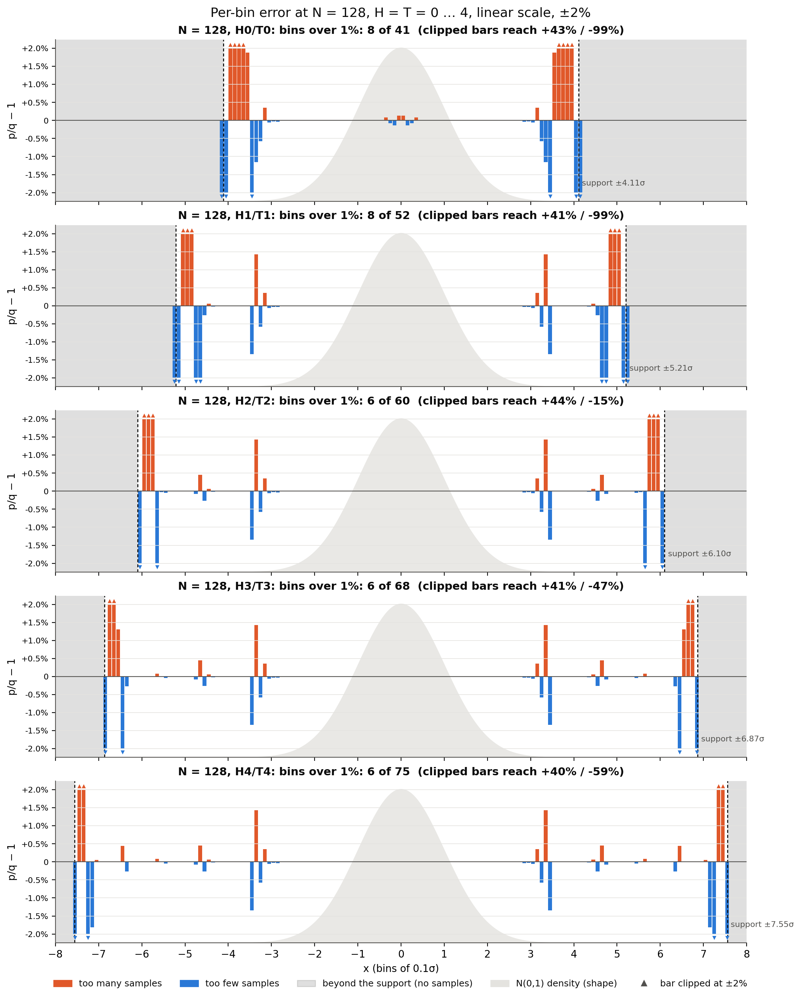

# Experiment 15: per-bin errors on a linear scale

This is a companion to section 6 of [report.md](report.md). It shows the same per-bin errors on a
**linear** axis, which is easier to read than the log scale used there.

- **Data:** the exact Trapezoid law, binned in 0.1σ bins and centred at 0. Each bar is how much
  more (orange) or less (blue) probability the bin gets than under N(0,1): p/q − 1.
- **Range:** the axis is fixed at **±2%**, which shows the body, shoulder and tail clusters at
  full height.
- **Clipping:** the few bars beyond ±2% are clipped and marked with a triangle. Each panel title
  gives the largest clipped value. These are always the bins at the support edge.
- **Beyond the support:** the shaded gray region; the generator produces no samples there.
- **Reference:** the light bell is the N(0,1) density, to show where the probability is.
- **Source:** both figures come from `analysis/bin_errors.py`, using `tables/bin_errors_0p1.csv`.

## Every N, recommended configuration (H1/T2)

- **N = 8.**
  - Many bins across the whole range are off by 0.5–1.6%.
  - The support ends at 4.45σ.
- **N = 16 and N = 32.**
  - The centre (−2σ to 2σ) becomes almost flat.
  - The error concentrates in isolated spikes of 1–2% at the base of each table: around 2.6σ and
    3.6σ at N=16, and around 2.9σ and 4.0σ at N=32.
- **N = 64 to 256.**
  - From −2.5σ to 2.5σ the bars are invisible at this scale (below 0.012%).
  - What remains is a pair of spikes of about ±1–1.6% in the shoulder (3–3.6σ), a smaller pair of
    0.2–0.46% further out (4.3–4.9σ), and the clipped edge bins just inside the support.
- **The edge** is the same at every N: a few bins of +40–45%, then nothing.
  - It is the only place where the error is large.
  - It is also where the Gaussian has almost no probability: at N=128, 2^33 samples are needed to
    see it.

## N = 128 with head and tail refinement, H = T = 0 … 4

- **H0/T0.**
  - The centre shows a small head wobble (about ±0.15%).
  - The region from 3.5σ to the support (4.11σ) is badly off: clipped at +43% and −99%.
- **H1/T1.**
  - The head wobble disappears.
  - The shoulder error shrinks to one pair of 1.4% spikes at 3.3–3.4σ.
  - The support moves to 5.21σ.
- **H2/T2.**
  - The centre and shoulder are the same as H1/T1.
  - One more small pair appears at 4.5–4.6σ (≤ 0.45%).
  - The support is at 6.10σ.
- **H3/T3 and H4/T4.** Everything inside ±5.5σ is unchanged (to 10⁻¹⁰). Each level adds one more
  small pair (≤ 0.5%) further out and moves the support, with its clipped edge, about 0.7σ outwards.

## How large is "too large"?

A percentage alone does not say whether an error matters. What matters is whether a test can see
it with the number of samples drawn. A bin with probability q and relative error ε becomes visible
after roughly n ≈ 4 / (q·ε²) samples:

| Bin (0.1σ wide) | q | 1% error visible after | 0.1% error visible after |
|---|---|---|---|
| centre, 0σ | ≈ 0.08 | about 5×10⁵ (2^19) | about 5×10⁷ (2^26) |
| shoulder, 3.3σ | ≈ 3.5×10⁻⁴ | about 1×10⁸ (2^27) | about 1×10¹⁰ (2^33) |
| tail, 5σ | ≈ 3×10⁻⁷ | about 1×10¹¹ (2^37) | about 1×10¹³ (2^43) |

That is why the clearly visible 1.4% spikes at 3.3σ (N=128 H1/T2) are exposed only after about
2^26–2^28 samples. The +44% edge bins need far more, about 2^33, because they hold so little
probability.

For comparison:
- **A good uniform PRNG and the exact Gaussian methods built on it** (such as the Classical
  Ziggurat) show no detectable deviation up to terabytes of output, roughly 2^40 and beyond.
- **The Trapezoid design N=128 H1/T2** is statistically indistinguishable from N(0,1) up to about
  2^27.7 samples (100-bin χ²) and 2^39.5 (KS).
  - That is enough for applications drawing up to about 10⁸ samples.
  - Longer runs need a larger N: the body error falls roughly as N^−1.37.
