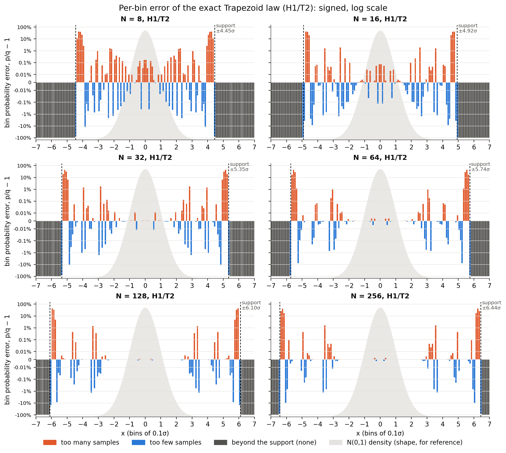
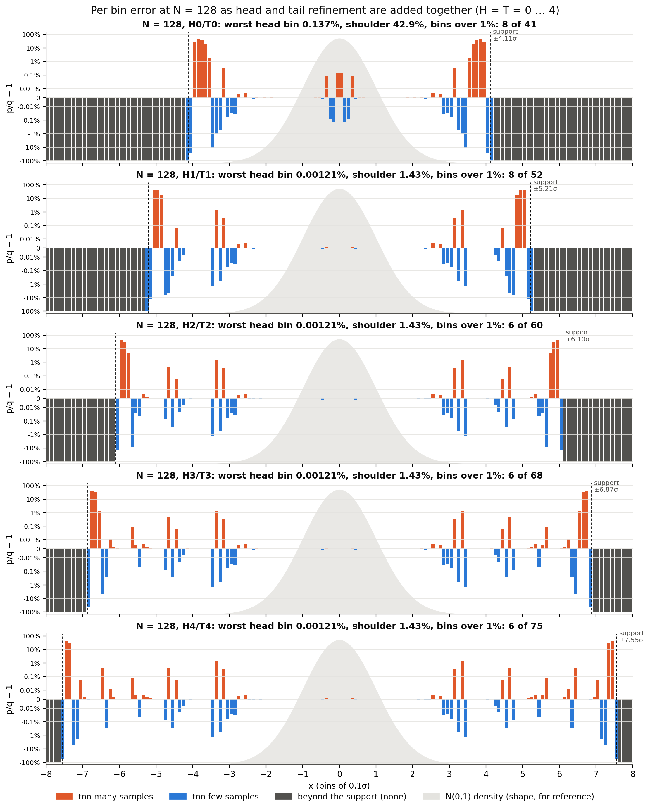
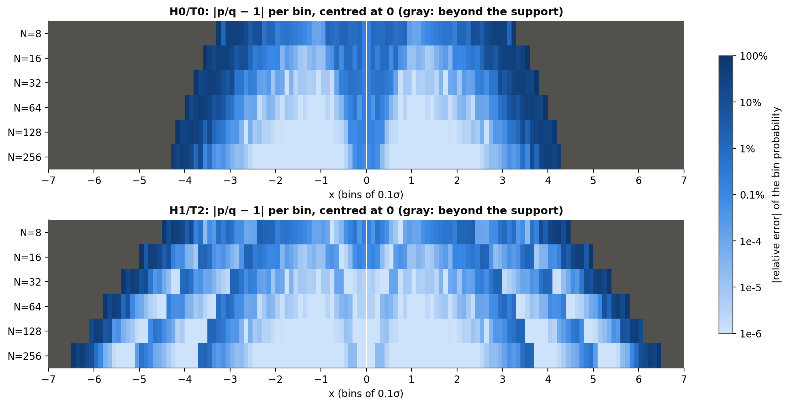
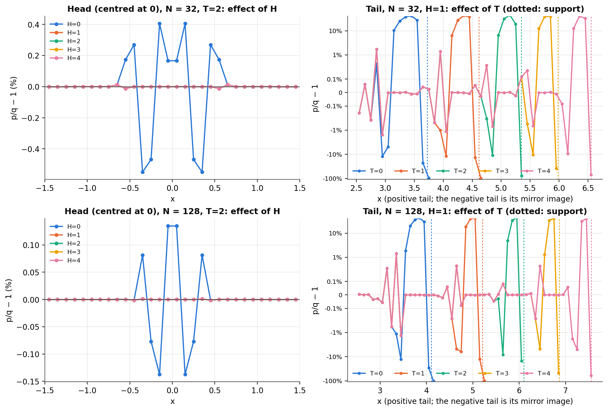
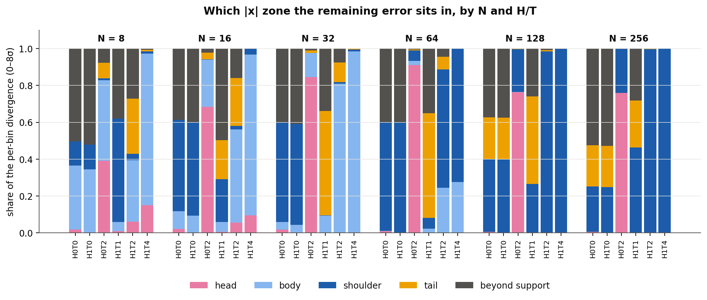
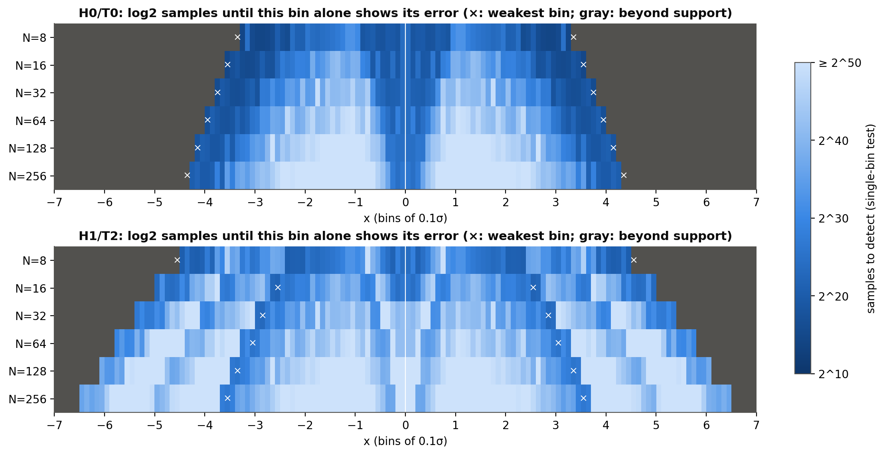

# Experiment 15 report: exact tail reach and refinement gains over the full grid

All 150 Trapezoid configurations (N = 8…256, H = 0…4, T = 0…4) were analysed exactly from the C tables,
with no sampling. The values agree with Experiment 12 to ≤ 1e-9 wherever both exist. Data:
`experiments/results/experiment15/`; tables and fits: `tables/`; figures: `figures/`.

## 1. Tail reach depends only on M = N^(T+1)

The support edge, and with it every tail metric, is a function of M = N^(T+1) alone. Configurations with
the same M have identical support to within 1.8e-15: for example, N=8/T=3, N=16/T=2 and N=64/T=1 all
stop at 4.923σ. This is exact, not approximate. The tail path descends T+1 levels and each level keeps
1/N of the remaining area, so the last leaf strip always holds a fraction 1/M of the Gaussian. The
fitted law (fig. 1) is

&nbsp;&nbsp;&nbsp;&nbsp;**2Q(support) ≈ 10^-2.16 · M^-1.07**

so each extra tail level pushes the expected out-of-support probability down by about a factor of N.

| N (H≥1) | T=0 | T=1 | T=2 | T=3 | T=4 |
|---|---|---|---|---|---|
| support, N=64 | 3.92 | 4.92 | 5.74 | 6.44 | 7.07 |
| 1%-reliable reach, N=64 | 3.18 | 4.35 | 5.25 | 6.01 | 6.68 |
| support, N=128 | 4.11 | 5.21 | 6.10 | 6.87 | 7.55 |
| 1%-reliable reach, N=128 | 3.41 | 4.67 | 5.64 | 6.47 | 7.19 |
| support, N=256 | 4.29 | 5.48 | 6.44 | 7.27 | 8.01 |
| 1%-reliable reach, N=256 | 3.62 | 4.97 | 6.01 | 6.89 | 7.67 |

(Full table, including tolerance 10%: `tables/tail_reach_by_N_T.csv`.)

**The reliable reach is about 0.4–0.5σ inside the support, not at it.** Just before the cliff, the tail
mass ratio overshoots by **+8.4% to +9.7%** in every configuration (fig. 5). The last leaf trapezoid
places the whole remaining tail mass inside [x_last, support], so mass that belongs beyond the support
shows up just before it. H has no effect on the tails.

## 2. Reach for a given sample count

A tail-count test compares the number of samples with |x| > t (t ≥ 2) with its normal expectation.
`tail_budget` is the smallest n at which any such test reaches 50% power; below it, no tail
deviation is detectable.

| N, H=1 | T=0 | T=1 | T=2 | T≥3 |
|---|---|---|---|---|
| 64 | 2^15.3 | 2^22.0 | 2^27.0 | 2^27.0 |
| 128 | 2^16.4 | 2^24.2 | **2^28.2** | 2^28.2 |
| 256 | 2^17.6 | 2^26.3 | 2^29.4 | 2^29.4 |

For T ≤ 1 the binding test is at the support edge, so the true tail limits the budget. From T=2 onward
(N ≥ 64) the binding test moves to about **3.2–3.6σ**, the bottom of the unrefined body layers, and stays
there for any further T. Past that budget, the reliable reach R(n) shrinks toward 3σ (N=128 H1/T2:
R = ∞ at 2^28, 3.19 at 2^32, 2.98 at 2^36). This happens because of the body error near 3.4σ, not the
tail. At N=128 H1/T2 the tail budget (2^28.2) is close to the χ² detection size (2^27.7), so this
configuration is balanced: neither the tail nor the body is the clear weak point.

## 3. What H and T refinement buy

D-reduction factors (D before / D after adding one level), from `tables/refinement_gain_factors.csv`:

| N | +T: 0→1 | +T: 1→2 | +T: 2→3 | +T: 3→4 | +H: 0→1 (at T=2) | +H: 1→2 |
|---|---|---|---|---|---|---|
| 32 (H=1) | 44.6× | 5.0× | 1.09× | 1.00× | 5.7× | 1.02× |
| 128 (H=1) | 114.7× | 2.2× | 1.01× | 1.00× | 4.2× | 1.00× |

- **T=1 is the big win** (45–115× in D): it removes the coarse bottom-strip error at 3–5σ.
  **T=2 saturates D** for N ≥ 32. Further levels change D by ≤ 9% (N=32), ≤ 2% (N=64) and ≤ 1% (N ≥ 128) but add 0.7–0.8σ of tail reach each,
  plus one table and one more uniform per tail sample.
- **H=1 is necessary and sufficient.** Without it, the top strip near x=0 holds 60–80% of D after the
  tail is refined (fig. 4), and the KS distance stays at its T=0 value (59e-6 for N=128 regardless of
  T). With H=1, KS drops 38× to 1.5e-6 at N=128 T≥1. H≥2 changes D by ≤ 2% for N ≥ 32 (up to 7% at N=16 and 23% at N=8) and never
  changes the tails.
- **Kurtosis** is a tail-sensitive moment check: T=0 has error −4.0e-3 at N=128, T=1 −3.9e-5, T=2 −8e-6.

## 4. The floor is the unrefined body, and only N lowers it

At H≥1, T≥3, about 98% of the remaining D sits at 2–4σ (N=128: 95% at 3–4σ). That is the trapezoid-fit
error of the root layers, which neither H nor T refine. The saturated floor follows

&nbsp;&nbsp;&nbsp;&nbsp;**D_floor ≈ 10^-3.64 · N^-1.37**  (H1/T4: 1.6e-5 at N=8 down to 1.3e-7 at N=256)

so doubling N divides the floor by about 2.6.

## 5. Design rules

1. Use **H = 1**. It removes the head error (KS) completely; more head levels do nothing.
2. Use **T = 2** for distribution quality. Add tail levels only to extend reach: each level adds about
   0.7–0.8σ and divides 2Q(support) by about N.
3. Choose **N** for the body floor (D ∝ N^-1.37) and the sample budget (2^27–2^29 for N = 64–256).
4. Quote the reliable reach as **support − about 0.45σ** (1% tail-mass tolerance), not the support itself.

For the recommended **N=128 H1/T2**: support 6.10σ, 1%-reliable reach 5.64σ, tail budget 2^28.2,
χ² detection 2^27.7, KS detection 2^39.5, table values 2568. With **T=4** the reach grows to 7.19σ
(support 7.55σ) at the cost of 2 more tables, with no change in D.

## Figures

1. `fig1_tail_reach_law.png`: support and 1% reach versus log2 N^(T+1); all N fall on one curve.
2. `fig2_divergence_heatmaps.png`: log10 D over H × T for each N.
3. `fig3_refinement_gain.png`: D and KS versus T for H=0 and H=1.
4. `fig4_divergence_by_region.png`: share of D by |x| region for selected H/T at N=64 and 128.
5. `fig5_tail_ratio_curves.png`: P(|X|>t)/P(|Z|>t) for T=0…4 at N=64 and 128 (H=1).
6. `fig6_bin_error_by_N.png` to `fig10_bin_detect_samples.png`: per-bin errors (section 6).

## 6. Per-bin errors by N, H and T (added 2026-11-12)

Sections 1–5 summarise the error as one number per region. This section shows it **bin by bin**:
the probability of |X| falling in each 0.1σ-wide bin, compared with N(0,1).

**Method:**
- Bin probabilities are differences of the exact survival P(|X| > t) stored in `tail_curves.csv`.
  No new computation was needed.
- Rebuilding the 100 χ² bins this way reproduces the stored `delta_binned` to every printed digit.
- Script: `analysis/bin_errors.py`. Tables:
  - `tables/bin_errors_0p1.csv`: every configuration × bin, giving p, q, p/q − 1, the bin's
    χ² term, and the single-bin detection size.
  - `tables/bin_error_summary.csv`: zone summaries per configuration.
- **Zones:** head |x| < 0.5, body 0.5–3, shoulder 3–4, tail 4 to the support. The tail is
  further split into the inner tail and the edge (the last 0.5σ before the support).
- **Single-bin detection size:** the number of samples at which that one bin's count is off by
  1.96 binomial standard deviations. It is a per-bin view of "how visible is this error".

### What the bins show

*Figure 6. Signed per-bin error p/q − 1 for H1/T2, from −7σ to 7σ and centred at 0, log scale both
ways: orange means too many samples, blue too few, gray means no samples at all (beyond the
support). The light bell is the N(0,1) density, for orientation. The law is symmetric, so each
negative bin mirrors its positive one.*

*Figure 6b. N = 128 with head and tail refinement added together, H/T = 0/0 to 4/4, same scale
as Figure 6 (−8σ to 8σ).*

Reading Figure 6b from top to bottom:
- **H0/T0.** The support ends at ±4.11σ.
  - The bins from 3.5σ to the support are off by +10% to +43%, then fall to −100%.
  - The head bins around 0 are off by about ±0.1%.
  - 8 of 41 bins exceed 1%.
- **H1/T1.** Both problems shrink at once.
  - The head bins drop to about 0.001%.
  - The old shoulder error collapses into a narrow cluster at 3.3–3.4σ (1.4%).
  - The support moves to ±5.21σ.
- **H2/T2.** The body from −3σ to 3σ is identical to H1/T1, because a second head level changes
  nothing at N=128.
  - The tail gains a small cluster at 4.5–4.6σ (≤ 0.45%).
  - The support moves to ±6.10σ.
  - 6 of 60 bins exceed 1%.
- **H3/T3 and H4/T4.** Every bin inside ±5.5σ stays the same as at H2/T2, to within 10⁻¹⁰.
  - Each extra level only adds one more small cluster at the base of the new tail table, and
    moves the support (and its +40% overshoot) out by about 0.7σ, to ±6.87σ and ±7.55σ.
  - The number of bins over 1% stays at 6.

So past H1/T2, refinement buys reach, not accuracy: the error pattern near the centre is fixed by N.

*Figure 7. |p/q − 1| per bin for every N, centred at 0: without refinement (H0/T0, top) and
recommended (H1/T2, bottom).*

1. **The error is not spread evenly. It sits in clusters at the base of each table.** At H1/T2
   with N ≥ 64:
   - bins from 0.5σ to 2.5σ are accurate to 0.012% (N=64), 0.0011% (N=128) and 0.0001% (N=256);
   - the error gathers in three places: the bottom of the root table (the shoulder, 3–3.5σ), the
     bottom of the first tail level (about 4.3–4.9σ, up to 0.2–0.46%), and the last bins before
     the support.
   - The bottom strips of each table cover the steepest relative fall of the Gaussian, so a
     straight trapezoid edge fits them worst.
2. **The edge always overshoots by about +40–45%, then drops to −100%.** In every configuration,
   the last trapezoid holds all of the remaining tail mass inside the support. Its last bins
   therefore carry too much, and everything beyond carries nothing.
   - These bins hold very little probability, so the overshoot is hard to see.
   - At T=2 the edge needs 2^20.7 samples to show at N=8, 2^33.4 at N=128 and 2^36.2 at N=256
     (single-bin test).
   - Each extra tail level pushes it about log2 N further: at N=128 with T=4 it needs 2^47.9.
3. **The body floor does not shrink with N in relative terms; it moves outwards.**
   - The largest shoulder error at T ≥ 1 is about 1–1.6% for every N ≥ 32 (N=32 1.4%, N=64 0.97%,
     N=128 1.43%, N=256 1.58%).
   - It sits further out as N grows (2.8σ → 3.5σ), where the Gaussian has less probability.
   - So it needs more samples to expose: 2^23.1 (N=32) to 2^26.6 (N=256).
   - This is why D, which weights errors by probability, falls with N even though the worst
     relative error does not (section 4).

### Number of bins with a visible error (H1/T2, bins fully inside the support)

| N | bins inside | \|p/q − 1\| > 1% | > 0.1% | weakest single bin (samples to expose) |
|---|---|---|---|---|
| 8 | 44 | 10 | 25 | 2^20.5 at 4.5σ |
| 16 | 49 | 10 | 17 | 2^21.7 at 2.5σ |
| 32 | 53 | 9 | 14 | 2^23.1 at 2.8σ |
| 64 | 57 | 5 | 10 | 2^25.7 at 3.0σ |
| 128 | 60 | 6 | 10 | 2^25.9 at 3.3σ |
| 256 | 64 | 6 | 10 | 2^26.6 at 3.5σ |

At N ≥ 64 only 5–6 bins exceed 1%:
- **N=64:** all 5 are edge bins (its shoulder peaks at 0.97%).
- **N=128 and N=256:** two shoulder bins (±1.3–1.6%) and four edge bins.

The weakest single bin at N=128 (2^25.9) is consistent with the full χ² test needing 2^27.7: the χ²
test spreads its power over 100 bins, so it needs a little more.

### What H changes: the head

*Figure 8. Left: head bins (−1.5σ to 1.5σ, centred at 0) for H = 0…4 at T=2. Right: positive-tail
bins for T = 0…4 at H=1, with each T's support dotted (the negative tail mirrors it).*

| N | largest head error (\|x\| < 0.5), H=0 | H=1 | H=2 |
|---|---|---|---|
| 8 | 1.43% | 0.383% | 0.029% |
| 16 | 0.92% | 0.129% | 0.0022% |
| 32 | 0.55% | 0.0005% | 0.0002% |
| 64 | 0.38% | 0.005% | 0.005% |
| 128 | 0.14% | 0.0012% | 0.0012% |
| 256 | 0.13% | 0.0022% | 0.0022% |

- **Without H, the head is the weakest part of a tail-refined design.** At H0/T2 with N ≥ 32 the
  weakest bin is at 0.1–0.4σ (2^20.6–2^24.7 samples). The head also holds 76–91% of the χ²
  divergence (Figure 9).
- **H=1 removes the head error.** It falls 3.7× at N=8, 7× at N=16, 1,100× at N=32 and 60–110× at
  N ≥ 64. The weakest bin then moves to the shoulder, and the samples needed to expose the design
  rise by a factor 2^1.4–2^4.1 (N=128: 2^24.5 → 2^25.9; N=64: 2^21.6 → 2^25.7).
- **H ≥ 2 changes nothing from N=64 up**, because the remaining error in the first 0.5σ comes from
  ordinary body strips that H does not touch. At small N it still helps.
- **The head error depends on N^(H+1)**, just as the tail depends on N^(T+1) (section 1). N=8 with
  H=1 has exactly the head error of N=64 with H=0 (0.383%), and N=16 with H=1 that of N=256 with
  H=0 (0.129%): the refined top strip is the same shape.

### What T changes: the shoulder and the tail

| N | shoulder (3–4σ), largest error: T=0 | T=1 | T=2 | bin 4.0–4.1σ: T=0 | T=1 | T=2 | bin 5.0–5.1σ, T=2 | inner tail, T=2 |
|---|---|---|---|---|---|---|---|---|
| 8 | 65.5% | 96.2% | 12.2% | none (beyond support) | none | +22.7% | none | — |
| 16 | 99.1% | 36.7% | 1.6% | none | +43.2% | +0.066% | none | 8.5% |
| 32 | 95.8% | 1.0% | 1.4% | none | −12.0% | −1.13% | +31.1% (edge) | 1.1% |
| 64 | 96.2% | 0.97% | 0.97% | none | +0.066% | +0.066% | −0.013% | 0.20% |
| 128 | 42.9% | 1.43% | 1.43% | −28.8% | −0.0005% | −0.0005% | −0.0002% | 0.45% |
| 256 | 36.7% | 1.58% | 1.58% | +43.2% (edge) | −0.00002% | −0.00002% | −0.019% | 0.46% |

"None" means the bin lies beyond the support (p = 0, error −100%).

- **T=0 is unusable beyond about 3.5σ.** The shoulder bins are off by 37–99%, and the support
  ends at 3.3–4.3σ.
- **T=1 fixes the shoulder for N ≥ 32**, bringing it to about 1%, the body floor. It is
  the largest single improvement in the whole grid.
- **T=2 makes the 4–5σ bins accurate**: at N ≥ 64, bins at 4σ and 5σ are within 0.07% and 0.02%.
  The inner tail (4σ to 0.5σ before the support) stays within 0.2–0.46%.
- **T ≥ 3 adds reach, not accuracy.** At T=4 the inner tail error is still 0.45–0.68% for
  N ≥ 64. The extra levels only move the edge overshoot further out, where it needs far more
  samples to expose (N=128: 2^33.4 at T=2 → 2^47.9 at T=4).

### Where the remaining error sits

*Figure 9. Share of the per-bin divergence Σ(p − q)²/q (0–8σ) in each zone.*

| Configuration | dominant zone |
|---|---|
| H0/T0 | beyond the support (37–53%), plus the shoulder (25–60%; 13% at N=8, where the body has 35%) |
| H1/T0 | the same: H alone does not help while the tail is unrefined |
| H0/T2 | the head (68–91% for N ≥ 16) |
| H1/T2 | N=8: body, tail and beyond the support (33 / 30 / 27%); N=16–32: the body (51–81%); N ≥ 64: the shoulder (64% at N=64, 98–100% at N ≥ 128) |
| H1/T4 | the body at N ≤ 32 (82–99%), the shoulder at N ≥ 64 (72–100%); tail and edge ≤ 1% |

*Figure 10. Samples needed for each bin on its own to show its error (darker = weaker), for H0/T0
and H1/T2, centred at 0. × marks the weakest bin of each N, on both sides. At H0/T0 it is the bin containing the support:
without tail refinement, the missing mass beyond the support is the easiest error to see.*

### Summary

- **N** sets how far out the body floor sits, and so how many samples expose it. Its largest
  relative error stays at about 1–1.6%.
- **H=1** removes the head error (7–1,000×). Without it, the head is the weakest region once the
  tail is refined.
- **T=1** removes the shoulder error, and **T=2** makes 4–5σ accurate to ≤ 0.07% (N ≥ 64).
  Beyond that, T only moves the support and its +40–45% edge overshoot outwards, making the
  overshoot exponentially harder to see.
- **For N=128 H1/T2,** 6 of 60 bins inside the support exceed 1%: two at 3.3–3.4σ and four at the
  5.6–6.0σ edge. Bins from 0 to 3σ are within 0.03%, and from 3.5 to 5.5σ within 0.45%.
