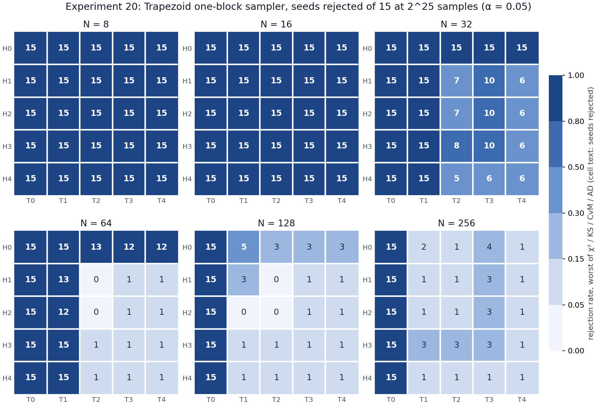

# Experiment 20, phase 1: goodness of fit of the one-block Trapezoid sampler (15 seeds)

**Sampler:** `zt_gaussian_philox_1call`, which uses exactly one Philox2x64-10 block per sample for
every H/T (Experiment 16, section 8).

**Setup:**
- Grid: N = 8…256, H = 0…4, T = 0…4 (150 configurations), 2^25 samples per run.
- Tests: χ², KS, CvM and AD against a fixed N(0,1) at α = 0.05, the same test code and bins as
  Experiments 11 and 13.
- Machine: 8 workers, one pinned to each core; boost 0 (3.2 GHz).
- Two runs, merged:

| Run | Seeds | Runs | Time | Failures |
|---|---|---|---|---|
| main | 1–5 | 750 | 13 min | 0 |
| extra | 6–15 | 1,500 | 26 min | 0 |

Every run used exactly 1.000000 Philox blocks per sample. Classical is not validated: its rejection
step makes it exact whatever the PRNG quality.

**Checks before each run:**
- Philox known-answer tests: pass.
- One-call map against its plain reference: 0 mismatches.
- Pipeline check: rerunning Experiment 13's row `trap_N128_H2_T4`, seed 1, gave the identical stream
  digest and p-values.

## Result

Each cell shows the number of seeds (of 15) rejected by the worst of the four tests. The color is
that number as a rate.

Labels are per test. Under a true N(0,1), each run rejects with probability 0.05, so a cell is labelled:
- **rejected** if P(≥ k of 15) < 0.001, i.e. k ≥ 5;
- **borderline** if P(≥ k of 15) < 0.05, i.e. k = 3–4;
- **consistent** otherwise (k ≤ 2).

| N | Rejected | Borderline | Consistent | Reading |
|---|---|---|---|---|
| 8, 16 | 25 / 25 | 0 | 0 | every configuration is detectable at 2^25 |
| 32 | 25 | 0 | 0 | H0 and T ≤ 1: 15/15. H ≥ 1 with T ≥ 2: 5–10/15, at the detection edge (Experiment 15: χ² 50% detection at 2^25.0) |
| 64 | 13 | 0 | 12 | H ≥ 1 with T ≥ 2: 0–1/15. H0, or T ≤ 1: 12–15/15 (χ²) |
| 128 | 6 | 4 | 15 | T0: 15/15. H0 with T ≥ 1: 3–5/15. **H ≥ 1 with T ≥ 1: 0–3/15**; H1/T2 and H2/T1: 0/15 on all four tests |
| 256 | 5 | 6 | 14 | T0: 15/15. All others 1–4/15; the T3 row and H3 row have 3/15, all three from seeds 1–5 |

**Agreement with Experiment 13** (30 seeds, original sampler, xoshiro256+): in 143 of 150
configurations, "rejected" here matches "Experiment 13 rejection rate ≥ 50%". The 7 disagreements:

- **N = 32, H ≥ 1, T = 3–4 (6 configurations):** 6–10/15 here against 40–47% in Experiment 13. Both
  put these configurations at the detection edge.
- **N = 128, H0/T1:** 5/15 here (5 by χ²) against 37% in Experiment 13. Same reading: H0 leaves the
  body error near 0 unrefined, and it is just detectable at 2^25.

## The N = 256 cells at 3/15

- **Where the rejections come from.** All of them are χ² rejections (p = 0.008–0.03), and all come
  from seeds 1–5. Seeds 6–15 gave 0 χ² rejections in these cells.
- **Why six cells show the same count.** For a given seed, configurations with the same number of
  index fields, 1 + max(H, T), have the same bit layout. Their streams are therefore nearly
  identical, so the six cells (T3 row, H3 row) are one draw shown six times.
- **A separate follow-up.** Seeds 6–25 on N = 256, H ∈ {1, 3}, T ∈ {1, 2, 3} rejected 0–2 of 20 per
  test, the 5% rate.
- **Theory.** Experiment 15 puts χ² 50% detection at 2^28.6 for N = 256, 8× more samples than
  tested, so every N = 256 configuration with T ≥ 1 should reject at about the false-alarm rate.
  Experiment 13 had 0–13% for the same configurations.
- **Conclusion:** chance, not a defect. N = 256 is at least as accurate as N = 128.

## Reading

- The one-block sampler's goodness of fit matches the original sampler's (Experiment 13) and the
  exact predictions (Experiment 15). Taking the descent indices from word A, which shortens the
  decision field to D = 23–53 bits, has no detectable effect at 2^25.
- **N = 128, H1/T2, the recommended configuration:** 0 rejections in 60 tests (15 seeds × 4 tests).
- What passes at 2^25:

| N | Passes at 2^25 with |
|---|---|
| ≤ 32 | nothing: every H/T is detectable |
| 64 | H ≥ 1 and T ≥ 2 |
| 128 | H ≥ 1 and T ≥ 1 (H0 is borderline) |
| 256 | T ≥ 1 |

## Files

- Data: `experiments/results/experiment20/validation/` (seeds 1–5) and
  `experiments/results/experiment20_seeds6_15/validation/` (seeds 6–15). Each holds
  `validation_raw.csv` and `metadata.json` (machine state, build commands, C tests, pipeline check).
- Configs: `experiments/experiment20.yaml` and `experiments/experiment20_seeds6_15.yaml`.
- Table: `tables/goodness_by_config.csv` (rejections per test, Fisher p-values, label, Experiment 13
  rates, Experiment 15 detection size).
- Analysis: `analysis/analyze_validation.py`, which merges both runs.
- Figure: `figures/rejection_grid.png` and `.svg`.
