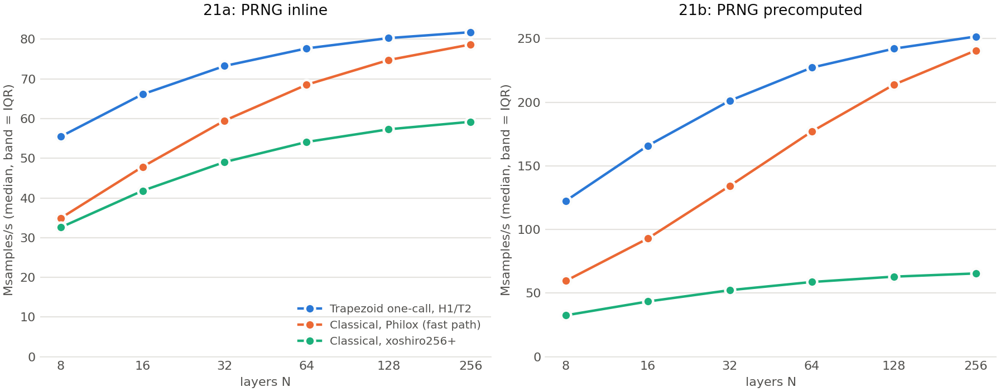
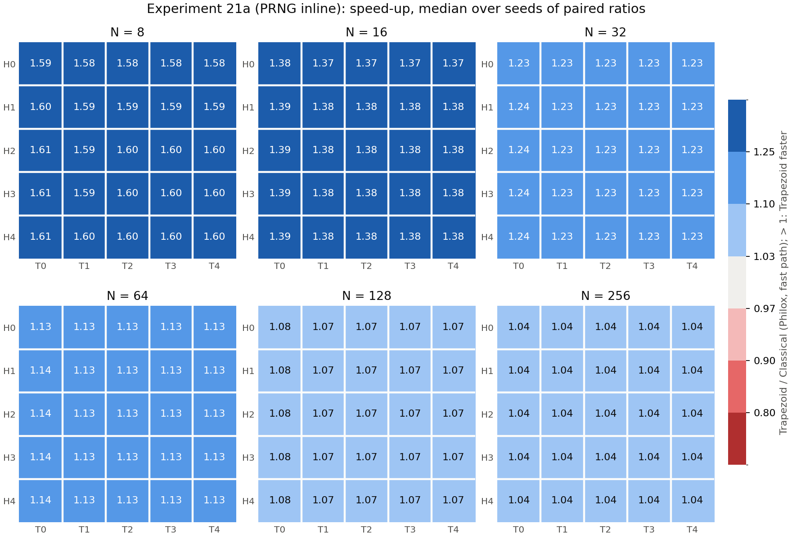
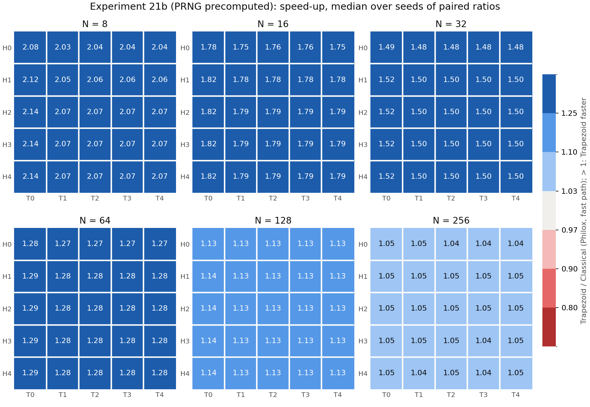

# Experiment 21: timing of the one-block Trapezoid against Classical (21a inline, 21b precomputed)

Experiment 21 is the repeated, isolated-core timing of the one-block Trapezoid sampler
(`zt_gaussian_philox_1call`; its goodness of fit is Experiment 20) against two Classical
Ziggurat samplers. It has two parts with the same grid, seeds and machine state; they differ
only in where the uniform random numbers come from:

- **21a, PRNG inline.** Philox2x64-10 (or xoshiro256+) runs inside the timed loop. This is
  the end-to-end cost of a sample on this CPU.
- **21b, PRNG precomputed.** The same stream is generated into a buffer before timing, and
  the timed loop only reads it. This isolates the sampler's own work, which is the closer
  model of hardware where the PRNG is a separate, pipelined unit.

The streams are bit-identical in both parts. All 24,300 21b timings have the same checksum
as the matching 21a timing, and that checksum equals the Experiment 20 stream.

## Setup

| | |
|---|---|
| Samplers | Trapezoid one-block (`trapezoid_1call`), N in {8..256}, H, T in {0..4} (150 configs) |
| | Classical, Philox2x64-10, fast path (`classical_philox_fast`): the fair comparison |
| | Classical, xoshiro256+ (`classical_xoshiro`): the original Exp 10–14 general sampler, no fast path; historical reference only |
| Grid | 162 configurations x 30 seeds x 5 repetitions = 24,300 timings per part |
| Samples | 2^25 timed samples per timing, after 100,000 warm-up samples; the stream is reset to the seed after warm-up, so every repetition times the identical stream |
| Processes | 21a: one timing per process (24,300 processes); 21b: 5 timings per process (4,860 processes, one buffer fill each) |
| Order | processes shuffled (seed 2026) across configurations and seeds |
| Machine | Ryzen 7 2700X; CPU 7 isolated (`isolcpus=domain,managed_irq,7`, `irqaffinity=0-6`), boost off, governor performance, 3.2 GHz; SMT off |
| Build | `gcc -O2`, one binary per part (`-DPHILOX_PRECOMPUTED -DXOSHIRO_PRECOMPUTED` for 21b) |
| Run | 21a: 4.01 h, 21b: 2.78 h, 2026-11-10; 0 failed; Tctl 50–54 °C throughout; code at 7171301 plus the Exp 21 harness |

Statistics: for each configuration and seed, the median over its 5 repetitions. Speed-up =
Trapezoid / Classical throughput, paired by seed at the same N. The reported value is the
median over the 30 seeds, with a 95% bootstrap interval over seeds. Cycles = 3.2 GHz /
throughput.

## Results

### Recommended configuration (H1/T2) against Classical

| N | 21a Trapezoid | 21a Classical Philox fast | **21a speed-up** | 21b Trapezoid | 21b Classical Philox fast | **21b speed-up** |
|---|---|---|---|---|---|---|
| 8 | 55.5 Ms/s (57.7 cyc) | 34.9 (91.7 cyc) | **1.589** [1.589, 1.589] | 122.5 (26.1 cyc) | 59.6 (53.7 cyc) | **2.056** [2.055, 2.057] |
| 16 | 66.1 (48.4) | 47.9 (66.9) | **1.382** [1.382, 1.382] | 165.8 (19.3) | 92.9 (34.4) | **1.785** [1.782, 1.786] |
| 32 | 73.3 (43.7) | 59.5 (53.8) | **1.232** [1.231, 1.232] | 201.2 (15.9) | 134.3 (23.8) | **1.499** [1.498, 1.500] |
| 64 | 77.7 (41.2) | 68.5 (46.7) | **1.134** [1.134, 1.134] | 227.2 (14.1) | 177.0 (18.1) | **1.284** [1.283, 1.285] |
| 128 | 80.3 (39.9) | 74.8 (42.8) | **1.074** [1.074, 1.074] | 242.1 (13.2) | 213.8 (15.0) | **1.133** [1.132, 1.133] |
| 256 | 81.8 (39.1) | 78.7 (40.7) | **1.039** [1.039, 1.040] | 251.7 (12.7) | 240.7 (13.3) | **1.046** [1.045, 1.046] |

Throughput is the median in Msamples/s; brackets give the 95% interval over seeds.

Against the original Classical xoshiro256+ sampler, Trapezoid H1/T2 is 1.38–1.70x faster in
21a and 3.77–3.87x faster in 21b. The 21b gap is mostly that sampler's design: it draws a
separate uniform for the sign and has no fast path, so it uses about 3.0–3.7 outputs per
sample. Read its column as the Exp 10–14 baseline, not as a statement about xoshiro.

### Full H/T grid

Range of the speed-up over Classical Philox fast across all 25 H/T settings:

| N | 21a | 21b |
|---|---|---|
| 8 | 1.576 (H0/T1) – 1.610 (H4/T0) | 2.031 (H0/T1) – 2.138 (H3/T0) |
| 16 | 1.371 – 1.391 | 1.755 – 1.822 |
| 32 | 1.226 – 1.236 | 1.481 – 1.517 |
| 64 | 1.131 – 1.136 | 1.273 – 1.293 |
| 128 | 1.073 – 1.076 | 1.128 – 1.139 |
| 256 | 1.039 – 1.041 | 1.044 – 1.050 |

Trapezoid is faster than Classical in all 300 configuration-and-part cells. Within a given N,
H/T changes the speed by at most 5% (N=8, 21b) and by under 1% from N=64 up. Refinement is
nearly free in time because the one-block layout never draws another block for it: refinement
reuses index bits already in word A. H/T can therefore be chosen on accuracy alone
(Experiments 15 and 20), and H1/T2 stays the recommendation.

## Interpretation

1. **The advantage is in the sampler, and inline PRNG cost dilutes it.** The cycle columns
   split cleanly. At N=128, Trapezoid costs 39.9 cycles inline against 13.2 precomputed,
   so one Philox2x64-10 block costs about 27 cycles here. Classical costs 42.8 against
   15.0, a 27.8-cycle difference for 1.013 blocks per sample: the same block cost. Both
   samplers pay the same ~27 cycles for random bits. Trapezoid wins on the remaining
   sampler work (13.2 vs 15.0 cycles at N=128; 26.1 vs 53.7 at N=8). Inline, this
   difference is a smaller fraction of the total, so the speed-up shrinks: N=128 goes from
   1.13x to 1.07x.
2. **Classical's cost at small N comes from rejection, not extra bits.** In 21b Classical
   Philox fast uses 1.147 blocks per sample at N=8, only 15% more bits than Trapezoid's 1.
   Yet it takes 2.06x the time. The extra cost is the rejection path: the wedge test and the
   branch mispredictions around it. Trapezoid has no rejection, so its cost per sample is
   nearly flat. With more layers Classical rejects less (1.007 blocks per sample at N=256),
   and the two converge.
3. **For hardware, 21b is the more relevant number.** A hardware PRNG runs as its own
   pipeline, so the sampler's own work sets the rate. On a CPU that work is 1.13x
   (N=128) to 2.06x (N=8) smaller for Trapezoid. The CPU result understates the hardware
   argument (bounded latency, no rejection loop, no exp/log in the slow path; see the
   paper argument), because a CPU hides some of Classical's branching with speculation.
4. **Agreement with Experiment 16.** Exp 16's single runs (inline, 1call vs Classical fast)
   gave 1.58, 1.37, 1.21, 1.12, 1.06 and 1.02x. 21a gives 1.59, 1.38, 1.23, 1.13, 1.07 and
   1.04x, within 0.02 everywhere.

## Noise and integrity

| | 21a | 21b |
|---|---|---|
| Timings | 24,300, 0 failed | 24,300, 0 failed |
| Checksum identical within seed (all repetitions) | yes | yes |
| Checksum identical between 21a and 21b | 24,300 / 24,300 | |
| SD of seed medians, % of median (median over configurations) | 0.02% | 0.14% |
| Within-seed SD, % (median over configurations) | 0.60% (between processes) | 0.07% (within a process) |
| Largest IQR, % of median | 0.19% | 0.38% |

The confidence intervals are about ±0.001 because the run-to-run noise on the isolated core
is small. The noise has one irregular part: occasional slow processes.

- **21a:** 362 of 24,300 timings (1.5%) are more than 3% below their configuration median.
  Their median is 0.74x the configuration median, and the slowest is 0.51x.
- **21b:** 37 of 4,860 processes (0.8%) are slow in all 5 of their repetitions alike,
  at 0.38–0.97x. A typical example is `trap1_N256_H4_T1` seed 24, which ran 101 Msamples/s
  five times against a median of 251. This one process drives the largest between-seed SD
  in 21b (15% for that configuration).

The slow processes are not caused by the seed or the code:

- Their buffer-fill time before timing is normal, so the core ran at full speed.
- Rerunning `trap1_N256_H4_T1` with seed 24 eight times gave 251–253 Msamples/s every time,
  the same as seed 5.
- They occur in all variants roughly in proportion to how often each variant runs, and at
  all hours of the run.
- Transparent huge pages are `madvise`-only, and the harness does not request them.

The most likely cause is the physical memory placement of the process's buffers and tables
(cache-set conflicts), which changes from process to process and stays fixed within one.
All statistics are medians, first over the repetitions of a seed and then over the seeds.
A slow process can shift at most one seed's value. Removing every timing more than 3% below
its configuration median changes no speed-up by more than 0.0001 (21a) or 0.0004 (21b),
across all 150 Trapezoid configurations.

## Files

- Harness: `experiments/experiment21_bench.c`; precomputed hooks in `c/philox2x64.h` and
  `c/xoshiro256plus.h` (`*_step()` is the generator; `*_next()` reads the buffer under
  `-D*_PRECOMPUTED`; the buffer ends in a guard page).
- Driver and configs: `experiments/experiment21.py`, `experiments/experiment21a.yaml`,
  `experiments/experiment21b.yaml`, `experiments/EXPERIMENT_21_README.md`.
- Raw data: `experiments/results/experiment21{a,b}/timing_raw.csv`, `metadata.json`
  (machine state, temperatures, build command, binary hash), `config.yaml`.
- Analysis: `reports/experiment21/analysis/analyze_experiment21.py`; tables
  `throughput_by_config.csv`, `speedup_by_config.csv` (both Classical references, with
  intervals), `noise_by_config.csv`, `integrity.csv`.
