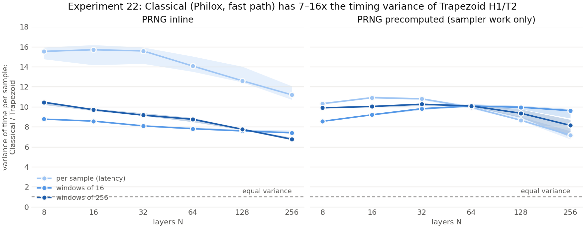
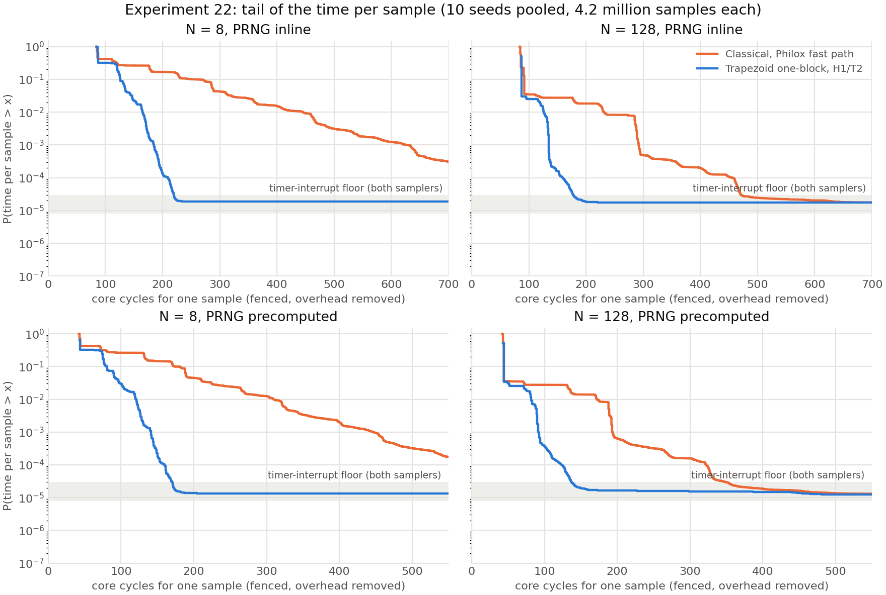

# Experiment 22: consistency of the time per sample, Trapezoid one-block against Classical

Experiments 16 and 21 compared the *mean* throughput of the two samplers. Over a long run the
means differ by a few percent at large N. This experiment measures how much the time per
sample *varies*, which decides whether a sample can be relied on to arrive in a fixed time.

**Result:** the variance of Classical's time per sample is **7–16× that of Trapezoid H1/T2**.
This holds at every N from 8 to 256, with the PRNG inline or precomputed, for single samples
and for windows of 16 and 256 samples. The ratio is stable across seeds, with 95% intervals
of ±0.04 to ±1.0.

## Setup

| | |
|---|---|
| Samplers | Trapezoid one-block (`zt_gaussian_philox_1call`), H1/T2 (recommended) and H0/T0 (no refinement); Classical, Philox2x64-10, fast path (`zb_gaussian_philox_fast`) |
| N | 8, 16, 32, 64, 128, 256 |
| Uniform modes | **inline**: Philox runs inside the timed region. **precomputed**: blocks generated outside timing into a 256 KiB buffer that stays in L2, refilled (untimed) every 8192 samples |
| What is timed | **window 1**: every sample separately, fenced with `lfence` on both sides, so samples do not overlap: the *latency* of one sample. **windows of 16 and 256**: consecutive samples run as in a normal loop, and the window is timed: the *throughput* over a short stretch |
| Timer | core-cycle counter read with `rdpmc`, user mode only. It counts real core cycles at any clock frequency, has 1-cycle resolution, and does not count cycles spent in interrupt handlers. The 66-cycle cost of a fenced read pair is calibrated in each process and subtracted |
| Samples | 4,194,304 per run at window 1; 16,777,216 at windows 16 and 256; 100,000 warm-up |
| Grid | 3 samplers × 6 N × 2 modes × 3 windows × 10 seeds = 1,080 runs, shuffled order, 0 failed |
| Machine | CPU 7 isolated, governor performance; **boost on** (about 4.2 GHz; switched on before the run and recorded). Cycle counts do not depend on the clock, and every buffer read is from L2, in the core clock domain. Tdie 53 → 74 °C over the 4.7 min run |

Statistics: per run, the mean, variance, quantiles and maximum of cycles per sample (window
cycles / W). Variance ratio = Classical variance / Trapezoid variance, paired by seed; the table
gives the median over the 10 seeds with a 95% bootstrap interval.

## Results

### Variance ratio, Classical / Trapezoid H1/T2

| N | inline, per sample | inline, W=16 | inline, W=256 | precomputed, per sample | precomputed, W=16 | precomputed, W=256 |
|---|---|---|---|---|---|---|
| 8 | **15.6** [14.8, 16.0] | 8.8 | 10.5 | 10.3 | 8.6 | 9.9 |
| 16 | **15.7** [14.2, 16.2] | 8.6 | 9.7 | 10.9 | 9.2 | 10.1 |
| 32 | **15.6** [14.3, 16.0] | 8.1 | 9.2 | 10.8 | 9.8 | 10.3 |
| 64 | **14.1** [13.5, 15.1] | 7.8 | 8.8 | 10.0 | 10.1 | 10.1 |
| 128 | **12.6** [12.5, 14.0] | 7.6 | 7.8 | 8.7 | 10.0 | 9.4 |
| 256 | **11.2** [10.7, 12.1] | 7.4 | 6.8 | 7.2 | 9.6 | 8.2 |

Intervals for every cell are in `tables/variance_ratio.csv`; the lowest single-seed ratio in
the whole grid is 6.6.

### Time per sample, N = 128, inline (median over seeds, core cycles)

| | mean | SD | p99.9 | Classical / Trapezoid SD |
|---|---|---|---|---|
| Trapezoid H1/T2, per sample | 87.5 | 7.1 | 135 | |
| Classical, per sample | 89.7 | 25.2 | 289 | 3.6× |
| Trapezoid H1/T2, W=16 | 41.7 | 2.4 | 53.3 | |
| Classical, W=16 | 44.2 | 6.7 | 77.6 | 2.7× |
| Trapezoid H1/T2, W=256 | 39.5 | 0.60 | 42.2 | |
| Classical, W=256 | 41.7 | 1.68 | 47.8 | 2.8× |

The means differ by 2–6%; the spread differs by about 3× in SD, i.e. about 8–13× in variance.
Every configuration is in `tables/consistency_by_config.csv`.

### Slow samples

Fraction of samples that take more than 2× or 3× the median time (per-sample timing; the
medians are the same for both samplers: 86–87 cycles inline, 44 precomputed):

| N | Classical, > 2× | Trapezoid, > 2× | Classical, > 3× | Trapezoid, > 3× |
|---|---|---|---|---|
| inline, 8 | 26% | 0.23% | 10% | 0.0019% |
| inline, 128 | 2.8% | 0.0039% | 0.83% | 0.0018% |
| inline, 256 | 1.5% | 0.0025% | 0.44% | 0.0017% |
| precomputed, 8 | 27% | 7.3% | 19% | 0.16% |
| precomputed, 128 | 2.8% | 0.51% | 2.2% | 0.0048% |
| precomputed, 256 | 1.5% | 0.33% | 1.3% | 0.0036% |

With the PRNG inline at N=128, about **1 in 36 Classical samples takes more than twice the
typical time, against 1 in 26,000 for Trapezoid**. Beyond 3× the median, Trapezoid's
fraction (about 1.8×10⁻⁵) is the timer-interrupt floor shared by both samplers (below), so
Trapezoid has essentially no slow samples of its own.

## Interpretation

1. **The cause is the rejection loop, not the table size.** Trapezoid's paths are finite:
   rectangle, wedge, and at most max(H, T) refinement levels, all on the one block already
   drawn. Classical's slow path costs about 4× its fast path (`exp()` wedge test, 50.5 against
   11.9 cycles, per-path measurement), and every rejection starts the whole sample again with
   a new block. Its time is a geometric mixture with no upper bound.
2. **Larger N narrows the gap but does not close it.** Classical's slow-path probability falls
   from 12.8% (N=8) to 0.7% (N=256), so its variance falls; the ratio is still 7–11× at N=256.
3. **Inline per-sample timing shows the largest ratio (11–16×).** A Classical rejection costs
   one more Philox block (about 23 cycles) on top of the repeated sampler work. Trapezoid
   never pays that, because its block count is fixed at one.
4. **Refinement costs almost nothing in consistency.** Trapezoid H1/T2 and H0/T0 have nearly
   the same SD (for example 7.1 against 6.7 cycles, N=128 inline, per sample), because a
   refined sample reuses bits already drawn.
5. **The CPU result is a lower bound for hardware.** On a CPU, Trapezoid still varies a little
   (rectangle against wedge against refinement, plus branch mispredictions). In a pipelined
   design every path fits a fixed-depth pipeline, so that variation disappears; Classical's
   rejection loop cannot be flattened that way.

## Measurement notes

- **Timer-interrupt floor.** Both samplers show the same flat tail at about 1.5×10⁻⁵ of
  samples, taking about 1,000–2,400 cycles. The kernel's 4 ms timer tick (about once per
  10⁵ fenced samples here) is excluded from the count, but it leaves cold caches and
  predictors behind for the sample it interrupts. This is the source of the per-sample maxima
  in the tables. It is not a property of either sampler, and the variance ratios and
  quantiles up to p99.99 are not affected by it.
- **Precomputed buffer.** A first version read the precomputed blocks from a buffer streamed
  from DRAM, as in Experiment 21b. Windows then showed occasional memory stalls of about
  1,000 cycles for both samplers, including Trapezoid H0/T0, but not with the PRNG inline:
  a property of the harness, not the samplers. The final harness keeps the buffer in L2.
- **Counter metadata.** In 496 of 1,080 runs the perf metadata page changed during the run
  (`counter_moved`). The SD of those runs is the same as the others' (median difference 0.01%).
- **Boost.** The run had boost on (about 4.2 GHz). Cycle counts, not times, are reported; a
  rerun with boost off would only move the memory-bound part of the per-sample latency.
- **Fenced latency.** Per-sample (window 1) times include the call and the wait for each sample
  to finish; they are higher than the throughput cost (about 44 against 12–14 cycles at N=128
  precomputed) and measure the spread of a single sample's latency.

## Files

- Harness: `experiments/experiment22_bench.c`; driver and config: `experiments/experiment22.py`,
  `experiments/experiment22.yaml`; `experiments/EXPERIMENT_22_README.md`.
- Raw results: `experiments/results/experiment22/runs.csv` (one row per run),
  `hist.csv` (histograms pooled over seeds), `metadata.json`, `config.yaml`.
- Analysis: `reports/experiment22/analysis/analyze_experiment22.py`; tables
  `consistency_by_config.csv`, `variance_ratio.csv`, `tail_fractions.csv`.
