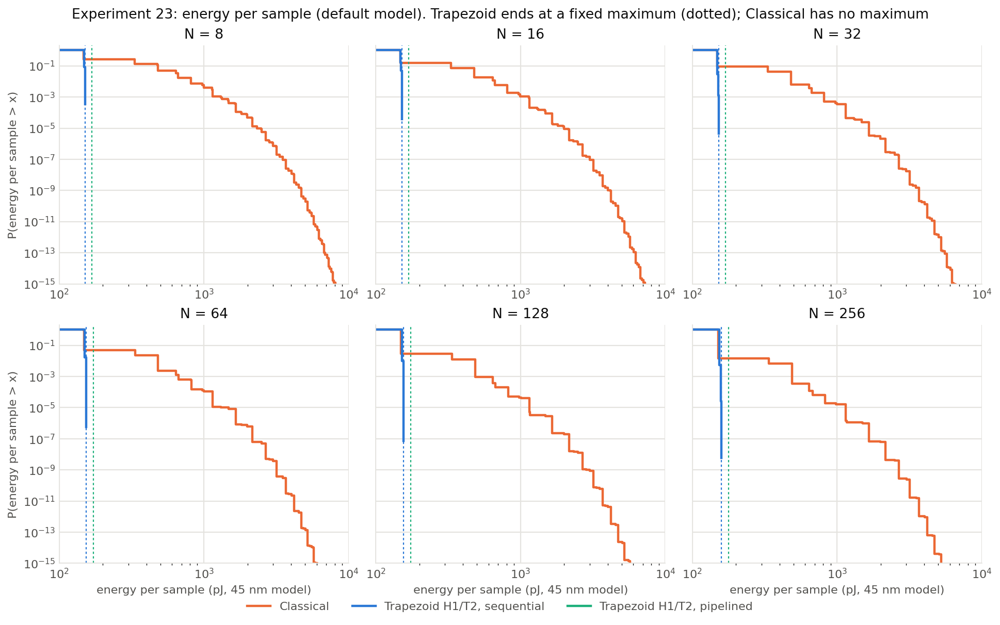
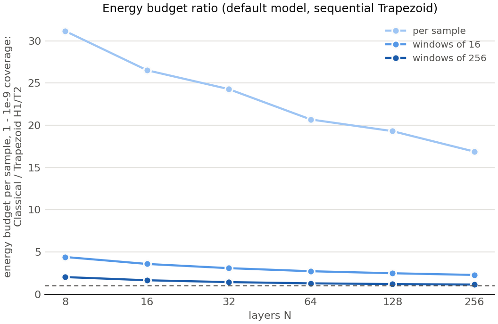
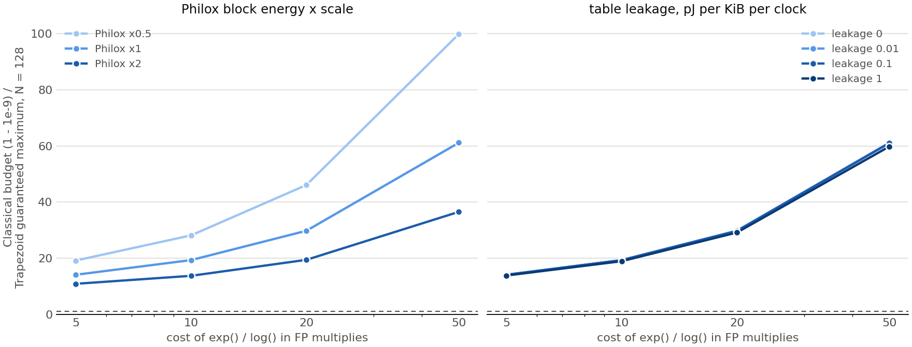

# Experiment 23: operation counts and energy per sample

Experiments 21 and 22 measured time on a CPU. This experiment asks what each sample *costs in
operations*, exactly. It then turns those counts into energy with a stated per-operation energy
model, to answer one question: **how much energy must be reserved per sample** so that only a
fraction ε of samples (or of windows of W samples) exceed it.

**Result:**
- **Trapezoid H1/T2:**
  - Every sample uses exactly one Philox block, no `exp` and no `log`.
  - Its energy per sample has a fixed maximum, only **2–3.5% above its typical sample**.
- **Classical:** its energy per sample has no maximum.
- **Single-sample budget:** in the default model, covering all but 10⁻⁹ of samples needs
  **17–31× Trapezoid's maximum** (19× at N=128). Across all 576 combinations of the swept
  assumptions the ratio never falls below 9×.
- **Windows:** the advantage shrinks as the budget is shared over more samples. It is 2.3–4.4× for
  windows of 16 and 1.1–2.0× for windows of 256 (default model, ε = 10⁻⁹).
- **Average energy:** close at large N (Classical 1.04× at N=128), and higher for a Trapezoid
  whose pipeline computes both datapaths on every sample (see the pipelined model below).

## Part 1: exact operation counts

**Method:**
- Counter macros (`c/ziggurat_opcount.h`) are compiled into the two Philox samplers only with
  `-DZIGGURAT_COUNT_OPS`. Without that flag the object code is byte-identical to before (checked
  with `objdump`), so earlier experiments and timings are unaffected.
- Operations are counted per algorithmic step. The Classical fast-path test, which the CPU code
  repeats at the start of its out-of-line slow path, is counted once.

**Grid:**
- Trapezoid one-block: every H, T ∈ {0..4} at N = 8..256 (150 configurations).
- Classical Philox fast path: N = 8..256.
- 5 seeds × 2^28 samples each, i.e. 1.34×10⁹ samples per configuration.
- 780 runs, 0 failed, 23 minutes.
- In addition, every Trapezoid path (main/head/tail side, every depth, rectangle and wedge) was
  run once on crafted blocks. This covers paths too rare to appear in the sample.

### Operations per sample (Trapezoid H1/T2 against Classical)

| N | Trapezoid blocks | Classical blocks: mean (max seen) | Classical P(> 1 block) | Classical `exp`: mean (max) | Classical `log`: mean (max) | Classical attempts (max) | Trapezoid `exp`/`log` |
|---|---|---|---|---|---|---|---|
| 8 | 1 | 1.147 (11) | 12.8% | 0.287 (9) | 0.044 (20) | 10 | 0 |
| 16 | 1 | 1.081 (8) | 7.4% | 0.164 (7) | 0.017 (14) | 8 | 0 |
| 32 | 1 | 1.044 (8) | 4.2% | 0.091 (6) | 0.0067 (14) | 7 | 0 |
| 64 | 1 | 1.024 (7) | 2.3% | 0.050 (6) | 0.0028 (12) | 7 | 0 |
| 128 | 1 | 1.013 (6) | 1.3% | 0.027 (5) | 0.0012 (10) | 5 | 0 |
| 256 | 1 | 1.007 (6) | 0.7% | 0.015 (4) | 0.0006 (10) | 5 | 0 |

**Trapezoid, across the whole grid** (all 150 configurations, 2×10¹¹ samples):
- Exactly 1 block, 1 attempt and no `exp` or `log` in every sample.
- At most 3 table reads.
- At most 2 + max(H,T) + 1 integer compares, all set by structure.
- The full counts are in `tables/op_counts.csv`.

**Classical** reaches `exp` in 1.5–29% of samples and `log` in 0.03–2% (by N). Every one of its
counts is unbounded.

### Checks on the Classical attempt structure

Classical's distribution has to be extended beyond what 1.34×10⁹ samples can show. This uses its
attempt structure, which was checked exactly first.

- **Exact decomposition.** Every observed per-sample vector equals
  k × (cost of a rejected attempt) + (cost of the accepted attempt) + (j − 1) × (cost of a tail
  iteration). The largest error over all configurations is **0** operations.
- **Geometric rejections.** The number of rejections per sample follows the geometric law. At
  N=128: observed 0.987790 / 0.0120607 / 1.473×10⁻⁴ / 1.77×10⁻⁶ for 0–3 rejections, against
  predicted 0.987790 / 0.0120607 / 1.473×10⁻⁴ / 1.80×10⁻⁶.
- **Independent attempts.** The accepted outcome's distribution is the same after 0 rejections
  as after ≥ 1 (N=128: fast-path share 0.97713 against 0.97711).
- **Per-attempt parameters:**

| N | Rejection probability per attempt | Tail acceptance per candidate | Share of samples entering the tail loop |
|---|---|---|---|
| 8 | 0.111 | 0.874 | 1.9% |
| 128 | 0.0122 | 0.931 | 0.058% |
| 256 | 0.0067 | 0.938 | 0.026% |

- **Model against the observed distribution.** I compared the model's energy budgets with the
  observed distribution at every probability the data can resolve (ε = 10⁻³ … 10⁻⁷, at least 30
  samples beyond). They agree in 28 of 30 cases.
  - In the other two, ε falls on a step of the distribution and the observed tail probability
    differs from the model's by 1.6 and 2.7 standard deviations: N=256 at 10⁻⁶ (9.40×10⁻⁷ against
    1.01×10⁻⁶) and N=16 at 10⁻⁷.
  - This is consistent with sampling noise across 30 checks.

**Trapezoid descent probabilities:**
- The observed frequencies match the exact 1/N per level (largest |z| = 2.05 over 744 cells).
- 10 (side, depth) cells, all at N=256 with depth 4, were never observed. There the more expensive
  wedge path is assumed, which can only raise the Trapezoid's energy.

## Part 2: energy model

### Assumptions (all in `experiments/experiment23.yaml`)

| # | Assumption | Value (default) | Swept |
|---|---|---|---|
| A1 | Energy adds up per operation; data-dependent switching energy is ignored | — | — |
| A2 | 45 nm per-operation energies after Horowitz (ISSCC 2014), 64-bit values scaled from 32-bit | FP multiply 14.8 pJ, FP add 1.8, int→FP 1.8, compare 0.2, int add 0.2, ×2^k 0.2, divide 59.2 | — |
| A3 | One Philox2x64-10 block: 10 rounds of a 64×64→128 multiply plus xor/add | 130 pJ | ×0.5, ×1, ×2 |
| A4 | `exp()` and `log()` each cost c FP multiplies | c = 10 | 5, 10, 20, 50 |
| A5 | Table read: 10 pJ for 64 bits from 8 KB, × (word bits / 64) × (KiB / 8)^α; word = Exp 14 b\* + 2 bits | α = 0.5 | 0, 0.5 |
| A6 | Leakage: λ pJ per KiB of table per clock; one clock per Philox block | λ = 0.01 | 0, 0.01, 0.1, 1 |
| A7 | Same PRNG and same 64-bit float output for both | — | — |
| A8 | CPU cycles are not used as energy | — | — |

**Table sizes** are those of Experiment 14 at the word length where rounding no longer matters:
Trapezoid H1/T2 0.19–7.1 KiB, Classical 0.04–1.6 KiB.

**Two Trapezoid structures:**
- **S, sequential:** only the operations of the path actually taken use energy.
- **P, pipelined:** the rectangle and wedge datapaths both run every clock, so the energy per
  sample is a constant.

Classical has no pipelined form, because its rejection loop cannot be flattened.

**Windows** of W samples are computed exactly as the W-fold convolution (samples are
independent), by FFT with exponential tilting. A plain FFT cannot resolve tail probabilities
below about 10⁻¹⁰. The tilted method was checked against an exact two-sample convolution down
to 10⁻¹⁵ and against a plain FFT at 10⁻⁴ and 10⁻⁶; all agree.

### Energy per sample (default model)

| N | Trapezoid S: mean / max | max / typical | Trapezoid P (constant) | Classical: mean / SD | Classical: typical / max | Mean ratio, Classical / Trapezoid S | Mean ratio, Classical / Trapezoid P |
|---|---|---|---|---|---|---|---|
| 8 | 148.2 / 151.0 pJ | 1.020 | 167.9 | 229.4 / 162.0 | 147.4 / unbounded | 1.55 | 1.37 |
| 16 | 148.6 / 151.6 | 1.022 | 168.8 | 192.6 / 117.1 | 147.6 / unbounded | 1.30 | 1.14 |
| 32 | 148.7 / 151.9 | 1.022 | 169.2 | 172.5 / 85.2 | 147.9 / unbounded | 1.16 | 1.02 |
| 64 | 149.9 / 153.7 | 1.026 | 171.6 | 161.9 / 62.3 | 148.5 / unbounded | 1.08 | 0.94 |
| 128 | 151.2 / 155.8 | 1.030 | 174.4 | 156.7 / 45.7 | 149.5 / unbounded | 1.04 | 0.90 |
| 256 | 152.9 / 158.3 | 1.035 | 177.7 | 154.6 / 33.6 | 150.7 / unbounded | 1.01 | 0.87 |

"Typical" is the median. The Philox block is about 86% of a typical sample's energy for both
samplers, which is why Trapezoid's worst case is so close to its typical case: it always uses
exactly one block.

Over the full H/T grid, Trapezoid's max / typical ratio is 1.016–1.046; the largest is
N=256 H4/T4 (`tables/trapezoid_grid_default.csv`).

### Energy budgets

Budget per sample needed so that only a fraction ε of single samples (W = 1), or of windows of
W samples, exceed it. Default model; values are Classical / Trapezoid S.

| N | W=1, ε=10⁻⁶ | W=1, ε=10⁻⁹ | W=1, ε=10⁻¹² | W=16, ε=10⁻⁹ | W=256, ε=10⁻⁹ | W=256, ε=10⁻⁹, against Trapezoid P |
|---|---|---|---|---|---|---|
| 8 | 19.9 | **31.2** | 41.3 | 4.40 | 2.02 | 1.79 |
| 16 | — | **26.5** | — | 3.58 | 1.65 | 1.45 |
| 32 | — | **24.3** | — | 3.08 | 1.43 | 1.26 |
| 64 | — | **20.7** | — | 2.72 | 1.28 | 1.12 |
| 128 | 10.6 | **19.3** | 26.9 | 2.48 | 1.20 | 1.04 |
| 256 | 10.5 | **16.9** | 25.4 | 2.28 | 1.14 | **0.98** |

Every cell is in `tables/budget_default.csv`.

In absolute terms at N=128, Classical must reserve **3,008 pJ** to cover all but one sample in
10⁹. Trapezoid's guaranteed maximum is **155.8 pJ**, and nothing exceeds it.

### Which Classical paths set the budget

From ε = 10⁻⁶ outwards the budget is set by the **exponential-tail loop**, not by wedge
rejections:
- Each tail candidate costs a new block, two `log()` calls and a division: about 500 pJ.
- About 7% of candidates are rejected, so the number of candidates is geometric.
- At N=128 the 10⁻⁹ budget is a sample with 5 tail candidates plus one `exp()` test. All of the
  probability beyond it comes from tail-loop paths.
- Wedge rejections (one `exp()` plus a new block, about 330 pJ each) set the budget only near
  ε = 10⁻⁴ at N ≥ 128, where the 10⁻⁴ budget is a sample with two rejections.

### Sensitivity

Single-sample budget ratio at ε = 10⁻⁹ (Classical budget / Trapezoid S guaranteed maximum), over
all 576 combinations of the swept assumptions:

| N | Minimum | Maximum |
|---|---|---|
| 8 | 16.3 | 171 |
| 64 | 11.1 | 111 |
| 128 | 10.7 | 100 |
| 256 | 9.2 | 88 |

- The ratio grows with the cost of `exp`/`log` and falls as the Philox block gets more expensive,
  because the block is the shared cost.
- Table leakage (λ up to 1 pJ per KiB per clock) and the read-energy scaling make almost no
  difference; the curves overlap.
- The **mean** ratio ranges from 0.94 (N=256, most expensive table assumptions) to 4.2 (N=8,
  expensive `exp`).

## Expectations (stated before the run) against results

| | Expected | Result |
|---|---|---|
| E1 Trapezoid worst / typical | 1.1–1.5 (S), exactly 1 (P) | **1.02–1.035** for H1/T2 (1.016–1.046 over the grid), exactly 1 (P). Better than expected, because the one block dominates |
| E2 Classical counts | geometric attempts; `exp` in 1–2% of samples at N=128; `log` rare; max about 6 blocks (N=128), 11 (N=8) | as expected: geometric confirmed; `exp`/`log` in 2.8% at N=128; max 6 and 11 blocks |
| E3 mean energy | Classical / Trapezoid about 1.0–1.1 at N=128, up to 1.3–2 at N=8; Trapezoid might be higher with high leakage | 1.04 (N=128) and 1.55 (N=8) for S, as expected. **Trapezoid P has a higher mean than Classical from N=64 up (Classical / P = 0.87–0.94)**; leakage itself hardly matters |
| E4 single-sample budget (1 − 10⁻⁹) | about 5–7× typical for Classical; ratio about 4–6× at N=128 | **19× at N=128**, 17–31× over N; never below 9× in any sweep. Larger than expected: I had not accounted for the `log`-heavy tail loop, which dominates this far out |
| E5 windows | ratio shrinks with W but stays above 1 | 2.3–4.4× (W=16) and 1.1–2.0× (W=256) against S. **Against the pipelined Trapezoid at N=256 and W=256 it falls to 0.98**, i.e. Classical needs slightly less |
| E6 risks | large tables at cheap `exp` could narrow the gap | the narrowest single-sample case is still 9.2× (N=256); for windows the gap does narrow, as above |

## Interpretation

1. **Energy per sample is bounded for Trapezoid and unbounded for Classical.** This follows
   from the counts alone: one block, no transcendental functions, and at most a structural
   number of reads and compares, against geometric attempts and tail iterations. The energy
   model only sets the scale.
2. **For a per-sample energy or time slot with no buffering, the difference is large:** about
   20× at N=128, and at least 9× under every assumption swept. This is the setting the
   argument fits: energy-harvesting or intermittent devices, and hard per-sample budgets.
3. **With a shared reserve, Classical catches up.** A reserve of 16 samples cuts the ratio to
   about 2.5×, and 256 samples to about 1.2× at N=128. That reserve is itself hardware Classical
   needs and Trapezoid does not.
4. **Pipelining costs Trapezoid average energy.** Running both datapaths every clock adds
   about 15% at N=128 (174 against 151 pJ). That makes its average about 10% above Classical's
   at large N. Gating the datapath that isn't selected (clock gating or operand isolation) would
   bring the energy back to the S figures while keeping the fixed timing. Model P is therefore
   an upper bound for Trapezoid.
5. **Where the gap comes from.** The Philox block dominates both samplers' typical energy, so
   the average ratio is close to 1 at large N. The gap is entirely in Classical's rare paths:
   rejections (`exp`, a new block) and the tail loop (`log`, a new block per candidate).

## Limitations

- **Energies are a 45 nm literature model**, not measurements or synthesis. Absolute pJ will
  differ by technology; the ratios are what the report relies on, and they are swept.
- **Operations are counted as the C code writes them.** A hardware design could fold some
  (for example, merge a conversion into a multiplier), and `exp`/`log` hardware ranges widely.
- **Switching energy depends on the data**, which this model ignores.
- **Classical's tail beyond the sampled range** is extended analytically from its
  attempt structure. That structure is exact (zero decomposition error) and its parameters are
  estimated from 1.34×10⁹ samples per configuration.
- **Table sizes come from Experiment 14's fixed-point word lengths.** The C code uses 64-bit
  doubles.

## Files

- Counters: `c/ziggurat_opcount.h`; instrumented samplers `c/ziggurat_basic_philox.c`,
  `c/ziggurat_trapezoid_philox.c` (no change without `-DZIGGURAT_COUNT_OPS`).
- Harness: `experiments/experiment23_count.c`; driver and config: `experiments/experiment23.py`,
  `experiments/experiment23.yaml` (includes every energy assumption);
  `experiments/EXPERIMENT_23_README.md`.
- Raw results: `experiments/results/experiment23/op_vectors.csv`, `trap_paths.csv`,
  `metadata.json`, `config.yaml`.
- Analysis: `reports/experiment23/analysis/energy_model.py`. Tables:
  - operation counts: `op_counts.csv`
  - energy and budgets: `energy_default.csv`, `budget_default.csv`, `trapezoid_grid_default.csv`,
    `sensitivity_window1.csv`
  - checks: `check_classical_decomposition.csv`, `check_classical_geometric.csv`,
    `check_classical_empirical_budget.csv`, `check_trapezoid_descent.csv`

## Conclusion: the argument

The Trapezoid Ziggurat turns the Classical Ziggurat's unbounded, heavy-tailed cost per sample
into a small constant that is known at design time.

**Trapezoid.** In every one of the 2×10¹¹ samples counted across all 150 configurations, it
consumed exactly one Philox block and one attempt, and evaluated no `exp()` or `log()`. Its energy
per sample is therefore bounded by a fixed maximum, only 2–3.5% above its typical sample for
H1/T2.

**Classical.** It offers no such bound. Its attempts and its exponential-tail candidates are
geometric, so every one of its operation counts is unbounded. Within 1.34×10⁹ samples at N=128 it
already reached 6 Philox blocks and 10 logarithms in a single sample.

**The budget.** To serve all but one sample in 10⁹ within a per-sample energy budget, Classical
must reserve 17–31× the Trapezoid's guaranteed maximum. At N=128 that is 3,008 pJ against
155.8 pJ: at 1 GS/s, 3.0 W of peak provisioning against 156 mW. The ratio stays at 9× or more
under every one of the 576 combinations of energy assumptions tested.

**The price.** The bound costs essentially nothing in average energy for a sequential datapath:
Classical uses 1.01–1.55× the Trapezoid's mean. A fully pipelined Trapezoid that evaluates both
branches every clock uses about 10% more than Classical at N ≥ 64, unless the unused branch is
gated.

**Where it matters.** This is exactly the property that systems need when they must guarantee
energy or time for every sample without buffering: energy-harvesting and intermittent devices,
hard real-time pipelines, and fixed-slot hardware. Classical can approach the Trapezoid only by
pooling its budget, but a reserve shared over 256 samples still leaves it 1.1–2.0× above. That
reserve is itself area, energy and latency the Trapezoid does not need.

The Trapezoid buys this guarantee with an exactly quantified approximation error and a few KiB
of table memory. All energy figures are from a 45 nm per-operation model; the ratios, not the
absolute picojoules, carry the conclusion.
