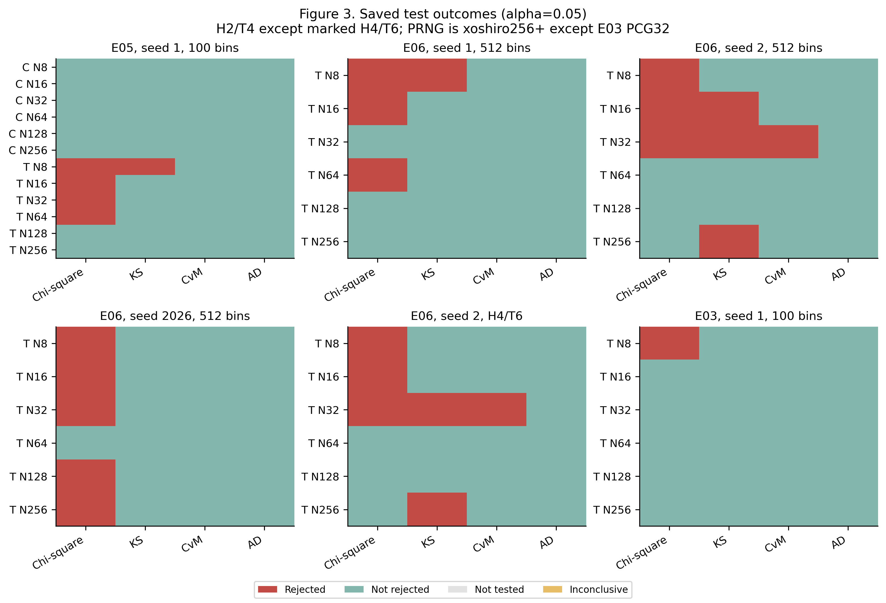
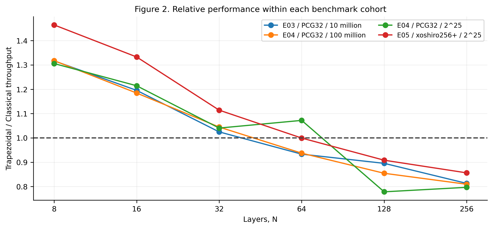
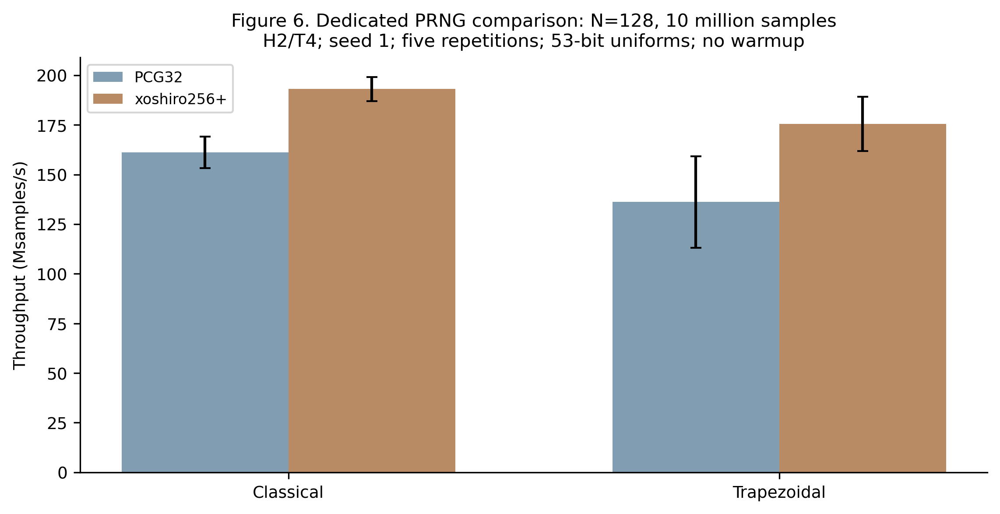
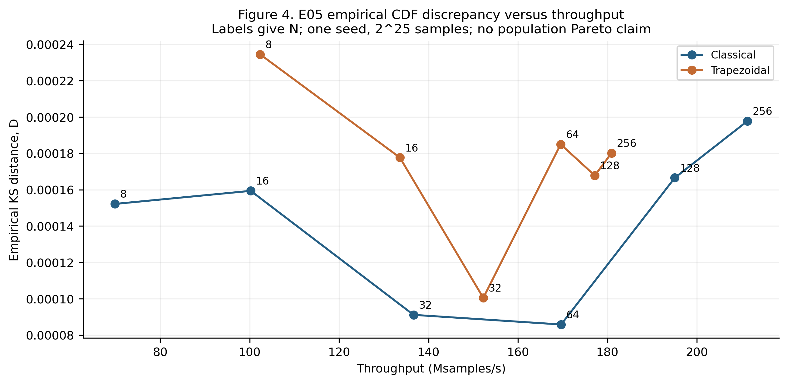
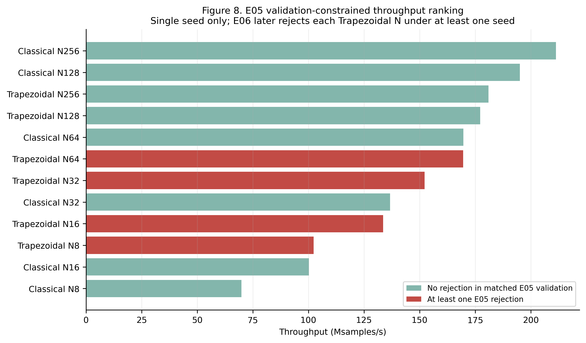
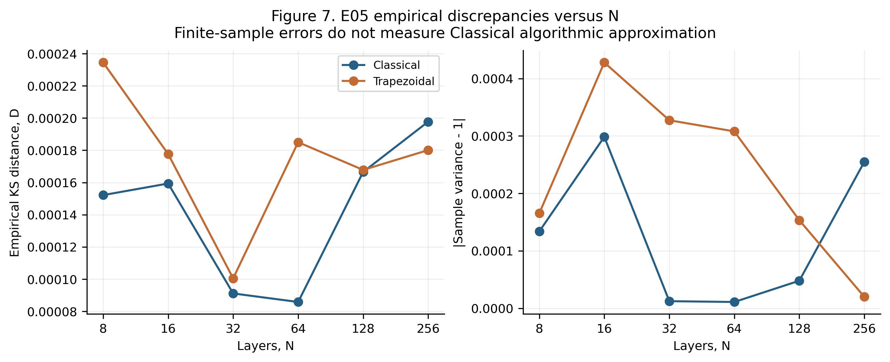

# Accuracy–Performance Trade-offs in Classical and Trapezoidal Ziggurat Gaussian Random Number Generators: An Experimental Study

Technical research report | Experiments 01–06 | Evidence reviewed 15 October 2026

## Abstract

This study evaluates whether a trapezoidal Gaussian sampler can exchange a controlled amount of distributional accuracy for useful computational speed relative to Classical Ziggurat. Existing C implementations, Python experiment drivers, archived configurations and saved numerical results were inspected without rerunning experiments or generating samples. Classical Ziggurat is treated as theoretically exact under ideal uniform inputs, exact arithmetic, correct tables and correct acceptance/rejection and tail rules. The implemented Trapezoidal sampler instead draws from first-order fitted geometry without an exact Gaussian correction. The evidence comprises 137 saved validation datasets, 548 test records and 1,220 timing/checkpoint records, with duplicate streams and dependent checkpoints retained but explicitly distinguished from independent evidence.

At small layer counts, Trapezoidal has higher matched median throughput, but persistent chi-square rejections undermine an accuracy-unconstrained recommendation. Refinement substantially reduces empirical discrepancies and tail deficits at a measurable speed cost; increasing refinement beyond H=2,T=4 does not reliably eliminate remaining rejections. In Experiment 05, Trapezoidal speedups decline from 1.465 at N=8 to 0.856 at N=256. Classical N=256 with xoshiro256+ reaches 211.280 Msamples/s and has no rejection in its matched single-seed validation. Trapezoidal N=256 reaches 180.896 Msamples/s and has no Experiment 05 rejection, but later seeds reject either its chi-square or KS test. No application tolerance for population distributional error is supplied, and no Trapezoidal configuration has a demonstrated combination of superior best-configured CPU throughput and robust validation support. Its rejection-free runtime remains a plausible hardware research direction, requiring fixed-point error analysis and direct FPGA measurements.

## 1. Introduction

### 1.1 Motivation

Gaussian random numbers support Monte Carlo simulation, communication-system noise models and stochastic engineering analysis. Generation speed matters when sampling consumes a substantial share of application runtime. Distributional approximation may be acceptable in some applications, but the permissible error must be established from application requirements. A faster generator that distorts rare events can be unsuitable even if its first two moments appear satisfactory.

### 1.2 Gaussian random number generation

The target is the fully specified standard normal distribution, with density phi(x)=exp(-x²/2)/sqrt(2*pi) and cumulative distribution Phi(x). Three distinct claims must be separated: mathematical distributional exactness, numerical fidelity of a finite implementation, and empirical agreement of observed samples with the null model. The saved tests address the third claim. They can help find numerical or implementation problems, but cannot prove the first.

### 1.3 Classical Ziggurat

Classical Ziggurat uses layered proposals and acceptance/rejection to preserve the target density. Finite layer count affects efficiency and table size, rather than inherently approximating the Gaussian distribution. The original Ziggurat publication provides the methodological background [R1]; the particular C implementation evaluated here uses floating-point uniforms and a separate random sign. Performance conclusions apply to this implementation, rather than every optimized Ziggurat implementation.

### 1.4 Proposed Trapezoidal Ziggurat

The project replaces curved horizontal regions with fitted trapezoids and optionally recursively subdivides extreme head and tail regions. Its sampling loop uses rectangle/triangle mixtures and table descent. There is no Gaussian density comparison to correct a proposed draw. Consequently, this implementation requires both approximation assessment and performance measurement.

### 1.5 Research questions

The central question is whether an approximate sampler can materially outperform a theoretically exact reference while satisfying application accuracy needs. The study examines layer count, head depth H, tail depth T and uniform PRNG choice. It distinguishes within-N speed gains from gains over the best tested Classical configuration; these are different deployment decisions. Ten explicit research-question answers are given in Section 10.

## 2. Algorithm overview

### 2.1 Standard normal distribution

Every saved goodness-of-fit test uses fixed N(0,1). Neither mean nor variance is fitted, and samples are not standardized before testing. Sample variance uses denominator m-1. Here m denotes the number of Gaussian samples, while N denotes the number of layers. Empirical moment errors are |sample mean| and |sample variance-1|. KS distance D is a sample-to-target CDF discrepancy; it contains sampling variation and is not a direct estimate of deterministic algorithmic bias.

### 2.2 Classical Ziggurat

In c/ziggurat_basic.c, a layer is selected uniformly. Interior rectangle candidates below the guaranteed interior boundary return immediately. Boundary-strip candidates are accepted only when a uniform height is below exp(-candidate²/2); rejection restarts layer selection. The base region mixes a rectangle with a tail procedure. The latter proposes xt=-log(1-U)/R and yt=-log(1-V), accepting when 2*yt>xt² and returning R+xt. A separate sign draw produces symmetry. Tables are built from an equal-area recurrence with precomputed cutoffs for N=8,16,32,64,128,256.

### 2.3 Theoretical exactness of Classical Ziggurat

Uniform proposals within equal-area covering regions, followed by exact under-density acceptance, give constant accepted joint density below the target curve. Marginalizing the accepted height therefore gives the Gaussian density. An exact conditional tail procedure completes the unbounded region. Changing a valid finite layer count changes proposal efficiency without changing the accepted target law. This statement assumes ideal independent uniform inputs, exact arithmetic and mathematical functions, correct table areas and correct boundary and tail conditions.

Practical software does not meet these assumptions literally. PCG32 and xoshiro256+ have finite state and period; uniforms have finite precision; tables and exp/log evaluations are rounded. This implementation preserves a rounded N=128 cutoff and permits a larger final-peak tolerance there (1e-10, versus 2e-12 otherwise). These are numerical implementation considerations, not evidence of inherent Classical approximation. A future isolated Classical rejection would require investigation of calibration, numerical behavior, PRNG effects, implementation defects and Type I error before assigning a cause.

### 2.4 Trapezoidal approximation

The inspected c/ziggurat_trapezoid.c partitions using G(x)=x*phi(x)+Q(x), where Q=1-Phi, and numerically inverts area targets with 100 bisection iterations. Each horizontal slice fits the inverse-density width x(y)=sqrt(-2*log(sqrt(2*pi)*y)) with a first-order orthonormal Legendre expansion. Composite Simpson quadrature uses 4,096 subintervals; a squared change of variables handles the tail singularity. The fitted endpoints define a rectangle width w and triangular increment d. The code selects the rectangle with probability 2w/(2w+d), returning w*U; otherwise it returns w+d*|U1-U2|. Since |U1-U2| has density 2(1-z), this produces the intended triangular component of the fitted geometry. These branches are component selections, not Gaussian rejection correction.

An ideal continuous projection preserves the constant width moment of its fitted slice; this area property alone does not preserve the pointwise Gaussian shape. Numerical quadrature and table construction add separate approximation sources. The implementation approximates the sampling region through inverse-PDF fitting, thereby changing the output density. No claim that every possible trapezoidal sampler is biased follows: a proposal-based trapezoidal design with a valid exact rejection correction could retain exactness. The conclusion here follows from this code's absence of that correction.

There is also a qualitative tail distinction. Each terminal fitted table has finite coefficients and each rectangle/triangle sample has bounded magnitude. For finite H and T, there are finitely many terminal entries, so this sampler has bounded output support under its fitted representation; a mathematical Gaussian has unbounded support. This establishes that the implemented geometric family is approximate even before finite uniform precision is considered. The support cutoff was not measured in the saved experiments, so no quantitative omitted-tail probability is asserted.

### 2.5 Head/tail refinement

The root table covers the positive half-density. Head descent replaces the first horizontal region with another N-way partition; tail descent replaces the last. Once descent has chosen a side, only that same extreme side can recurse further. The terminal layer is sampled from its fitted geometry, followed by a sign. Refinement targets extreme-region geometry rather than correcting every interior fit. Interior approximation can therefore remain after deeper head/tail refinement. Increasing H or T changes random-number consumption and subsequent stream alignment, so same seed does not provide paired identical observations across different depths.

The loop has no Gaussian rejection restarts. At most max(H,T) descents occur, followed by a component draw. Under ideal uniform layer selection, each next extreme descent has conditional probability 1/N, yielding a rapidly decaying frequency of deep paths. This structural observation explains why extra depth may add little average work, but it is not a measured latency distribution.

### 2.6 PRNG implementations

PCG-XSH-RR uses a 64-bit state update and 32-bit outputs. Each double uniform combines the upper 27 bits of one output and upper 26 bits of a second, yielding a 53-bit grid in [0,1). xoshiro256+ uses a four-word state and one 64-bit output per uniform, discarding its lower 11 bits and scaling the upper 53 bits by 2^-53. SplitMix64 initializes its state. Both tested paths therefore use the same nominal uniform precision, but different generator-call counts per uniform. The xoshiro specialization includes the same sampler source with symbol remapping. This comparison does not establish PRNG independence or long-stream statistical quality. The PRNG authors' source and discussion provide background [R3].

## 3. Experimental methodology

### 3.1 Software environment

Archived results identify Apple Clang 17.0.0 (clang-1700.6.3.2), optimization -O2 and flags -std=c11 -Wall -Wextra -pedantic -O2. Later metadata identify macOS-26.2-arm64-arm-64bit. Python numerical provenance includes Python 3.12.7, NumPy 1.26.4 and SciPy 1.13.1. The precise CPU model, core affinity, frequency policy and thermal state are not supplied sufficiently to reproduce hardware conditions; arm64 is an architecture identifier, not a processor model. No present-host hardware assumption is substituted for archived benchmark metadata.

Experiment 01's executable hash begins c6bfdc88; later temporary builds have other hashes. Full hashes, compiler/build commands, timestamps and source records are retained in analysis/provenance.json and normalized CSV original_record columns. Some later source snapshots differ from current uncommitted files, so saved metadata and archived artifacts take precedence when reconstructing measured conditions. The repository already contained uncommitted Experiment 06 work before this report. No original source or result file was modified.

### 3.2 Experiment configurations

PCG32 is used by Experiments 01–04. Experiments 05–06 use xoshiro256+. The dedicated prng_comparison results provide a separate, directly matched PRNG study at N=128. It is supplemental evidence, not an invented seventh numbered experiment. H/T do not apply to Classical and are recorded as N/A, even when a raw C record encodes zeros. Trapezoid and trapezoid_refined labels are normalized to Trapezoidal while preserving H/T and original labels in original_record.

Only saved data were read. No experiment driver was imported or executed, no sampler was rebuilt or run, and no additional goodness-of-fit test was performed. The report recomputes descriptive timing statistics and rejection summaries. Original JSON records, including numerical flags and available tail summaries, remain traceable through source paths and indexes.

### 3.3 Statistical validation methods

The per-test significance level is 0.05 throughout. Decisions are Rejected, Not rejected, Not tested or Inconclusive. A valid saved decision is retained even when AD omits a p-value below calibration resolution; its statistic and critical threshold still determine rejection. An underflowed p-value of zero is numerical rounding, not a mathematically zero event probability. No p-value is used as an accuracy score.

Pearson chi-square uses 100 equal-width interior bins on [-5,5] for Experiments 01–05, plus two unbounded tail bins. Experiment 06 uses 512 interior bins plus two tails. Expected counts are m*[Phi(right)-Phi(left)], evaluated with survival-function differences on the positive tail for stability. Bins are pooled left to right using expected counts only until each expected count reaches 5; the final remainder merges backward. Degrees of freedom are final bins minus one because no null parameters are fitted. Final bin counts are 98 at m=10 million with the 100-bin setting, 102 at 33,554,432 or 100 million with that setting, and 492 at 33,554,432 with the 512-bin setting. Raw chi-square values are compared only within the same m and bin calibration [R2].

KS uses the complete sorted sample and a fixed-null two-sided finite-sample calibration. CvM uses complete order statistics with a finite-sample approximation. AD uses a fixed-null probability transform with the saved Marsaglia-Marsaglia finite-n approximation and a critical-value decision; upper-tail p-values below 1e-4 are omitted. These approximations and test dependence limit interpretation. No multiple-testing adjustment was applied in the original experiments. Rejection of any test is used here only as an exploratory screening flag, not a proof of a defect.

Repeated-seed summaries retain sample count, PRNG, N/H/T, test and chi-square calibration. Duplicate same-configuration, same-seed results are not counted as additional independent runs. The 100-million PCG32 streams shared by Experiments 01 and 04, and xoshiro seed-1 streams shared by Experiments 05 and 06, are explicitly identified. Prefixes with different m can overlap; they are not independent datasets. No second-level uniformity test is defensible from only two or three comparable seeds per configuration. Under a calibrated continuous null and independent inputs, p-values are approximately uniform and the expected rejection rate is 5%; a small realized count need not equal 5%.

### 3.4 Performance benchmarking

Throughput is m/elapsed_seconds/10^6 in Msamples/s. Each cohort retains algorithm, N/H/T, PRNG, sample count, seed, warmup and harness. Reported mean, median and sample standard deviation are calculated across saved timing repetitions; coefficient of variation is 100*SD/mean. Medians are the primary point comparisons. Speedup is median Trapezoidal throughput divided by matched Classical throughput, not the median of paired ratios. Improvement is 100*(speedup-1). Refinement overhead is 100*(1-refined median/unrefined median) at fixed N and Experiment 01 conditions.

Experiments 01 and the dedicated PRNG comparison have no Gaussian warmup. Experiments 03–04 warm 100,000 samples outside timing and reset the seed. Experiment 05 has no warmup and uses cumulative checkpoints in one fixed 2^25-sample stream; its four checkpoints are dependent. The standard loop includes sample generation, checksum, sum and sum-of-squares work. Initialization and expensive table fitting are excluded. Checkpoint clock reads and intervening bookkeeping contribute to subsequent cumulative timings. Validation transfer/output timings are not substituted for benchmark timings. Timing repetitions measure runtime variation, not independent statistical validation: the seed is reused.

Different harnesses, warmups, PRNGs and sample counts are not pooled. Within-cohort ratios are primary evidence; cross-cohort patterns describe robustness without assigning all differences to one cause. Error bars in Figure 1 show repetition SD around the median for descriptive variability; they are not confidence intervals. No timing significance test or causal hardware attribution is claimed.

### 3.5 Experiment 01–06 inventory

Table 1 identifies the implemented objectives and completion coverage. All six numbered experiments have saved completed outputs for their planned scopes; absence of a measurement outside that scope is still a limitation. Existing output plots and reports were inspected as supporting context; numerical files determine quantitative claims. Input datasets are generated streams recorded during the original experiments, not external observational data. Raw Gaussian observations were discarded after validation; only numerical summaries and hashes remain. Report production does not regenerate them.

**Table 1. Experiment inventory.** Complete metadata and sources are in tables/experiment_inventory.csv. GOF denotes Chi-square, KS, CvM and AD.

| Exp. / name | Objective | Algorithms / variables | Samples / seeds | Metrics / saved results |
| --- | --- | --- | --- | --- |
| 01 Refinement grid and PRNG profiling | Map speed, validation and refinement cost | Classical; Trapezoidal; N=8,16,32; Trapezoidal H,T=0..4; 78 unique configurations | 100,000,000 per run; 1 | Throughput; four GOF tests; moments; tails; uniform-call profiling; Complete: 780 timings, 78 validations, 78 profiling runs |
| 02 Selected seed replication | Check whether selected E01 rejections persist | Classical; Trapezoidal; Classical N8; Trapezoidal N8 H0/T0 and N8,16,32 H2/T4 | 100,000,000; 2; comparison with E01 seed 1 | Four GOF tests; moments; Complete: 5 validations |
| 03 Layer-count comparison | Locate speed crossover and layer dependence | Classical; Trapezoidal; N=8,16,32,64,128,256; H2/T4 | 10,000,000; 1 | Throughput; four GOF tests; moments; Complete: 60 timings, 6 validations |
| 04 Sample-count comparison | Assess timing stability and validation power at longer runs | Classical; Trapezoidal; N=8..256 powers of two; H2/T4 | 100,000,000 and 33,554,432; separate cohorts; 1 | Throughput; Trapezoidal GOF and moments; Complete: 120 timings, 12 validations |
| 05 xoshiro256+ checkpoint study | Compare algorithms over cumulative timing prefixes | Classical; Trapezoidal; N=8..256 powers of two; H2/T4; checkpoints 100k,1m,10m,2^25 | 33,554,432 generated per run; 1 | Cumulative throughput; full-data four GOF tests; moments; Complete: 60 timing runs / 240 checkpoint records; 12 validations |
| 06 Fine-bin and repeated-seed validation | Assess binning sensitivity, seeds, deeper refinement | Trapezoidal only; N=8..256; H2/T4 seeds 1,2,2026; H4/T6 seed 2 | 33,554,432; 1, 2, 2026; H4/T6 only seed 2 | Four GOF tests; 512 interior chi-square bins; moments; Complete: 24 validations in four result directories |

Experiments 01–06 all contribute accuracy evidence; 01,03,04,05 contribute timing and accuracy/performance comparisons. Experiment 01 profiles PRNG work; the dedicated PRNG study changes the uniform source under matched conditions. Refinement efficiency is addressed by the full Experiment 01 grid and the Experiment 06 same-seed H2/T4 versus H4/T6 validation. Experiment 06 has no throughput measurements. Original generated figures cover grid heatmaps, statistical comparisons and tails in 01, seed comparisons in 02, layer plots in 03, separate sample-count layer plots in 04 and cumulative speed curves in 05. Experiment 06 supplies validation tables/reports rather than a timing plot. The new eight figures consolidate this evidence without treating missing plots as missing experimental results.

**Table 2. Configuration summary.** This compact view gives the complete tested parameter ranges; per-configuration, seed and timing-prefix records are in tables/configuration_summary.csv.

| Exp. | Algorithm | N | H | T | PRNG | Samples |
| --- | --- | --- | --- | --- | --- | --- |
| 01 | Classical | 8,16,32 | N/A | N/A | PCG32 | 100m |
| 01 | Trapezoidal | 8,16,32 | 0..4 | 0..4 | PCG32 | 100m |
| 02 | Classical | 8 | N/A | N/A | PCG32 | 100m |
| 02 | Trapezoidal | 8; 8,16,32 | 0; 2 | 0; 4 | PCG32 | 100m |
| 03 | Both | 8..256 | 2 (T only) | 4 (T only) | PCG32 | 10m |
| 04 | Both | 8..256 | 2 (T only) | 4 (T only) | PCG32 | 100m; 2^25 |
| 05 | Both | 8..256 | 2 (T only) | 4 (T only) | xoshiro256+ | 2^25 |
| 06 | Trapezoidal | 8..256 | 2; 4 | 4; 6 | xoshiro256+ | 2^25 |
| PRNG | Both | 128 | 2 (T only) | 4 (T only) | Both | 10m |

## 4. Statistical accuracy results

### 4.1 Theoretical accuracy baseline

Classical is theoretically exact under the ideal assumptions of Section 2.3. Experiment 01's three Classical configurations and Experiment 05's six Classical configurations show no rejection across their four saved tests; Experiment 02's Classical N=8 also has no rejection. These checks support the evaluated implementations over their tested streams, but do not establish PRNG quality, independence or correctness for all seeds.

### 4.2 Chi-square results

Every one of the 75 Experiment 01 Trapezoidal configurations rejects chi-square at 100 million samples. All three Classical configurations do not reject. This separates the observed benefit of refinement from complete recovery of Gaussian agreement. Experiment 02 confirms chi-square rejection for the four selected Trapezoidal cases under seed 2. Its unrefined N=8 case rejects all four tests under both seeds. Repeated very small chi-square p-values at low N are consistent with stable distributional discrepancy and the known uncorrected geometric approximation. They do not by themselves isolate fitting error from other numerical or implementation effects.

Table 3 gives fine-bin results at fixed m=2^25, H2/T4 and xoshiro256+. All final bin counts are 492 and df=491. The small-N rejections persist across all three seeds. Larger N has fewer rejections, but no N is free of all four test rejections over the three seeds. The individual p-values are presented for reproducibility, not for ranking closeness to Gaussianity.

**Table 3. Experiment 06 chi-square validation and repeated seeds.** All rows: Trapezoidal, H2/T4, xoshiro256+, m=33,554,432, 492 bins, df=491. R means rejected and NR means not rejected. Other test outcomes appear in Figure 3 and Appendix B.

| N | Seed 1 statistic / p | Seed 2 statistic / p | Seed 2026 statistic / p | Rejected seeds |
| --- | --- | --- | --- | --- |
| 8 | 969.6629 / 1.0659e-33 | 964.7952 / 3.5691e-33 | 860.8906 / 1.1801e-22 | 3/3 |
| 16 | 609.2002 / 0.00021046 | 620.507 / 6.2127e-05 | 638.1834 / 7.9298e-06 | 3/3 |
| 32 | 537.6501 / 0.071449 | 550.2512 / 0.03283 | 559.2143 / 0.017668 | 2/3 |
| 64 | 552.3367 / 0.028562 | 514.5916 / 0.22294 | 494.5782 / 0.44624 | 1/3 |
| 128 | 478.1329 / 0.65281 | 530.3283 / 0.10673 | 590.9217 / 0.0012815 | 1/3 |
| 256 | 438.2194 / 0.95794 | 469.6274 / 0.74883 | 550.7383 / 0.031788 | 1/3 |

Experiment 03's 10-million PCG32 H2/T4 datasets reject chi-square only at N=8. At 100 million in Experiment 04, N=8,16,32,64,128 reject, while N=256 does not. For example, N=32 has chi-square 94.1327, df=97, p=0.563529 at 10 million, versus 215.5520, df=101, p=2.70347e-10 at 100 million. The raw statistics are not directly comparable because sample count and final bins change. These decisions demonstrate sensitivity to power and binning, rather than a contradiction in mathematical exactness.

### 4.3 Other goodness-of-fit tests

The Experiment 01 Trapezoidal grid has 27 KS, 16 CvM and 27 AD rejections in addition to 75 chi-square rejections. Refinement often removes the global CDF-test rejection while localized discrepancies remain detectable by the chosen histogram test. This is a plausible explanation based on the different statistics, not proof of a specific spatial error pattern: saved per-bin residuals are insufficient for that localization.

Experiment 05 rejects Trapezoidal chi-square at N=8,16,32,64 and KS at N=8. Its N=128 and N=256 configurations have no rejection in the four-test screen. In Experiment 06 seed 1, the same N=32 stream changes from chi-square rejection with 100 interior bins to non-rejection with 512 interior bins. KS, CvM and AD are unchanged for identical streams. More bins do not automatically increase power against every deviation: the degrees of freedom and alignment of departures with bin boundaries also change. Figure 3 presents the resulting decisions without converting them into accuracy grades.

Figure 3. Statistical validation heatmaps. Each cell retains its saved per-test decision. Panels have distinct stream and calibration labels; H2/T4 applies except where marked H4/T6. Non-rejection does not prove exactness.

### 4.4 Accuracy versus layers

For Classical, empirical mean, variance and KS discrepancies fluctuate with N under one seed; none is evidence that increasing layers improves theoretical exactness. For Trapezoidal, Experiment 01 unrefined KS distance decreases from approximately 8.70e-4 at N=8 to 2.35e-4 at N=32, while chi-square remains rejected. Refinement and larger N generally reduce severe departures, but the resulting sample discrepancies are not monotonic. Figure 7 shows this directly in the xoshiro cohort; its noisy moment errors cannot be interpreted as a deterministic convergence rate.

### 4.5 Accuracy versus refinement

At fixed PCG32, N=8, seed 1 and 100 million samples, moving from H0/T0 to H2/T4 reduces KS D from 0.000869853 to 0.0000830202 and chi-square from 192084.523 to 975.411 with unchanged df=101. The latter still rejects. Head-only H2/T0 gives D=0.000632958; tail-only H0/T4 gives approximately D=0.0008751. Thus a large improvement from combined refinement cannot be assigned to either depth alone. Figure 5 compares single-variable slices with the other depth fixed.

The tail summaries provide a concrete distributional consequence. Table 3a shows the saved two-sided event P(|X|>z) at N=8, seed 1. The unrefined tail deficit at z=3 and complete absence beyond z=4 agree with the qualitative bounded-support concern. Refinement restores much of the observed tail mass. The refined z=2 error is larger than the unrefined error, illustrating that local improvements need not improve every tail threshold. No new tail test was run.

**Table 3a. Experiment 01 two-sided tail probabilities at N=8.** Each row uses 100 million samples. SE is the binomial standard error under the Gaussian null; it is a scale reference, not an adjusted confidence statement.

| Configuration | z | Observed count | Empirical probability | Absolute error | Null SE |
| --- | --- | --- | --- | --- | --- |
| Classical | 2.0 | 4548683 | 0.04548683 | 1.3434e-05 | 2.084e-05 |
| Classical | 3.0 | 269210 | 0.0026921 | 7.6961e-06 | 5.1889e-06 |
| Classical | 4.0 | 6224 | 6.224e-05 | 1.1025e-06 | 7.9585e-07 |
| Trapezoidal H0/T0 | 2.0 | 4546533 | 0.04546533 | 3.4934e-05 | 2.084e-05 |
| Trapezoidal H0/T0 | 3.0 | 171598 | 0.00171598 | 0.00098382 | 5.1889e-06 |
| Trapezoidal H0/T0 | 4.0 | 0 | 0 | 6.3342e-05 | 7.9585e-07 |
| Trapezoidal H2/T4 | 2.0 | 4542486 | 0.04542486 | 7.5404e-05 | 2.084e-05 |
| Trapezoidal H2/T4 | 3.0 | 269372 | 0.00269372 | 6.0761e-06 | 5.1889e-06 |
| Trapezoidal H2/T4 | 4.0 | 6271 | 6.271e-05 | 6.3248e-07 | 7.9585e-07 |

Experiment 06's seed-2 H4/T6 comparison changes both depths together. Its chi-square rejections at N=8,16,32 persist, with nearly unchanged statistics relative to H2/T4. At N=8 the statistic changes from 964.795 to 962.554; at N=16 it changes from 620.507 to 621.305. KS rejection at N=16 disappears, while N=32's KS/CvM and N=256's KS rejections remain. This is evidence of diminishing returns for the measured combined depth increase, not an isolated estimate of either H or T's effect. No H4/T6 throughput was measured, so its runtime penalty cannot be quantified.

### 4.6 Repeated-seed consistency

The chi-square rejection frequencies across the three H2/T4 xoshiro seeds are 3/3,3/3,2/3,1/3,1/3,1/3 for N=8 through 256. With any-test screening, these become 3/3,3/3,2/3,1/3,1/3,2/3, because seed 2 also rejects KS at N=256. These are descriptive frequencies from three seeds, not stable population estimates. The three large-N cases may include Type I variation; the low-N repeated very small p-values are substantially more compelling evidence of persistent discrepancy. All p-value lists and rejection counts are retained in repeated_seed_summary.csv, grouped by compatible calibration. No uniformity claim or pooled p-value test is made.

## 5. Computational performance results

### 5.1 Throughput versus layers

Both algorithms generally gain throughput as N increases over the tested range. In Experiment 03 the Classical medians rise from 59.497 to 177.576 Msamples/s and Trapezoidal from 78.344 to 144.361. The 100-million Experiment 04 cohort has corresponding endpoints 58.934 to 177.072 and 77.652 to 143.325. Trapezoidal's gain flattens at high N; Classical continues to improve. The 2^25 PCG32 cohort shows an unusually low Classical N=64 median and Trapezoidal N=128 median relative to nearby cohorts. Those observations are retained, not smoothed away or assigned a cache explanation without hardware counters.

Figure 1. Throughput versus layers in four distinct cohorts. Points are medians and bars show sample SD over five timing repetitions. All Trapezoidal curves use H2/T4. Warmup and harness differ between PCG and xoshiro panels, precluding direct attribution of cross-panel gains to the PRNG alone.

### 5.2 Classical versus Trapezoidal

Trapezoidal beats matched Classical at N=8,16,32 in Experiment 03 and the 100-million Experiment 04 cohort; the crossover lies between tested N=32 and N=64. Experiment 04's 2^25 cohort also has a Trapezoidal advantage at N=64, but this does not repeat in the other PCG32 cohort. Experiment 05 has a practical tie at N=64 (ratio 0.99935), with a Trapezoidal advantage at N<=32 and Classical advantage at N>=128. Exact crossover values between tested N are not measured.

Table 4 reports the directly matched Experiment 05 full-length measurements. Five timing repetitions reuse seed 1; their variation is not evidence from five independent Gaussian streams. The Trapezoidal N=8 CV exceeds 10%, so its median speedup should not be interpreted as a precisely stable hardware constant.

**Table 4. Experiment 05 full-run throughput.** All rows use xoshiro256+, m=33,554,432, seed 1, -O2, five repetitions, zero warmup. Trapezoidal uses H2/T4. SD and mean are across repetition throughputs. Full metadata and all other cohorts appear in tables/throughput_summary.csv.

| Algorithm | N | Mean | Median | SD | CV (%) | Speedup |
| --- | --- | --- | --- | --- | --- | --- |
| Classical | 8 | 69.22261 | 69.86199 | 1.4985 | 2.165 | 1 |
| Trapezoidal | 8 | 98.31392 | 102.3157 | 9.9916 | 10.16 | 1.46454 |
| Classical | 16 | 99.01194 | 100.225 | 4.6283 | 4.675 | 1 |
| Trapezoidal | 16 | 133.7916 | 133.5808 | 0.85069 | 0.6358 | 1.33281 |
| Classical | 32 | 136.1093 | 136.6367 | 1.4169 | 1.041 | 1 |
| Trapezoidal | 32 | 153.1762 | 152.2316 | 2.8256 | 1.845 | 1.11413 |
| Classical | 64 | 169.7205 | 169.6468 | 0.4208 | 0.2479 | 1 |
| Trapezoidal | 64 | 168.5039 | 169.537 | 2.0948 | 1.243 | 0.999353 |
| Classical | 128 | 194.5083 | 195.059 | 1.2376 | 0.6363 | 1 |
| Trapezoidal | 128 | 174.824 | 177.1617 | 5.3276 | 3.047 | 0.908247 |
| Classical | 256 | 211.1373 | 211.28 | 1.386 | 0.6565 | 1 |
| Trapezoidal | 256 | 180.8852 | 180.8962 | 0.68667 | 0.3796 | 0.856192 |

Figure 2. Trapezoidal/Classical median-throughput ratios within each cohort. The unity line distinguishes faster and slower configurations. Sample-count and harness differences remain visible as separate series.

### 5.3 Refinement overhead

Table 4a holds Experiment 01 timing conditions fixed. H2/T4 reduces throughput relative to H0/T0 by 23.63% at N=8, 12.87% at N=16 and 8.08% at N=32. These are throughput losses; corresponding increases in time per sample would be different percentages. Head-only and tail-only settings are also shown. Once most extreme-region error is reduced, deeper refinement changes throughput modestly and non-monotonically within observed run variability. It does not remove interior fitting error.

**Table 4a. Matched refinement throughput and overhead in Experiment 01.** PCG32, seed 1, 100 million samples; medians of ten repetitions.

| N | H | T | Median (Msamples/s) | Overhead (%) | KS D | Chi-square |
| --- | --- | --- | --- | --- | --- | --- |
| 8 | 0 | 0 | 101.1646 | 0 | 0.000869853 | 192084.5 |
| 8 | 2 | 0 | 91.68826 | 9.3672 | 0.000632958 | 185890.9 |
| 8 | 0 | 4 | 83.51194 | 17.449 | 0.00087512 | 7448.083 |
| 8 | 2 | 4 | 77.25914 | 23.63 | 8.30202e-05 | 975.4111 |
| 8 | 4 | 4 | 77.1808 | 23.708 | 8.58557e-05 | 965.8432 |
| 16 | 0 | 0 | 115.0582 | 0 | 0.000462162 | 82365.42 |
| 16 | 2 | 0 | 111.7278 | 2.8945 | 0.000271973 | 80077.67 |
| 16 | 0 | 4 | 105.5666 | 8.2494 | 0.000469773 | 2270.635 |
| 16 | 2 | 4 | 100.2512 | 12.869 | 8.74026e-05 | 327.3889 |
| 16 | 4 | 4 | 100.9702 | 12.244 | 9.11326e-05 | 327.5391 |
| 32 | 0 | 0 | 129.6181 | 0 | 0.000234746 | 36475.25 |
| 32 | 2 | 0 | 123.9921 | 4.3404 | 0.000118625 | 35751.14 |
| 32 | 0 | 4 | 120.9173 | 6.7126 | 0.000261771 | 672.0479 |
| 32 | 2 | 4 | 119.1456 | 8.0795 | 8.63787e-05 | 215.552 |
| 32 | 4 | 4 | 118.9663 | 8.2179 | 8.67387e-05 | 216.1966 |

Figure 5. Refinement slices with the other depth fixed in Experiment 01. The throughput and KS panels show that an empirical discrepancy can fall substantially while measured throughput decreases. KS distances retain sampling variation; no new goodness-of-fit test is performed.

### 5.4 PRNG performance

The dedicated matched PRNG study at N=128, ten million samples and five repetitions gives Classical 161.070 Msamples/s with PCG32 and 193.020 with xoshiro256+, a 19.84% increase. Trapezoidal H2/T4 rises from 136.173 to 175.451, a 28.84% increase. Its relative speedup against Classical improves from approximately 0.8454 to 0.90898, yet remains below one. These data demonstrate a material change in measured cost, not a formal test of statistical significance or general superiority of the PRNG. Figure 6 restricts the comparison to this dedicated cohort; Experiment 05 is not compared causally with Experiment 04.

PCG32 spends two generator steps per 53-bit uniform, while xoshiro256+ spends one. Because the Trapezoidal sampling path consumes more uniforms, reducing uniform cost can improve its relative throughput. This mechanism is supported by the source and Experiment 01 call counts, while the exact attribution of runtime savings is unmeasured. The dedicated PRNG comparison has no statistical validation, so it cannot establish unchanged distributional quality after a PRNG substitution.

Figure 6. Dedicated PCG32 versus xoshiro256+ throughput comparison. Both supply nominally 53-bit double uniforms under the same harness, layer count and sample count. Bars are median throughput and error bars are sample SD.

### 5.5 Acceptance efficiency

Experiment 01 records uniform-call profiling. At N=8, Classical consumes 3.70114 uniforms per Gaussian sample, unrefined Trapezoidal 4.16853 and H2/T4 Trapezoidal 4.35919. Each PCG32 uniform consumes two PCG output calls. For these configurations the estimated PRNG fractions are 0.357726, 0.719197 and 0.558471, respectively. The fractions come from isolated uniform microbenchmark cost multiplied by call counts and divided by a baseline Gaussian timing; they are not exact CPU attribution and need not track the total benchmark speedup proportionally. Profiling timings are not pooled with ordinary timing runs.

Refinement adds layer-selection draws, comparisons and table accesses. It does not increase a Gaussian rejection frequency because this Trapezoidal implementation has no such rejection step. Rectangle and triangle branch names in the source must not be mistaken for acceptance probability against phi. The saved ordinary results do not supply a complete comparable rejection/attempt counter series. Thus no numerical explanation based on rejection frequencies or cache misses is asserted. Initialization, table-fitting cost, latency tails and memory traffic remain unbenchmarked here.

## 6. Accuracy–performance trade-offs

### 6.1 Accuracy-constrained performance

The desired optimization is to maximize throughput(theta), subject to population distributional error(theta)<=epsilon, where theta=(N,H,T,PRNG). Neither epsilon nor an application loss function is defined. This report therefore uses an exploratory screen: a configuration has supported validation in a cohort when all four available saved tests do not reject at alpha=0.05. An unavailable validation is Not tested; a missing decisive statistic would be Inconclusive. A single rejection raises a screening flag, but does not automatically prove systematic bias because multiple, correlated tests are involved.

Under the Experiment 05 screen, the fastest supported configuration is Classical N=256, xoshiro256+, with 211.280 Msamples/s. The fastest locally supported Trapezoidal configuration is N=256,H2/T4 with 180.896 Msamples/s, 14.38% below its matched Classical baseline. N=128 is also locally supported but slower at 177.162. Experiment 06 weakens both Trapezoidal recommendations: N=128 rejects chi-square at seed 2026, and N=256 rejects KS at seed 2 and chi-square at seed 2026. No evaluated Trapezoidal H2/T4 setting has zero rejections across every compatible Experiment 06 seed and test.

**Table 5. Accuracy–performance trade-off in Experiment 05.** Trapezoidal H2/T4 and xoshiro256+ throughout. Error is empirical KS D; speedup uses the same-N Classical median. E06 is a separate later validation screen, not an independent repeat of E05 seed 1.

| N | E05 validation | KS D | Median Msamples/s | Speedup | E06 any-test rejects |
| --- | --- | --- | --- | --- | --- |
| 8 | Rejected | 0.000234493 | 102.3157 | 1.46454 | 3/3 seeds |
| 16 | Rejected | 0.000177682 | 133.5808 | 1.33281 | 3/3 seeds |
| 32 | Rejected | 0.000100498 | 152.2316 | 1.11413 | 2/3 seeds |
| 64 | Rejected | 0.000185008 | 169.537 | 0.999353 | 1/3 seeds |
| 128 | No rejection | 0.000167812 | 177.1617 | 0.908247 | 1/3 seeds |
| 256 | No rejection | 0.000180106 | 180.8962 | 0.856192 | 2/3 seeds |

Some earlier, weaker screens do coincide with a same-N speed advantage: Experiment 03 N=16 and N=32 H2/T4 have no rejection at ten million samples, with speedups 1.19545 and 1.02474. Experiment 04 N=32 at 2^25 samples also has no rejection and a 1.04044 ratio. These are legitimate locally supported results, but their PCG32 counterparts reject chi-square at 100 million samples under both available seeds for N=16 and N=32. They establish conditional single-seed gains, rather than a robust approximation guarantee.

A small-N speed advantage is not a global optimization win. In this layer range, increasing Classical N improves its own throughput without sacrificing ideal theoretical exactness. Even the fastest measured Trapezoidal setting in the comparable Experiment 05 cohort remains slower than the fastest Classical setting. Table 5 should therefore support application-specific decisions rather than a default recommendation to use an approximate small-N generator.

### 6.2 Accuracy versus throughput

Figure 4 uses empirical KS distance, not p-values, on its vertical axis. All points have the same PRNG, sample count, timing harness and seed, so the displayed comparison is internally meaningful as an observation. However, different configurations consume different random draws and D includes noise. A point with a smaller realized D has not been proved to have a smaller population approximation error. Moment errors and tail summaries supplement, rather than replace, full-distribution checks.

Figure 4. Empirical KS discrepancy versus Experiment 05 throughput, with N labels. The Classical curve is a finite-sample implementation check of a theoretically exact algorithm. No statistical confidence region or rigorous population frontier is inferred.

### 6.3 Pareto analysis

A rigorous accuracy/performance Pareto frontier requires a common, well-defined population error objective or defensible error estimates with uncertainty. Existing results provide empirical discrepancies and hypothesis-test decisions, not a certified distributional-error bound. No population Pareto-optimal set is claimed. Figure 8 instead gives a validation-constrained ranking inside Experiment 05. Its single-seed criterion is deliberately visible, and later seed rejections are disclosed. Classical's theoretical exactness is additional information that the empirical scatter alone does not encode.

Figure 8. Throughput ranking under the matched Experiment 05 four-test screen. Green indicates no rejection for that saved seed, not mathematical exactness or robust multi-seed support. The fastest entry is Classical N=256.

### 6.4 Diminishing returns

The H2/T4 versus H4/T4 Experiment 01 comparisons and H2/T4 versus H4/T6 Experiment 06 comparisons show limited additional improvement in the remaining chi-square discrepancy. Increasing N over a wider range improves measured throughput for both methods and reduces the most severe Trapezoidal departures, but large-N validation is still seed-sensitive. Consequently, larger N appears more promising than indefinite refinement of the extreme regions, subject to table-size constraints. It is not a proved global optimum because no full factorial N/H/T grid exists above N=32, and H4/T6 has no timing evidence.

Figure 7 shows why no monotonic population-accuracy claim is justified: moment and KS errors fluctuate even where rejection counts decrease. The theoretical exactness of Classical does not vary with these observed fluctuations.

Figure 7. Empirical KS and variance errors versus N for Experiment 05. One seed and one sample count are used; the curves illustrate measured discrepancies, not theoretical error rates.

### 6.5 Comparison with theoretically exact Classical Ziggurat

Scenario A, faster Trapezoidal with application-acceptable approximation, remains possible but unestablished because no epsilon is specified and the small-N speed leaders reject available validation. Scenario B, slower Trapezoidal with locally supported validation, describes N=128 and N=256 in Experiment 05; these configurations offer no demonstrated CPU accuracy/performance benefit over matched Classical. Scenario C, faster Trapezoidal with persistent discrepancy, describes the small-N results, particularly the repeated low-N chi-square rejections. Such configurations should not be selected solely for speed.

The strongest supported conclusion is that the implementation offers an architectural alternative and measured same-N small-table speed gains, but no compelling default CPU advantage over the best tested Classical configuration when distributional fidelity is required. Whether a specific application can tolerate the small-N errors is unresolved.

### 6.6 Recommended configurations

Table 6 separates deployment advice from research hypotheses. There is no unique most accurate Trapezoidal configuration: the metrics, seeds and calibrations do not support that ranking. A provisional fastest Trapezoidal entry can be named only under the restricted Experiment 05 single-seed screen.

**Table 6. Evidence-based recommendations.** Throughputs refer to the indicated experiment rather than pooled environments.

| Use case | Configuration | Accuracy evidence | Msamples/s | Advantages / limitations | Confidence |
| --- | --- | --- | --- | --- | --- |
| Default CPU choice | Classical N256, H/T N/A, xoshiro256+ | E05 four tests not rejected; ideal algorithm exact | 211.28 | Highest E05 throughput; no algorithmic geometric approximation; One matched validation seed; CPU-specific | Strong within measured E05 cohort; limited cross-platform generality |
| Fastest provisional Trapezoidal under E05 screen | Trapezoidal N256 H2/T4, xoshiro256+ | E05 no rejection; E06 seed 2 KS and seed 2026 chi-square reject | 180.8962 | Fastest locally non-rejected Trapezoidal result; 14.38% slower than same-N Classical; fails expanded screen | Tentative; not robust validation support |
| Most accurate Trapezoidal | No unique supported selection | Errors fluctuate; no population-error bound | N/A | Avoids ranking by p-values; Only 2-3 comparable seeds; no specified epsilon | Insufficient evidence |
| Pure throughput within evaluated E05 cohort | Classical N256, xoshiro256+ | E05 no rejection; ideal algorithm exact | 211.28 | Faster than all Trapezoidal E05 entries; Initialization and table memory not in objective | Strong within cohort |
| FPGA research starting point | Trapezoidal N256 H2/T4, xoshiro256+ as software reference | Best provisional Trapezoidal speed; mixed repeated-seed validation | 180.8962 | Bounded table descent; no Gaussian rejection loop; Large tables; finite support; no FPGA data; compare N128 H2/T4 as area alternative | Hypothesis only; hardware PRNG choice remains open |

## 7. Discussion

### 7.1 Interpretation of accuracy results

The large improvement from unrefined to refined sampling is supported by KS, moment and tail summaries, not merely by a change in p-values. Repeated low-N chi-square rejection is consistent with unresolved localized departures in the fitted density. Isolated large-N rejections have weaker causal interpretation because of multiplicity and few seeds. The absence of Classical rejections in the saved comparisons supports those streams; its exactness claim rests on acceptance/rejection theory, not successful tests.

### 7.2 Sources of approximation error

First-order width fitting approximates a curved inverse-density boundary. Extreme-region recursion improves the geometry there but leaves ordinary interior fitted slices. Simpson quadrature, bisection, floating-point arithmetic and finite uniform precision add separate numerical effects. The terminal tail fit has bounded support. These structural observations explain why exact Gaussianity should not be presumed. Available summaries cannot partition total discrepancy among these sources or quantify the population error at a particular tail threshold beyond the saved observations.

### 7.3 Performance bottlenecks

Uniform generation is material because each Trapezoidal sample uses layer selection, component selection, one or two component uniforms and a sign, plus any recursive selections. Classical incurs rejection and transcendental work on a minority of paths, and its layer geometry improves fast-path frequency as N grows. This provides a mechanism consistent with the measured crossover, but the report does not infer exact branch frequencies without counters. Cache effects, thermal effects and CPU scheduling are possible explanations for timing fluctuations, not measured findings. The PRNG swap offers direct evidence that uniform cost changes relative throughput.

### 7.4 Algorithmic complexity

Both algorithms use constant-time lookup/arithmetic on common paths. Classical has random-length rejection loops with finite expected cost, while Trapezoidal has a finite configured descent bound. Trapezoidal preprocessing is substantial: approximately N*(1+H+T) fitted slices, each with 4,097 quadrature points, plus partition inversions. None of this fitting cost appears in the throughput plots.

The C Trapezoidal table structure contains 1,282 doubles at the compile-time maximum N=256. Its static 33-table array therefore accounts for 338,448 bytes of double storage, independent of the chosen active H/T depths. This is a source-derived storage calculation, not a cache or FPGA resource measurement. An implementation that stores only active entries would scale differently. Classical uses two 256-entry double arrays plus scalar state. These details motivate explicit memory and initialization studies before calling the approximate method simpler overall.

### 7.5 Implications for FPGA implementation

A rejection-free, bounded-depth sampling graph may simplify latency budgeting or pipelining. This is the strongest reason to continue Trapezoidal research even without a CPU speed advantage. However, it still needs PRNG bandwidth, multipliers, absolute differences, table memories, branching/control and precision management. Recursive table addressing can complicate scheduling. Classical requires a policy for rejection restarts and transcendental tail evaluation, but hardware buffering or parallelism may mitigate these costs. CPU throughput does not predict FPGA throughput.

N=256,H2/T4 is a defensible software reference for a first architecture investigation because it combines the highest provisional Trapezoidal throughput with less severe validation evidence than small N, not because it is proven most accurate. N=128,H2/T4 should be an explicit alternative when memory is constrained. No LUT, flip-flop, BRAM, DSP, clock, power or FPGA throughput numbers are available. No hardware superiority is claimed, and the software PRNG choice is not a hardware recommendation.

**Table 7. Classical versus Trapezoidal summary.**

| Dimension | Classical Ziggurat | Trapezoidal Ziggurat |
| --- | --- | --- |
| Theoretical exactness | Exact under ideal inputs, arithmetic, tables and acceptance/tail rules | Approximate fitted sampling geometry; no Gaussian correction |
| Approximation error | No inherent layer-count error; practical numerical/PRNG effects remain | Fitting, finite terminal support, numerical construction and PRNG effects |
| Acceptance/rejection | Gaussian boundary rejection and exact tail rejection | Rectangle/triangle component selection; no Gaussian rejection |
| Layers N | Primarily efficiency and table size | Efficiency, table size and approximation resolution |
| Head/tail refinement | Not applicable in evaluated implementation | Recursive extreme-region subdivision, bounded configured depth |
| Complexity | Fast lookup path; variable rejection loops | Lookup/component arithmetic plus possible table descent; costly preprocessing |
| PRNG requirements | 53-bit uniforms; PCG32 or xoshiro256+ | Same precision; more measured uniform calls/sample |
| CPU throughput | Fastest E05: 211.280 Msamples/s at N256 | Fastest E05: 180.896 Msamples/s at N256 H2/T4 |
| FPGA considerations | Tail math and restarts need hardware design | Bounded descent may help scheduling; memory/arithmetic/accuracy costs unmeasured |

## 8. Limitations

Finite samples impose noise and finite power. Increasing m can detect deviations too small for a smaller dataset; failure to reject is not evidence of zero error. Only one validation seed is available for most configurations, two for selected PCG cases and three for H2/T4 xoshiro cases. Timing repetitions reuse the seed. Distinct deterministic seeds are treated as nominally separate streams, without proof of independence.

Multiple hypotheses and correlated tests create false-rejection opportunities. No original familywise or false-discovery adjustment was used. The strict any-test screen is exploratory and can reject a correct implementation by chance. P-values cannot rank population accuracy. Approximate AD and CvM calibration and finite numerical precision create further uncertainty.

Different chi-square binning and expected-count merging produce different degrees of freedom. Raw statistics across incompatible calibrations cannot be compared as an error scale. Histograms and residual arrays needed to localize the discrepancy are not generally retained. Raw sample streams were deleted; new quantile error or independent tail diagnostics cannot be recovered without prohibited reruns. Available KS and moment errors are empirical, not certified population error bounds.

Both uniform generators have finite state, finite period and finite grid precision. This study is not a PRNG test suite and does not evaluate serial dependence, stream overlap or long-period behavior. Changes in PRNG and harness occur together across some numbered experiments, preventing causal attribution. The separate matched PRNG comparison remedies only one N and sample-count setting, with no accompanying validation.

Timing depends on CPU, compiler optimization, warmup, harness, thermal state and background load. Results are from one archived macOS arm64 environment without precise enough hardware controls to claim universality. Small crossover margins have no formal uncertainty test. The sample-count anomaly at N=64 in Experiment 04 and the sizable N=8 Trapezoidal timing CV in Experiment 05 reinforce this caution. Initialization and table-building cost are omitted.

All planned Experiment 01–06 scopes have numerical outputs, but coverage is incomplete for the research question: no Classical validation in 03–04, no timing in 02 or 06, no large-N full refinement grid and no H4/T6 throughput. Later seeds qualify earlier single-seed Trapezoidal claims. There is no defined application epsilon, FPGA implementation or hardware resource/latency/power measurement. Theoretical Classical exactness, practical numerical fidelity and empirical validation remain separate throughout.

## 9. Future work

Future work should first define an application-relevant error tolerance, including rare-tail requirements. Analytical bounds for inverse-density fitting and terminal tail truncation would connect approximation structure to that tolerance. Saved summary evidence suggests studying residual interior fit error after extreme refinement and testing higher-order or constrained fits that preserve useful density properties.

A preregistered repeated-seed validation matrix should include Classical and Trapezoidal at matched m, PRNG, precision and bin rules. It should preserve compact bin counts, edges, residuals, quantiles and tail summaries, permitting later analysis without retaining every sample. Independent-seed counts should be sufficient to characterize rejection variability, rather than interpreting two or three outcomes as a stable frequency. Multiple-testing policy should be specified in advance.

A focused large-N H/T factorial design could compare increased layers with increased refinement under matched conditions. H4/T6 requires throughput measurement before estimating its accuracy-per-cost benefit. The PRNG comparison should expand across N while controlling harness and uniform precision and including matching validation. Timing should record the CPU model, affinity, thermal/frequency controls, initialization cost and meaningful uncertainty on small differences.

An exact correction built around a valid trapezoidal proposal is a possible algorithmic direction, but would require a proven envelope and correct tail treatment; adding a rejection condition informally is insufficient. An FPGA comparison should implement both architectures using defined precision, equivalent random-bit quality and matched output requirements, then measure area, throughput, latency and power. N256 H2/T4 and N128 H2/T4 are starting design points, not established hardware optima. No future experiment was executed for this report.

## 10. Conclusion

**Q1. How does throughput change with N?** Both methods generally accelerate over N=8–256. Classical gains more at high N; Trapezoidal saturates earlier. PCG32 speed crossover is usually between tested N=32 and 64, with one sample-count cohort favoring Trapezoidal at 64. xoshiro Experiment 05 is essentially tied at 64 and favors Classical at 128 and 256.

**Q2. How do H and T affect statistical accuracy?** Combined H2/T4 dramatically improves the unrefined low-N CDF and extreme-tail behavior. It does not remove Experiment 01 chi-square rejection. Deeper H4/T6 has little effect on the persistent seed-2 chi-square discrepancy; head and tail effects cannot be separated in that combined comparison.

**Q3. What performance is sacrificed for better approximation?** In the matched PCG32 Experiment 01, H2/T4 loses 23.63%, 12.87% and 8.08% throughput relative to H0/T0 at N=8,16,32. H4/T6 has no measured speed. Better tail or CDF behavior is supported, but no formal epsilon is certified.

**Q4. Is Trapezoidal ever faster?** Yes. Same-N small-layer medians are higher across several cohorts. Experiment 05 gives ratios 1.465,1.333,1.114 at N=8,16,32. These cases reject at least one matched test; none is faster than the best tested Classical N256 in that cohort.

**Q5. What is fastest with available validation support?** Classical N256 with xoshiro256+ reaches 211.280 Msamples/s with no Experiment 05 rejection. Trapezoidal N256 H2/T4 reaches 180.896 and has no rejection in that one-seed screen, but expanded Experiment 06 seeds reject it. No Trapezoidal setting has robust zero-rejection support across the available three-seed screen.

**Q6. Are more layers preferable to more refinement?** Existing evidence favors investigating larger N after moderate refinement: throughput rises, severe low-N discrepancies diminish and deeper extreme refinement has diminishing returns. An optimal allocation is unresolved without a larger factorial design and explicit error/memory objectives.

**Q7. Does PRNG selection change relative performance?** Yes, materially in the dedicated N128 study: xoshiro256+ raises Classical throughput by 19.84% and Trapezoidal by 28.84%, improving the relative ratio while leaving Trapezoidal slower. A universal effect or formal significance claim is unsupported.

**Q8. What practical benefit is currently demonstrated?** Same-N small-table CPU speed gains and a sampling graph without Gaussian rejection loops. There is no demonstrated overall CPU accuracy/performance advantage over the best tested, theoretically exact Classical configuration when fidelity matters. Application-specific acceptance of approximation remains open.

**Q9. What should enter future FPGA investigation?** Trapezoidal N256 H2/T4 is a provisional software reference, with N128 H2/T4 as a memory-conscious comparison and Classical as the required exact baseline. The proposed benefit is bounded sampling control, not measured FPGA superiority.

**Q10. What remains unresolved?** Population approximation bounds, application tolerance, rare-tail cutoff effects, reliable large-N seed behavior, H4/T6 runtime, full layer/refinement trade-offs, PRNG quality and cross-platform timing generality. Direct, precision-controlled FPGA measurements are required for hardware claims.

The present recommendation is Classical N256 with xoshiro256+ for the tested CPU setting. Continued Trapezoidal work is scientifically justified as an approximation and hardware-architecture investigation, with its residual error and control-flow advantages evaluated explicitly.

## Appendix A. Complete experiment configuration tables

The full tables/configuration_summary.csv preserves experiment, algorithm, N, H, T, PRNG, sample count, seed and source path for every available measured configuration, including Experiment 05's dependent timing prefixes. Table 2 provides the compact complete parameter-domain view. Appendix B and C give the full validation dataset and timing-aggregate coverage below. N/A denotes unavailable or inapplicable information; no missing measurement is replaced by zero.

## Appendix B. Full statistical results

Every saved validation dataset appears below. Cells contain statistic; p-value; decision (R or NR). NA denotes an unavailable p-value; AD decisions still use critical values. All alpha values are 0.05. Table groups identify sample count, PRNG, seed and chi-square calibration. Each row contains the four saved tests, not new validation. Full precision, moments, critical values, numerical flags, source hashes and original records are in tables/validation_summary.csv. Repeated original streams remain visible but do not become extra independent seeds.

### B. experiment_01; m=100,000,000; PCG32; seed=1

Chi-square final bins=102, df=101. Source: experiments/results/experiment_01/raw/validation/basic_N16_seed1_validation/validation_result.json.

| Configuration | Chi-square: stat; p; result | KS: D; p; result | CvM: stat; p; result | AD: stat; p; result |
| --- | --- | --- | --- | --- |
| C N8 | 85.5805; 0.86391; NR | 8.56505e-05; 0.45547; NR | 0.187725; 0.29257; NR | 1.0279; 0.34297; NR |
| C N16 | 113.791; 0.18115; NR | 6.04576e-05; 0.85814; NR | 0.0448999; 0.90642; NR | 0.457985; 0.7899; NR |
| C N32 | 106.146; 0.34353; NR | 5.23005e-05; 0.94729; NR | 0.035885; 0.95309; NR | 0.289673; 0.94571; NR |
| T N8 H0/T0 | 192085; 0; R | 0.000869853; 3.7975e-66; R | 14.8689; 1.6649e-09; R | 200.396; N/A; R |
| T N8 H0/T1 | 22698.9; 0; R | 0.000869543; 4.2304e-66; R | 14.567; 1.1673e-09; R | 68.517; N/A; R |
| T N8 H0/T2 | 8889.69; 0; R | 0.000882316; 4.8168e-68; R | 14.7229; 1.4048e-09; R | 68.5211; N/A; R |
| T N8 H0/T3 | 7620.27; 0; R | 0.00087635; 3.9268e-67; R | 14.7119; 1.3866e-09; R | 68.4591; N/A; R |
| T N8 H0/T4 | 7448.08; 0; R | 0.00087512; 6.0417e-67; R | 14.6762; 1.3294e-09; R | 68.2578; N/A; R |
| T N8 H1/T0 | 185803; 0; R | 0.000632118; 3.9298e-35; R | 0.589398; 0.023777; R | 134.271; N/A; R |
| T N8 H1/T1 | 16474.9; 0; R | 0.000155414; 0.01596; R | 0.243132; 0.19742; NR | 2.38378; 0.057038; NR |
| T N8 H1/T2 | 2643.31; 0; R | 0.00014734; 0.026024; R | 0.252282; 0.18547; NR | 1.67135; 0.14038; NR |
| T N8 H1/T3 | 1318.51; 4.2969e-211; R | 0.000150913; 0.021028; R | 0.251372; 0.18662; NR | 1.65186; 0.14404; NR |
| T N8 H1/T4 | 1163.58; 3.92e-180; R | 0.000147943; 0.025113; R | 0.236197; 0.20707; NR | 1.58297; 0.15785; NR |
| T N8 H2/T0 | 185891; 0; R | 0.000632958; 3.1774e-35; R | 0.456773; 0.051379; NR | 134.264; N/A; R |
| T N8 H2/T1 | 16258.5; 0; R | 7.34786e-05; 0.65279; NR | 0.0992678; 0.58848; NR | 1.81712; 0.11605; NR |
| T N8 H2/T2 | 2459.01; 0; R | 8.44454e-05; 0.47376; NR | 0.136583; 0.43318; NR | 1.22376; 0.25867; NR |
| T N8 H2/T3 | 1146.34; 1.0399e-176; R | 8.83702e-05; 0.4156; NR | 0.15309; 0.3803; NR | 1.28595; 0.23697; NR |
| T N8 H2/T4 | 975.411; 4.6756e-143; R | 8.30202e-05; 0.49585; NR | 0.135147; 0.43819; NR | 1.20433; 0.2659; NR |
| T N8 H3/T0 | 185892; 0; R | 0.000633088; 3.0745e-35; R | 0.428036; 0.060991; NR | 134.164; N/A; R |
| T N8 H3/T1 | 16233.8; 0; R | 7.43186e-05; 0.63862; NR | 0.116141; 0.51139; NR | 1.90431; 0.10374; NR |
| T N8 H3/T2 | 2447.14; 0; R | 8.84865e-05; 0.41394; NR | 0.160003; 0.36049; NR | 1.32715; 0.22371; NR |
| T N8 H3/T3 | 1138.34; 4.0258e-175; R | 8.82157e-05; 0.41781; NR | 0.159645; 0.36148; NR | 1.30987; 0.22917; NR |
| T N8 H3/T4 | 967.52; 1.6188e-141; R | 8.32757e-05; 0.49185; NR | 0.139711; 0.42251; NR | 1.21891; 0.26046; NR |
| T N8 H4/T0 | 185926; 0; R | 0.000633098; 3.0667e-35; R | 0.424719; 0.062218; NR | 134.152; N/A; R |
| T N8 H4/T1 | 16225.3; 0; R | 7.54798e-05; 0.61907; NR | 0.117464; 0.50585; NR | 1.90537; 0.1036; NR |
| T N8 H4/T2 | 2446.16; 0; R | 9.09365e-05; 0.37991; NR | 0.162186; 0.35449; NR | 1.33509; 0.22126; NR |
| T N8 H4/T3 | 1135.79; 1.2892e-174; R | 9.03757e-05; 0.38754; NR | 0.1617; 0.35581; NR | 1.31674; 0.22698; NR |
| T N8 H4/T4 | 965.843; 3.436e-141; R | 8.58557e-05; 0.45239; NR | 0.143395; 0.41034; NR | 1.23307; 0.25529; NR |
| T N16 H0/T0 | 82365.4; 0; R | 0.000462162; 5.602e-19; R | 3.31034; 1.5607e-08; R | 38.9883; N/A; R |
| T N16 H0/T1 | 5531.78; 0; R | 0.000472398; 8.2696e-20; R | 3.11502; 4.2128e-08; R | 13.9004; N/A; R |
| T N16 H0/T2 | 2430.46; 0; R | 0.000470553; 1.1711e-19; R | 3.09506; 4.6634e-08; R | 13.6481; N/A; R |
| T N16 H0/T3 | 2269.07; 0; R | 0.000470183; 1.2555e-19; R | 3.10535; 4.4253e-08; R | 13.6769; N/A; R |
| T N16 H0/T4 | 2270.64; 0; R | 0.000469773; 1.3561e-19; R | 3.10035; 4.5395e-08; R | 13.6511; N/A; R |
| T N16 H1/T0 | 80125.8; 0; R | 0.000272103; 7.412e-07; R | 0.1293; 0.4593; NR | 24.4829; N/A; R |
| T N16 H1/T1 | 3621.23; 0; R | 6.5827e-05; 0.77907; NR | 0.0398329; 0.93401; NR | 0.387091; 0.86144; NR |
| T N16 H1/T2 | 502.141; 1.6356e-54; R | 9.30896e-05; 0.35149; NR | 0.106292; 0.5549; NR | 0.627877; 0.62204; NR |
| T N16 H1/T3 | 342.988; 4.2706e-28; R | 9.63737e-05; 0.31089; NR | 0.119914; 0.49577; NR | 0.686459; 0.57025; NR |
| T N16 H1/T4 | 336.804; 3.8491e-27; R | 9.53337e-05; 0.32339; NR | 0.115906; 0.51238; NR | 0.670279; 0.58417; NR |
| T N16 H2/T0 | 80077.7; 0; R | 0.000271973; 7.5176e-07; R | 0.0831077; 0.67408; NR | 24.2844; N/A; R |
| T N16 H2/T1 | 3591.82; 0; R | 6.32989e-05; 0.81781; NR | 0.038693; 0.93977; NR | 0.400914; 0.84783; NR |
| T N16 H2/T2 | 489.836; 2.2644e-52; R | 8.36826e-05; 0.48552; NR | 0.0959088; 0.60531; NR | 0.611833; 0.63688; NR |
| T N16 H2/T3 | 334.13; 9.9089e-27; R | 8.90226e-05; 0.40634; NR | 0.109841; 0.53875; NR | 0.666929; 0.58709; NR |
| T N16 H2/T4 | 327.389; 1.0601e-25; R | 8.74026e-05; 0.42955; NR | 0.105545; 0.55837; NR | 0.648819; 0.60309; NR |
| T N16 H3/T0 | 80067.8; 0; R | 0.000272043; 7.4605e-07; R | 0.104824; 0.56174; NR | 24.3782; N/A; R |
| T N16 H3/T1 | 3595.42; 0; R | 6.81189e-05; 0.74225; NR | 0.047401; 0.89187; NR | 0.442974; 0.8053; NR |
| T N16 H3/T2 | 488.171; 4.402e-52; R | 8.70026e-05; 0.43539; NR | 0.10701; 0.55159; NR | 0.667481; 0.5866; NR |
| T N16 H3/T3 | 334.2; 9.668e-27; R | 9.22826e-05; 0.36197; NR | 0.122579; 0.48508; NR | 0.728766; 0.53528; NR |
| T N16 H3/T4 | 327.165; 1.1464e-25; R | 9.08426e-05; 0.38118; NR | 0.118787; 0.50038; NR | 0.712639; 0.54837; NR |
| T N16 H4/T0 | 80067.5; 0; R | 0.000272043; 7.4605e-07; R | 0.101229; 0.57888; NR | 24.3618; N/A; R |
| T N16 H4/T1 | 3594.25; 0; R | 6.84589e-05; 0.73669; NR | 0.0479991; 0.88832; NR | 0.447181; 0.80099; NR |
| T N16 H4/T2 | 487.772; 5.1635e-52; R | 8.72826e-05; 0.4313; NR | 0.107904; 0.5475; NR | 0.672864; 0.58192; NR |
| T N16 H4/T3 | 334.35; 9.1676e-27; R | 9.27326e-05; 0.3561; NR | 0.124231; 0.47859; NR | 0.73811; 0.52784; NR |
| T N16 H4/T4 | 327.539; 1.0058e-25; R | 9.11326e-05; 0.37726; NR | 0.119618; 0.49698; NR | 0.717888; 0.54408; NR |
| T N32 H0/T0 | 36475.3; 0; R | 0.000234746; 3.27e-05; R | 0.603805; 0.021903; R | 7.4531; 0.00020345; R |
| T N32 H0/T1 | 1334.67; 2.4284e-214; R | 0.000250121; 7.3623e-06; R | 0.703605; 0.012484; R | 3.3727; 0.017776; R |
| T N32 H0/T2 | 684.192; 2.0183e-87; R | 0.000263481; 1.8664e-06; R | 0.695489; 0.013063; R | 3.28128; 0.019747; R |
| T N32 H0/T3 | 673.725; 1.769e-85; R | 0.000261721; 2.2454e-06; R | 0.692466; 0.013286; R | 3.26949; 0.020017; R |
| T N32 H0/T4 | 672.048; 3.6177e-85; R | 0.000261771; 2.2337e-06; R | 0.692743; 0.013265; R | 3.27354; 0.019923; R |
| T N32 H1/T0 | 35849.5; 0; R | 0.000118611; 0.11993; NR | 0.145023; 0.4051; NR | 5.5871; 0.0015083; R |
| T N32 H1/T1 | 856.503; 5.0419e-120; R | 9.05764e-05; 0.3848; NR | 0.136511; 0.43343; NR | 0.818117; 0.46815; NR |
| T N32 H1/T2 | 223.707; 2.7982e-11; R | 0.000102455; 0.24459; NR | 0.149024; 0.39256; NR | 0.833435; 0.45754; NR |
| T N32 H1/T3 | 215.674; 2.6146e-10; R | 9.93247e-05; 0.27729; NR | 0.141415; 0.41683; NR | 0.806363; 0.47648; NR |
| T N32 H1/T4 | 213.966; 4.1702e-10; R | 9.91147e-05; 0.27959; NR | 0.140733; 0.41909; NR | 0.802827; 0.47901; NR |
| T N32 H2/T0 | 35751.1; 0; R | 0.000118625; 0.11985; NR | 0.151583; 0.38479; NR | 5.62821; 0.0014425; R |
| T N32 H2/T1 | 855.87; 6.671e-120; R | 9.05215e-05; 0.38555; NR | 0.12395; 0.47968; NR | 0.878529; 0.42772; NR |
| T N32 H2/T2 | 227.435; 9.7119e-12; R | 8.47887e-05; 0.46851; NR | 0.118495; 0.50158; NR | 0.774559; 0.49976; NR |
| T N32 H2/T3 | 217.266; 1.6878e-10; R | 8.61387e-05; 0.44816; NR | 0.115359; 0.5147; NR | 0.772429; 0.50135; NR |
| T N32 H2/T4 | 215.552; 2.7035e-10; R | 8.63787e-05; 0.44459; NR | 0.115325; 0.51484; NR | 0.772054; 0.50164; NR |
| T N32 H3/T0 | 35755.4; 0; R | 0.000118605; 0.11996; NR | 0.150398; 0.38837; NR | 5.62193; 0.0014523; R |
| T N32 H3/T1 | 855.197; 8.9839e-120; R | 9.12215e-05; 0.37606; NR | 0.125298; 0.47445; NR | 0.880858; 0.42623; NR |
| T N32 H3/T2 | 227.499; 9.537e-12; R | 8.52087e-05; 0.46213; NR | 0.118664; 0.50089; NR | 0.773633; 0.50045; NR |
| T N32 H3/T3 | 217.621; 1.5302e-10; R | 8.65787e-05; 0.44163; NR | 0.115499; 0.5141; NR | 0.771041; 0.5024; NR |
| T N32 H3/T4 | 215.938; 2.4316e-10; R | 8.68087e-05; 0.43824; NR | 0.115463; 0.51426; NR | 0.770802; 0.50258; NR |
| T N32 H4/T0 | 35754.5; 0; R | 0.000118605; 0.11996; NR | 0.149958; 0.3897; NR | 5.61882; 0.0014572; R |
| T N32 H4/T1 | 855.438; 8.0741e-120; R | 9.10915e-05; 0.37781; NR | 0.125018; 0.47553; NR | 0.879161; 0.42731; NR |
| T N32 H4/T2 | 227.746; 8.8874e-12; R | 8.51287e-05; 0.46334; NR | 0.118504; 0.50154; NR | 0.772608; 0.50122; NR |
| T N32 H4/T3 | 217.885; 1.4225e-10; R | 8.64987e-05; 0.44282; NR | 0.115357; 0.51471; NR | 0.770112; 0.5031; NR |
| T N32 H4/T4 | 216.197; 2.2652e-10; R | 8.67387e-05; 0.43927; NR | 0.115321; 0.51486; NR | 0.769875; 0.50328; NR |

### B. experiment_02; m=100,000,000; PCG32; seed=2

Chi-square final bins=102, df=101. Source: experiments/results/experiment_02/processed/validation_results.json.

| Configuration | Chi-square: stat; p; result | KS: D; p; result | CvM: stat; p; result | AD: stat; p; result |
| --- | --- | --- | --- | --- |
| C N8 | 99.1817; 0.53256; NR | 7.52355e-05; 0.62318; NR | 0.0954427; 0.60768; NR | 0.572377; 0.67449; NR |
| T N8 H0/T0 | 192809; 0; R | 0.000864; 2.8909e-65; R | 14.6918; 1.3542e-09; R | 200.5; N/A; R |
| T N8 H2/T4 | 1045.85; 7.4144e-157; R | 7.44354e-05; 0.63665; NR | 0.0784508; 0.70086; NR | 1.08535; 0.31543; NR |
| T N16 H2/T4 | 296.408; 4.318e-21; R | 6.57157e-05; 0.78082; NR | 0.0984224; 0.59266; NR | 0.803812; 0.4783; NR |
| T N32 H2/T4 | 203.125; 7.5103e-09; R | 0.000116668; 0.1314; NR | 0.163909; 0.34984; NR | 0.897483; 0.4158; NR |

### B. experiment03; m=10,000,000; PCG32; seed=1

Chi-square final bins=98, df=97. Source: experiments/results/experiment03/processed/trapezoid_validation_vs_layers.json.

| Configuration | Chi-square: stat; p; result | KS: D; p; result | CvM: stat; p; result | AD: stat; p; result |
| --- | --- | --- | --- | --- |
| T N8 H2/T4 | 195.719; 1.2095e-08; R | 0.000347552; 0.17841; NR | 0.156792; 0.36953; NR | 1.0191; 0.34741; NR |
| T N16 H2/T4 | 97.7486; 0.45959; NR | 0.000216788; 0.73506; NR | 0.0790913; 0.69713; NR | 0.724736; 0.53852; NR |
| T N32 H2/T4 | 94.1327; 0.56353; NR | 0.00029138; 0.36377; NR | 0.137027; 0.43164; NR | 0.768786; 0.5041; NR |
| T N64 H2/T4 | 95.727; 0.51749; NR | 0.000236642; 0.62989; NR | 0.101279; 0.57864; NR | 0.809594; 0.47417; NR |
| T N128 H2/T4 | 103.275; 0.31251; NR | 0.000343453; 0.18879; NR | 0.222817; 0.2273; NR | 1.25543; 0.24735; NR |
| T N256 H2/T4 | 107.402; 0.22091; NR | 0.000164454; 0.94962; NR | 0.0396523; 0.93493; NR | 0.367193; 0.88054; NR |

### B. experiment04; m=100,000,000; PCG32; seed=1

Chi-square final bins=102, df=101. Source: experiments/results/experiment04/processed/trapezoid_validation_vs_layers.json.

| Configuration | Chi-square: stat; p; result | KS: D; p; result | CvM: stat; p; result | AD: stat; p; result |
| --- | --- | --- | --- | --- |
| T N8 H2/T4 | 975.411; 4.6756e-143; R | 8.30202e-05; 0.49585; NR | 0.135147; 0.43819; NR | 1.20433; 0.2659; NR |
| T N16 H2/T4 | 327.389; 1.0601e-25; R | 8.74026e-05; 0.42955; NR | 0.105545; 0.55837; NR | 0.648819; 0.60309; NR |
| T N32 H2/T4 | 215.552; 2.7035e-10; R | 8.63787e-05; 0.44459; NR | 0.115325; 0.51484; NR | 0.772054; 0.50164; NR |
| T N64 H2/T4 | 131.44; 0.022545; R | 9.01443e-05; 0.39072; NR | 0.0717971; 0.74058; NR | 0.547718; 0.69872; NR |
| T N128 H2/T4 | 137.082; 0.0098317; R | 0.000115371; 0.13955; NR | 0.158457; 0.3648; NR | 0.868883; 0.43392; NR |
| T N256 H2/T4 | 110.527; 0.24293; NR | 7.73994e-05; 0.58694; NR | 0.0865253; 0.65501; NR | 0.595035; 0.65271; NR |

### B. experiment04; m=33,554,432; PCG32; seed=1

Chi-square final bins=102, df=101. Source: experiments/results/experiment04/processed/trapezoid_validation_vs_layers.json.

| Configuration | Chi-square: stat; p; result | KS: D; p; result | CvM: stat; p; result | AD: stat; p; result |
| --- | --- | --- | --- | --- |
| T N8 H2/T4 | 423.206; 4.9855e-41; R | 0.000165048; 0.32007; NR | 0.265856; 0.16926; NR | 1.50554; 0.17516; NR |
| T N16 H2/T4 | 145.695; 0.0024136; R | 8.53707e-05; 0.96733; NR | 0.0268233; 0.9854; NR | 0.186921; 0.99357; NR |
| T N32 H2/T4 | 122.561; 0.071193; NR | 0.000211273; 0.099996; NR | 0.272407; 0.16202; NR | 1.26122; 0.24534; NR |
| T N64 H2/T4 | 125.499; 0.049743; R | 0.000137513; 0.5497; NR | 0.0979226; 0.59515; NR | 0.52844; 0.71798; NR |
| T N128 H2/T4 | 110.168; 0.25044; NR | 0.000240434; 0.041317; R | 0.425074; 0.062085; NR | 2.18795; 0.072575; NR |
| T N256 H2/T4 | 100.008; 0.5092; NR | 9.30178e-05; 0.93358; NR | 0.0539563; 0.85192; NR | 0.372448; 0.87557; NR |

### B. experiment05; m=33,554,432; xoshiro256+; seed=1

Chi-square final bins=102, df=101. Source: experiments/results/experiment05/processed/validation_results.json.

| Configuration | Chi-square: stat; p; result | KS: D; p; result | CvM: stat; p; result | AD: stat; p; result |
| --- | --- | --- | --- | --- |
| C N8 | 68.2547; 0.99485; NR | 0.000152187; 0.41864; NR | 0.127314; 0.46674; NR | 0.626109; 0.62366; NR |
| C N16 | 92.8845; 0.70533; NR | 0.000159373; 0.36149; NR | 0.0919769; 0.62565; NR | 0.740567; 0.5259; NR |
| C N32 | 101.65; 0.46314; NR | 9.11441e-05; 0.94318; NR | 0.0553239; 0.84338; NR | 0.339519; 0.9058; NR |
| C N64 | 98.3503; 0.55609; NR | 8.5843e-05; 0.96566; NR | 0.0503663; 0.87405; NR | 0.395741; 0.85295; NR |
| C N128 | 90.8772; 0.75496; NR | 0.000166556; 0.30963; NR | 0.181667; 0.30599; NR | 0.914635; 0.40533; NR |
| C N256 | 76.244; 0.96861; NR | 0.000197743; 0.14493; NR | 0.203727; 0.26037; NR | 1.13674; 0.29288; NR |
| T N8 H2/T4 | 387.279; 4.021e-35; R | 0.000234493; 0.04993; R | 0.437897; 0.057492; NR | 2.40064; 0.055878; NR |
| T N16 H2/T4 | 153.11; 0.00063716; R | 0.000177682; 0.23994; NR | 0.153825; 0.37813; NR | 1.0323; 0.34076; NR |
| T N32 H2/T4 | 152.973; 0.0006537; R | 0.000100498; 0.88697; NR | 0.0492158; 0.88103; NR | 0.427216; 0.82137; NR |
| T N64 H2/T4 | 136.915; 0.010087; R | 0.000185008; 0.20089; NR | 0.310145; 0.1266; NR | 1.60317; 0.15365; NR |
| T N128 H2/T4 | 97.0467; 0.59281; NR | 0.000167812; 0.30112; NR | 0.246219; 0.19329; NR | 1.28346; 0.2378; NR |
| T N256 H2/T4 | 77.5704; 0.95983; NR | 0.000180106; 0.22643; NR | 0.295197; 0.13946; NR | 1.36506; 0.21225; NR |

### B. experiment06; m=33,554,432; xoshiro256+; seed=1

Chi-square final bins=492, df=491. Source: experiments/results/experiment06/processed/validation_results.json.

| Configuration | Chi-square: stat; p; result | KS: D; p; result | CvM: stat; p; result | AD: stat; p; result |
| --- | --- | --- | --- | --- |
| T N8 H2/T4 | 969.663; 1.0659e-33; R | 0.000234493; 0.04993; R | 0.437897; 0.057492; NR | 2.40064; 0.055878; NR |
| T N16 H2/T4 | 609.2; 0.00021046; R | 0.000177682; 0.23994; NR | 0.153825; 0.37813; NR | 1.0323; 0.34076; NR |
| T N32 H2/T4 | 537.65; 0.071449; NR | 0.000100498; 0.88697; NR | 0.0492158; 0.88103; NR | 0.427216; 0.82137; NR |
| T N64 H2/T4 | 552.337; 0.028562; R | 0.000185008; 0.20089; NR | 0.310145; 0.1266; NR | 1.60317; 0.15365; NR |
| T N128 H2/T4 | 478.133; 0.65281; NR | 0.000167812; 0.30112; NR | 0.246219; 0.19329; NR | 1.28346; 0.2378; NR |
| T N256 H2/T4 | 438.219; 0.95794; NR | 0.000180106; 0.22643; NR | 0.295197; 0.13946; NR | 1.36506; 0.21225; NR |

### B. experiment06_seed2; m=33,554,432; xoshiro256+; seed=2

Chi-square final bins=492, df=491. Source: experiments/results/experiment06_seed2/processed/validation_results.json.

| Configuration | Chi-square: stat; p; result | KS: D; p; result | CvM: stat; p; result | AD: stat; p; result |
| --- | --- | --- | --- | --- |
| T N8 H2/T4 | 964.795; 3.5691e-33; R | 0.000166619; 0.30919; NR | 0.139771; 0.42231; NR | 0.796767; 0.48338; NR |
| T N16 H2/T4 | 620.507; 6.2127e-05; R | 0.000239882; 0.042058; R | 0.43665; 0.057922; NR | 2.13889; 0.077143; NR |
| T N32 H2/T4 | 550.251; 0.03283; R | 0.000254185; 0.026176; R | 0.488672; 0.042565; R | 2.43148; 0.05382; NR |
| T N64 H2/T4 | 514.592; 0.22294; NR | 0.0001345; 0.57843; NR | 0.0697098; 0.75335; NR | 0.377264; 0.87096; NR |
| T N128 H2/T4 | 530.328; 0.10673; NR | 0.000195284; 0.15463; NR | 0.212887; 0.24384; NR | 1.20358; 0.26619; NR |
| T N256 H2/T4 | 469.627; 0.74883; NR | 0.000235283; 0.048701; R | 0.396225; 0.073927; NR | 1.86668; 0.10887; NR |

### B. experiment06_seed2026; m=33,554,432; xoshiro256+; seed=2026

Chi-square final bins=492, df=491. Source: experiments/results/experiment06_seed2026/processed/validation_results.json.

| Configuration | Chi-square: stat; p; result | KS: D; p; result | CvM: stat; p; result | AD: stat; p; result |
| --- | --- | --- | --- | --- |
| T N8 H2/T4 | 860.891; 1.1801e-22; R | 8.67614e-05; 0.96225; NR | 0.0555034; 0.84226; NR | 0.485519; 0.76163; NR |
| T N16 H2/T4 | 638.183; 7.9298e-06; R | 0.000184409; 0.20389; NR | 0.306598; 0.12952; NR | 1.44306; 0.19068; NR |
| T N32 H2/T4 | 559.214; 0.017668; R | 0.000160023; 0.35657; NR | 0.144655; 0.40628; NR | 0.749359; 0.51901; NR |
| T N64 H2/T4 | 494.578; 0.44624; NR | 0.000102482; 0.87256; NR | 0.0390484; 0.93799; NR | 0.278036; 0.95369; NR |
| T N128 H2/T4 | 590.922; 0.0012815; R | 0.000120209; 0.7173; NR | 0.0778671; 0.70428; NR | 0.875556; 0.42962; NR |
| T N256 H2/T4 | 550.738; 0.031788; R | 0.000110684; 0.80554; NR | 0.0754508; 0.71857; NR | 0.728739; 0.5353; NR |

### B. experiment06_seed2_H4T6; m=33,554,432; xoshiro256+; seed=2

Chi-square final bins=492, df=491. Source: experiments/results/experiment06_seed2_H4T6/processed/validation_results.json.

| Configuration | Chi-square: stat; p; result | KS: D; p; result | CvM: stat; p; result | AD: stat; p; result |
| --- | --- | --- | --- | --- |
| T N8 H4/T6 | 962.554; 6.2123e-33; R | 0.000181431; 0.21929; NR | 0.163944; 0.34975; NR | 0.897812; 0.4156; NR |
| T N16 H4/T6 | 621.305; 5.6838e-05; R | 0.000234343; 0.050166; NR | 0.408155; 0.068758; NR | 2.00106; 0.091713; NR |
| T N32 H4/T6 | 550.694; 0.031881; R | 0.000252933; 0.027315; R | 0.477587; 0.045431; R | 2.3766; 0.057539; NR |
| T N64 H4/T6 | 515.374; 0.21579; NR | 0.000133755; 0.5856; NR | 0.0693297; 0.75568; NR | 0.375713; 0.87245; NR |
| T N128 H4/T6 | 529.99; 0.10862; NR | 0.000193854; 0.16051; NR | 0.209329; 0.2501; NR | 1.18641; 0.27277; NR |
| T N256 H4/T6 | 469.668; 0.74841; NR | 0.000235224; 0.048793; R | 0.396985; 0.073585; NR | 1.86986; 0.10843; NR |

## Appendix C. Full throughput results

All 166 performance aggregates are listed below, with mean, median and sample SD in Msamples/s and CV in percent. Each aggregate retains a fixed seed reused across timing repetitions. Source files and raw run records are in tables/performance_runs.csv; complete grouping metadata and relative speedups are in tables/throughput_summary.csv. Experiment 05 prefix sample counts are distinct dependent checkpoints from five complete 2^25-sample runs. Standard and checkpoint harnesses, PRNGs and sample-count cohorts are never pooled.

### C. experiment_01; measured samples=100,000,000; PCG32

Warmup=0; harness=standard; repetitions=10; seed=1. Source: experiments/results/experiment_01/processed/performance_runs.csv.

| Configuration | Mean | Median | SD | CV (%) | Speedup |
| --- | --- | --- | --- | --- | --- |
| Classical N8 | 58.63703 | 58.55524 | 0.44452 | 0.75809 | 1 |
| Classical N16 | 84.76869 | 85.38827 | 1.0407 | 1.2277 | 1 |
| Classical N32 | 113.3505 | 114.1675 | 1.4378 | 1.2684 | 1 |
| Trapezoidal N8 H0/T0 | 101.0371 | 101.1646 | 1.2491 | 1.2363 | 1.72768 |
| Trapezoidal N8 H0/T1 | 81.49269 | 85.64655 | 11.776 | 14.451 | 1.46266 |
| Trapezoidal N8 H0/T2 | 79.71905 | 84.16014 | 12.507 | 15.689 | 1.43728 |
| Trapezoidal N8 H0/T3 | 82.23208 | 83.59306 | 3.874 | 4.7111 | 1.42759 |
| Trapezoidal N8 H0/T4 | 83.28945 | 83.51194 | 1.0016 | 1.2026 | 1.42621 |
| Trapezoidal N8 H1/T0 | 92.55013 | 92.82709 | 0.96339 | 1.0409 | 1.58529 |
| Trapezoidal N8 H1/T1 | 78.67528 | 78.89631 | 1.133 | 1.4401 | 1.34738 |
| Trapezoidal N8 H1/T2 | 76.71471 | 77.35373 | 2.2109 | 2.882 | 1.32104 |
| Trapezoidal N8 H1/T3 | 78.15934 | 78.30899 | 0.534 | 0.68322 | 1.33735 |
| Trapezoidal N8 H1/T4 | 77.20814 | 77.21245 | 1.3006 | 1.6845 | 1.31863 |
| Trapezoidal N8 H2/T0 | 91.38575 | 91.68826 | 0.77979 | 0.85329 | 1.56584 |
| Trapezoidal N8 H2/T1 | 77.92337 | 77.69377 | 0.99018 | 1.2707 | 1.32685 |
| Trapezoidal N8 H2/T2 | 76.74555 | 76.96049 | 1.2037 | 1.5684 | 1.31432 |
| Trapezoidal N8 H2/T3 | 75.60449 | 77.18551 | 4.3168 | 5.7097 | 1.31817 |
| Trapezoidal N8 H2/T4 | 75.42344 | 77.25914 | 5.3707 | 7.1208 | 1.31942 |
| Trapezoidal N8 H3/T0 | 90.07287 | 91.1131 | 2.9903 | 3.3199 | 1.55602 |
| Trapezoidal N8 H3/T1 | 78.2129 | 78.02171 | 0.70134 | 0.89671 | 1.33245 |
| Trapezoidal N8 H3/T2 | 76.51767 | 76.74082 | 1.8604 | 2.4313 | 1.31057 |
| Trapezoidal N8 H3/T3 | 76.97973 | 77.26992 | 0.74762 | 0.97119 | 1.31961 |
| Trapezoidal N8 H3/T4 | 76.50967 | 76.83311 | 1.4009 | 1.831 | 1.31215 |
| Trapezoidal N8 H4/T0 | 91.76774 | 91.88064 | 0.75533 | 0.82309 | 1.56913 |
| Trapezoidal N8 H4/T1 | 78.54426 | 78.90564 | 0.90886 | 1.1571 | 1.34754 |
| Trapezoidal N8 H4/T2 | 74.68128 | 77.62396 | 7.5363 | 10.091 | 1.32565 |
| Trapezoidal N8 H4/T3 | 76.93835 | 77.64518 | 1.7003 | 2.2099 | 1.32602 |
| Trapezoidal N8 H4/T4 | 76.24273 | 77.1808 | 2.4014 | 3.1497 | 1.31809 |
| Trapezoidal N16 H0/T0 | 115.7088 | 115.0582 | 2.0059 | 1.7335 | 1.34747 |
| Trapezoidal N16 H0/T1 | 103.4881 | 104.2777 | 3.7423 | 3.6161 | 1.22122 |
| Trapezoidal N16 H0/T2 | 103.6929 | 104.8295 | 4.1351 | 3.9878 | 1.22768 |
| Trapezoidal N16 H0/T3 | 101.431 | 104.1237 | 9.7875 | 9.6494 | 1.21941 |
| Trapezoidal N16 H0/T4 | 105.0413 | 105.5666 | 1.1956 | 1.1382 | 1.23631 |
| Trapezoidal N16 H1/T0 | 112.2485 | 112.5149 | 0.98023 | 0.87327 | 1.31769 |
| Trapezoidal N16 H1/T1 | 101.4737 | 101.804 | 0.78069 | 0.76935 | 1.19225 |
| Trapezoidal N16 H1/T2 | 100.7134 | 101.2636 | 1.3048 | 1.2956 | 1.18592 |
| Trapezoidal N16 H1/T3 | 98.35538 | 100.9894 | 4.4718 | 4.5465 | 1.18271 |
| Trapezoidal N16 H1/T4 | 96.73505 | 99.09977 | 10.442 | 10.794 | 1.16058 |
| Trapezoidal N16 H2/T0 | 111.2143 | 111.7278 | 2.0778 | 1.8683 | 1.30847 |
| Trapezoidal N16 H2/T1 | 100.8076 | 101.4272 | 1.3503 | 1.3395 | 1.18784 |
| Trapezoidal N16 H2/T2 | 99.93751 | 100.7107 | 1.7097 | 1.7108 | 1.17944 |
| Trapezoidal N16 H2/T3 | 93.84296 | 98.89839 | 18.568 | 19.787 | 1.15822 |
| Trapezoidal N16 H2/T4 | 98.06163 | 100.2512 | 6.6627 | 6.7944 | 1.17406 |
| Trapezoidal N16 H3/T0 | 110.4992 | 111.7007 | 2.0865 | 1.8882 | 1.30815 |
| Trapezoidal N16 H3/T1 | 99.79412 | 100.7845 | 3.3437 | 3.3506 | 1.18031 |
| Trapezoidal N16 H3/T2 | 100.0569 | 100.546 | 1.6521 | 1.6511 | 1.17752 |
| Trapezoidal N16 H3/T3 | 100.1471 | 100.7951 | 1.6932 | 1.6907 | 1.18043 |
| Trapezoidal N16 H3/T4 | 100.0359 | 100.5566 | 1.6982 | 1.6976 | 1.17764 |
| Trapezoidal N16 H4/T0 | 110.2083 | 112.2214 | 4.4258 | 4.0159 | 1.31425 |
| Trapezoidal N16 H4/T1 | 100.3929 | 101.2732 | 1.8958 | 1.8884 | 1.18603 |
| Trapezoidal N16 H4/T2 | 99.35445 | 101.0734 | 3.8994 | 3.9248 | 1.18369 |
| Trapezoidal N16 H4/T3 | 99.49088 | 100.4415 | 3.0944 | 3.1102 | 1.17629 |
| Trapezoidal N16 H4/T4 | 100.3934 | 100.9702 | 1.2164 | 1.2116 | 1.18248 |
| Trapezoidal N32 H0/T0 | 128.7543 | 129.6181 | 1.6584 | 1.288 | 1.13533 |
| Trapezoidal N32 H0/T1 | 119.9553 | 119.4598 | 2.2276 | 1.857 | 1.04636 |
| Trapezoidal N32 H0/T2 | 119.8986 | 119.8787 | 2.4218 | 2.0199 | 1.05003 |
| Trapezoidal N32 H0/T3 | 121.1374 | 122.2536 | 1.9451 | 1.6057 | 1.07083 |
| Trapezoidal N32 H0/T4 | 118.9624 | 120.9173 | 4.9177 | 4.1338 | 1.05912 |
| Trapezoidal N32 H1/T0 | 125.8742 | 126.6778 | 1.7364 | 1.3795 | 1.10958 |
| Trapezoidal N32 H1/T1 | 118.1274 | 119.0519 | 2.3931 | 2.0258 | 1.04278 |
| Trapezoidal N32 H1/T2 | 116.5629 | 117.394 | 3.7838 | 3.2461 | 1.02826 |
| Trapezoidal N32 H1/T3 | 118.1185 | 119.421 | 3.0161 | 2.5535 | 1.04602 |
| Trapezoidal N32 H1/T4 | 118.5239 | 119.2266 | 1.6772 | 1.4151 | 1.04431 |
| Trapezoidal N32 H2/T0 | 124.0609 | 123.9921 | 2.2387 | 1.8045 | 1.08605 |
| Trapezoidal N32 H2/T1 | 116.5402 | 116.8648 | 2.5298 | 2.1707 | 1.02363 |
| Trapezoidal N32 H2/T2 | 105.7106 | 117.5261 | 37.072 | 35.069 | 1.02942 |
| Trapezoidal N32 H2/T3 | 117.3504 | 119.4308 | 6.6266 | 5.6469 | 1.0461 |
| Trapezoidal N32 H2/T4 | 117.2572 | 119.1456 | 4.3271 | 3.6903 | 1.0436 |
| Trapezoidal N32 H3/T0 | 125.0206 | 125.8069 | 2.0196 | 1.6154 | 1.10195 |
| Trapezoidal N32 H3/T1 | 119.3158 | 119.5867 | 1.5123 | 1.2675 | 1.04747 |
| Trapezoidal N32 H3/T2 | 115.427 | 116.5012 | 4.5117 | 3.9087 | 1.02044 |
| Trapezoidal N32 H3/T3 | 118.4174 | 119.2454 | 1.4619 | 1.2346 | 1.04448 |
| Trapezoidal N32 H3/T4 | 117.7132 | 117.9076 | 1.8283 | 1.5532 | 1.03276 |
| Trapezoidal N32 H4/T0 | 124.8824 | 125.1538 | 1.6877 | 1.3515 | 1.09623 |
| Trapezoidal N32 H4/T1 | 110.5402 | 119.1143 | 20.926 | 18.931 | 1.04333 |
| Trapezoidal N32 H4/T2 | 118.7013 | 119.3743 | 1.4009 | 1.1802 | 1.04561 |
| Trapezoidal N32 H4/T3 | 113.8077 | 119.1957 | 12.602 | 11.073 | 1.04404 |
| Trapezoidal N32 H4/T4 | 118.1667 | 118.9663 | 1.6302 | 1.3796 | 1.04203 |

### C. experiment03; measured samples=10,000,000; PCG32

Warmup=100000; harness=standard; repetitions=5; seed=1. Source: experiments/results/experiment03/raw/performance/performance_runs.json.

| Configuration | Mean | Median | SD | CV (%) | Speedup |
| --- | --- | --- | --- | --- | --- |
| Classical N8 | 59.34061 | 59.49725 | 0.65932 | 1.1111 | 1 |
| Classical N16 | 83.4222 | 84.94517 | 3.8348 | 4.5968 | 1 |
| Classical N32 | 111.4083 | 115.3309 | 7.5265 | 6.7558 | 1 |
| Classical N64 | 141.6205 | 141.6712 | 1.4997 | 1.0589 | 1 |
| Classical N128 | 144.3805 | 157.0228 | 27.938 | 19.35 | 1 |
| Classical N256 | 175.8267 | 177.5757 | 4.1409 | 2.3551 | 1 |
| Trapezoidal N8 H2/T4 | 78.33695 | 78.34412 | 0.55478 | 0.7082 | 1.31677 |
| Trapezoidal N16 H2/T4 | 101.8243 | 101.5476 | 2.0888 | 2.0513 | 1.19545 |
| Trapezoidal N32 H2/T4 | 110.97 | 118.1838 | 19.329 | 17.419 | 1.02474 |
| Trapezoidal N64 H2/T4 | 131.3529 | 132.2034 | 2.3827 | 1.814 | 0.933171 |
| Trapezoidal N128 H2/T4 | 139.7328 | 140.5936 | 1.8656 | 1.3351 | 0.89537 |
| Trapezoidal N256 H2/T4 | 144.4115 | 144.3606 | 1.478 | 1.0235 | 0.812952 |

### C. experiment04; measured samples=100,000,000; PCG32

Warmup=100000; harness=standard; repetitions=5; seed=1. Source: experiments/results/experiment04/raw/performance/samples_100000000/performance_runs.json.

| Configuration | Mean | Median | SD | CV (%) | Speedup |
| --- | --- | --- | --- | --- | --- |
| Classical N8 | 56.40459 | 58.93394 | 5.6087 | 9.9437 | 1 |
| Classical N16 | 85.49161 | 85.5304 | 0.22046 | 0.25787 | 1 |
| Classical N32 | 114.375 | 114.3763 | 0.21279 | 0.18605 | 1 |
| Classical N64 | 139.8509 | 140.4167 | 2.5215 | 1.803 | 1 |
| Classical N128 | 161.1803 | 162.7861 | 3.0726 | 1.9063 | 1 |
| Classical N256 | 176.6215 | 177.0723 | 1.0088 | 0.57114 | 1 |
| Trapezoidal N8 H2/T4 | 77.16248 | 77.65235 | 1.4006 | 1.8151 | 1.31762 |
| Trapezoidal N16 H2/T4 | 101.1997 | 101.3048 | 1.0587 | 1.0462 | 1.18443 |
| Trapezoidal N32 H2/T4 | 119.5204 | 119.4789 | 0.33189 | 0.27768 | 1.04461 |
| Trapezoidal N64 H2/T4 | 126.7803 | 131.6002 | 11.634 | 9.1768 | 0.937212 |
| Trapezoidal N128 H2/T4 | 138.2367 | 139.0987 | 2.0971 | 1.5171 | 0.854487 |
| Trapezoidal N256 H2/T4 | 142.494 | 143.3248 | 2.5192 | 1.7679 | 0.809414 |

### C. experiment04; measured samples=33,554,432; PCG32

Warmup=100000; harness=standard; repetitions=5; seed=1. Source: experiments/results/experiment04/raw/performance/samples_33554432/performance_runs.json.

| Configuration | Mean | Median | SD | CV (%) | Speedup |
| --- | --- | --- | --- | --- | --- |
| Classical N8 | 58.69065 | 58.69648 | 0.42744 | 0.72829 | 1 |
| Classical N16 | 79.65086 | 82.86109 | 9.2546 | 11.619 | 1 |
| Classical N32 | 109.401 | 113.4596 | 9.9028 | 9.0518 | 1 |
| Classical N64 | 124.2427 | 121.4288 | 16.651 | 13.402 | 1 |
| Classical N128 | 147.7017 | 161.207 | 26.688 | 18.069 | 1 |
| Classical N256 | 175.3185 | 177.5019 | 4.3233 | 2.466 | 1 |
| Trapezoidal N8 H2/T4 | 75.42255 | 76.64066 | 2.8226 | 3.7423 | 1.30571 |
| Trapezoidal N16 H2/T4 | 100.4414 | 100.6278 | 0.74355 | 0.74028 | 1.21442 |
| Trapezoidal N32 H2/T4 | 117.8337 | 118.0484 | 2.3613 | 2.004 | 1.04044 |
| Trapezoidal N64 H2/T4 | 126.1617 | 130.1735 | 7.3382 | 5.8165 | 1.07201 |
| Trapezoidal N128 H2/T4 | 130.4131 | 125.4634 | 7.9788 | 6.1181 | 0.778275 |
| Trapezoidal N256 H2/T4 | 135.798 | 141.4295 | 9.0613 | 6.6726 | 0.796777 |

### C. experiment05; measured samples=100,000; xoshiro256+

Warmup=0; harness=checkpoint; repetitions=5; seed=1. Source: experiments/results/experiment05/raw/performance/performance_runs.json.

| Configuration | Mean | Median | SD | CV (%) | Speedup |
| --- | --- | --- | --- | --- | --- |
| Classical N8 | 70.8906 | 70.87171 | 1.8581 | 2.6211 | 1 |
| Classical N16 | 105.662 | 108.6956 | 4.7834 | 4.527 | 1 |
| Classical N32 | 146.4825 | 147.2753 | 2.197 | 1.4998 | 1 |
| Classical N64 | 181.6352 | 184.162 | 5.6561 | 3.114 | 1 |
| Classical N128 | 206.3181 | 206.6116 | 5.7758 | 2.7995 | 1 |
| Classical N256 | 227.1072 | 228.833 | 3.3721 | 1.4848 | 1 |
| Trapezoidal N8 H2/T4 | 103.128 | 101.7294 | 2.7379 | 2.6549 | 1.4354 |
| Trapezoidal N16 H2/T4 | 133.1204 | 133.1558 | 0.079207 | 0.0595 | 1.22503 |
| Trapezoidal N32 H2/T4 | 152.5946 | 152.9052 | 3.4168 | 2.2391 | 1.03823 |
| Trapezoidal N64 H2/T4 | 167.523 | 168.634 | 1.9823 | 1.1833 | 0.915683 |
| Trapezoidal N128 H2/T4 | 163.8451 | 175.4386 | 27.494 | 16.78 | 0.849123 |
| Trapezoidal N256 H2/T4 | 180.2502 | 179.8563 | 1.0628 | 0.5896 | 0.785972 |

### C. experiment05; measured samples=1,000,000; xoshiro256+

Warmup=0; harness=checkpoint; repetitions=5; seed=1. Source: experiments/results/experiment05/raw/performance/performance_runs.json.

| Configuration | Mean | Median | SD | CV (%) | Speedup |
| --- | --- | --- | --- | --- | --- |
| Classical N8 | 68.29537 | 69.65244 | 3.2027 | 4.6895 | 1 |
| Classical N16 | 101.8388 | 101.5125 | 1.6949 | 1.6643 | 1 |
| Classical N32 | 137.6928 | 137.5894 | 0.41982 | 0.30489 | 1 |
| Classical N64 | 171.0416 | 171.0571 | 1.2969 | 0.75822 | 1 |
| Classical N128 | 197.3203 | 197.4333 | 2.1845 | 1.1071 | 1 |
| Classical N256 | 215.3605 | 216.4502 | 2.2859 | 1.0614 | 1 |
| Trapezoidal N8 H2/T4 | 102.9977 | 102.9866 | 0.58158 | 0.56466 | 1.47858 |
| Trapezoidal N16 H2/T4 | 132.9523 | 133.1558 | 0.55909 | 0.42052 | 1.31172 |
| Trapezoidal N32 H2/T4 | 154.0042 | 153.9646 | 1.4673 | 0.95274 | 1.11901 |
| Trapezoidal N64 H2/T4 | 167.8363 | 168.3785 | 1.1163 | 0.66511 | 0.984341 |
| Trapezoidal N128 H2/T4 | 165.7591 | 176.0253 | 22.877 | 13.802 | 0.891568 |
| Trapezoidal N256 H2/T4 | 179.9689 | 180.0504 | 0.78884 | 0.43832 | 0.831833 |

### C. experiment05; measured samples=10,000,000; xoshiro256+

Warmup=0; harness=checkpoint; repetitions=5; seed=1. Source: experiments/results/experiment05/raw/performance/performance_runs.json.

| Configuration | Mean | Median | SD | CV (%) | Speedup |
| --- | --- | --- | --- | --- | --- |
| Classical N8 | 68.0761 | 69.79682 | 3.9985 | 5.8736 | 1 |
| Classical N16 | 95.0982 | 99.57779 | 12.511 | 13.155 | 1 |
| Classical N32 | 137.1002 | 137.0952 | 0.10815 | 0.078886 | 1 |
| Classical N64 | 169.9324 | 170.0362 | 0.40305 | 0.23718 | 1 |
| Classical N128 | 194.3035 | 195.16 | 2.8336 | 1.4583 | 1 |
| Classical N256 | 211.7373 | 211.3763 | 1.1297 | 0.53353 | 1 |
| Trapezoidal N8 H2/T4 | 103.4977 | 103.5197 | 0.26003 | 0.25125 | 1.48316 |
| Trapezoidal N16 H2/T4 | 133.2848 | 133.0265 | 0.7895 | 0.59234 | 1.33591 |
| Trapezoidal N32 H2/T4 | 152.4708 | 151.8695 | 3.3047 | 2.1674 | 1.10777 |
| Trapezoidal N64 H2/T4 | 166.7707 | 168.2142 | 4.7656 | 2.8576 | 0.989285 |
| Trapezoidal N128 H2/T4 | 171.6924 | 177.4214 | 13.213 | 7.696 | 0.909107 |
| Trapezoidal N256 H2/T4 | 181.1733 | 181.2251 | 0.78228 | 0.43179 | 0.857358 |

### C. experiment05; measured samples=33,554,432; xoshiro256+

Warmup=0; harness=checkpoint; repetitions=5; seed=1. Source: experiments/results/experiment05/raw/performance/performance_runs.json.

| Configuration | Mean | Median | SD | CV (%) | Speedup |
| --- | --- | --- | --- | --- | --- |
| Classical N8 | 69.22261 | 69.86199 | 1.4985 | 2.1648 | 1 |
| Classical N16 | 99.01194 | 100.225 | 4.6283 | 4.6745 | 1 |
| Classical N32 | 136.1093 | 136.6367 | 1.4169 | 1.041 | 1 |
| Classical N64 | 169.7205 | 169.6468 | 0.4208 | 0.24794 | 1 |
| Classical N128 | 194.5083 | 195.059 | 1.2376 | 0.63628 | 1 |
| Classical N256 | 211.1373 | 211.28 | 1.386 | 0.65647 | 1 |
| Trapezoidal N8 H2/T4 | 98.31392 | 102.3157 | 9.9916 | 10.163 | 1.46454 |
| Trapezoidal N16 H2/T4 | 133.7916 | 133.5808 | 0.85069 | 0.63583 | 1.33281 |
| Trapezoidal N32 H2/T4 | 153.1762 | 152.2316 | 2.8256 | 1.8446 | 1.11413 |
| Trapezoidal N64 H2/T4 | 168.5039 | 169.537 | 2.0948 | 1.2432 | 0.999353 |
| Trapezoidal N128 H2/T4 | 174.824 | 177.1617 | 5.3276 | 3.0474 | 0.908247 |
| Trapezoidal N256 H2/T4 | 180.8852 | 180.8962 | 0.68667 | 0.37962 | 0.856192 |

### C. prng_comparison; measured samples=10,000,000; xoshiro256+

Warmup=0; harness=standard; repetitions=5; seed=1. Source: experiments/results/prng_comparison/runs.json.

| Configuration | Mean | Median | SD | CV (%) | Speedup |
| --- | --- | --- | --- | --- | --- |
| Classical N128 | 190.3199 | 193.0204 | 5.9912 | 3.1479 | 1 |
| Trapezoidal N128 H2/T4 | 170.5865 | 175.4509 | 13.6 | 7.9727 | 0.908976 |

### C. prng_comparison; measured samples=10,000,000; PCG32

Warmup=0; harness=standard; repetitions=5; seed=1. Source: experiments/results/prng_comparison/runs.json.

| Configuration | Mean | Median | SD | CV (%) | Speedup |
| --- | --- | --- | --- | --- | --- |
| Classical N128 | 156.2086 | 161.0695 | 7.9241 | 5.0728 | 1 |
| Trapezoidal N128 H2/T4 | 126.4276 | 136.173 | 22.984 | 18.18 | 0.84543 |

## Appendix D. Figure generation and provenance

analysis/consolidate_results.py reads saved validation JSON and timing JSON/CSV only. analyze_accuracy.py summarizes saved decisions and deduplicates same-configuration, same-seed statistical evidence; analyze_performance.py computes cohort-specific descriptive timing statistics. run_analysis.py orchestrates these read-only transformations and saves derived_results.json. generate_figures.py creates eight vector PDF figures and eight 300-DPI PNG counterparts; write_report.py creates this Markdown and its supporting inventory, recommendations and algorithm-comparison tables. render_report.py produces the PDF from this same Markdown. No script imports the experimental drivers or runs the C executable.

Figure 1 uses the raw timing repetitions aggregated by cohort; Figure 2 uses matched ratios of medians. Figure 3 reads saved decisions. Figures 4 and 7 use empirical KS and moment summaries at fixed sample count. Figure 5 uses matched Experiment 01 refinement slices. Figure 6 uses the dedicated PRNG study. Figure 8 ranks Experiment 05 medians using that experiment's saved four-test screen. No p-value is used as an error coordinate or a performance score.

The machine-readable tables preserve full precision rather than the rounded display values. Original fields retained in CSV JSON cells and analysis/provenance.json preserve metadata not normalized into dedicated columns. tables/source_manifest.csv gives SHA-256 hashes for inputs used by the analysis and interpretation. An independent before/after integrity check in analysis/integrity_check.json records source/result preservation during report generation.

## Appendix E. Additional analysis and unresolved measurements

tables/refinement_overhead.csv contains every Experiment 01 Trapezoidal configuration, rather than only the illustrative slices in Table 4a. tables/repeated_seed_summary.csv lists compatible rejection frequencies and full p-value lists with duplicate seed repetitions excluded. tables/tail_results.csv and tables/prng_profile.csv retain all original Experiment 01 numerical columns and source paths. They support the tail and uniform-cost discussion without claiming unavailable quantiles, residual histograms or rejection-loop counts.

No test of p-value uniformity, new significance test, Gaussian draw, benchmark, sampler modification or future experiment is part of this analysis. The fastest statistically screened configuration is an empirical designation within a specified cohort, not a mathematically certified solution of the epsilon-constrained problem.

## References and primary data sources

[R1] Marsaglia, G. and Tsang, W. W. (2000). The Ziggurat Method for Generating Random Variables. Journal of Statistical Software, 5(8), 1–7. https://doi.org/10.18637/jss.v005.i08. Primary methodological reference; no historical throughput figure is compared with this project's measurements.

[R2] SciPy 1.13.1 documentation. scipy.stats.chisquare. https://docs.scipy.org/doc/scipy-1.13.1/reference/generated/scipy.stats.chisquare.html. Used for the no-fitted-parameter degrees-of-freedom convention and calibration requirements.

[R3] Blackman, D. and Vigna, S. PRNG reference implementations and discussion. https://prng.di.unimi.it/ and https://prng.di.unimi.it/xoshiro256plus.c. The project's inspected source, not a generic PRNG label, determines bit precision and call counts in this report.

[D1] experiments/results/experiment_01/{raw/validation,processed,artifacts,execution_order.json}: 78-configuration grid, ten-repetition timing, tails and PRNG profiling.

[D2] experiments/results/experiment_02/processed/validation_results.json and archived configuration/source artifacts: five seed-2 validations.

[D3] experiments/results/experiment03/raw/performance/performance_runs.json; processed/trapezoid_validation_vs_layers.json; artifacts/layers_experiment.json: six-layer PCG32 study.

[D4] experiments/results/experiment04/raw/performance/samples_*/performance_runs.json; processed/trapezoid_validation_vs_layers.json and profile artifacts: two separate sample-count cohorts.

[D5] experiments/results/experiment05/raw/performance/performance_runs.json; processed/validation_results.json; execution_order.json: xoshiro256+ timing checkpoints and both-algorithm validation.

[D6] experiments/results/{experiment06,experiment06_seed2,experiment06_seed2026,experiment06_seed2_H4T6}/processed/validation_results.json and execution_order.json: fine-bin and repeated-seed validation.

[D7] experiments/results/prng_comparison/{runs.json,comparison.csv,metadata.json}: matched uniform-generator timing comparison at N128.

[C1] c/ziggurat_basic.c, c/ziggurat_trapezoid.c, c/pcg_rng.h, c/xoshiro256plus.h, c/prng.h, c/benchmark.c, c/Makefile and experiments/validation.py, together with archived measured drivers and configurations: algorithm and methodology inspection. All project paths are relative to the repository identified in README.md.
